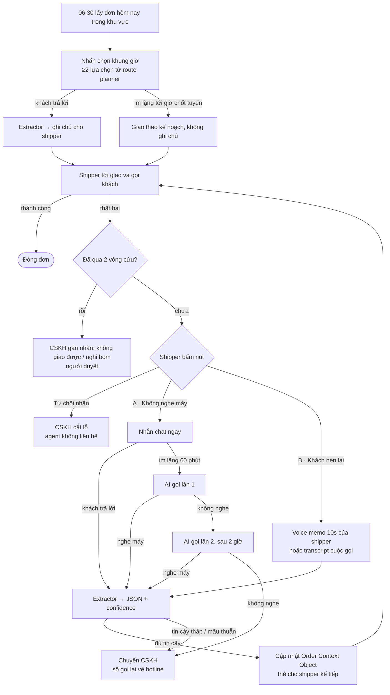

drpee

# Kiến trúc tổng và problem cho slide

Bản kiểm chứng luồng mới mà Ben đề xuất ngày 12/10/2026, kiến trúc hệ thống hướng tới khi triển khai thật, data flow, tech stack cho demo 31/10, và bộ số liệu problem có nguồn, kèm biểu đồ để dùng cho slide và trailer.

Slide problem

## 4 con số hero

Mỗi số đi kèm nguồn và trả lời một câu hỏi của giám khảo: tốn bao nhiêu, xảy ra thường không, vì sao hệ thống hiện tại không tự giải được, và cộng lại mỗi ngày mất bao nhiêu.

40.000đ

mỗi đơn giao thất bại, người bán trả phí vận chuyển hoàn (tối đa)

Shopee Chính sách Trả hàng & Hoàn tiền §7.1, hiệu lực 11/3/2026 · Seller Edu 3648 · VTV 25/3/2025

Tốn bao nhiêu

8–12%

đơn bị "bom" trên toàn quốc; tới 20% vùng xa, 25–30% mùa sale

VECOM và ThS. Trần Anh Tùng (UEF), Người Lao Động 19/7/2025

Thường xuyên

0

khung giờ giao người mua được chọn: thương lượng giờ nằm ngoài hệ thống

help.shopee.vn bài 79559: "Shopee chưa hỗ trợ lựa chọn thời gian giao hàng cụ thể"

Nguyên nhân gốc

31–46 tr

đồng mỗi ngày cho một depot 10.000 đơn; riêng phần có nguồn ≈ 31 triệu

Mô hình của team, dựng từ phí công bố của Shopee và thu nhập shipper (GHN). Xem biểu đồ 3

Mô hình suy diễn

1 · Tỷ lệ đơn bị bom tại Việt Nam

Nguồn: VECOM (toàn quốc, vùng xa); ThS. Trần Anh Tùng (hiện tại, mùa sale). Cùng bài Người Lao Động. Số này đo khách từ chối, nên dùng để nói quy mô vấn đề.

2 · Một ngày của depot 10.000 đơn

Giả định của team. 8% lấy mốc Loqate, thấp hơn dải VECOM. Tỷ lệ cứu baseline 20–30% là số vendor (Shipsy).

3 · Thiệt hại mỗi ngày, mỗi depot (triệu đồng)

Lượt giao lại: 800 đơn × \~1,5 lượt × 6.000–8.000đ thu nhập shipper (GHN). Hub/CSKH là ước lượng của team. Không còn dùng phí chiều đi của TikTok Shop như bản đăng ký.

4 · Quy mô TMĐT tăng nhanh hơn khả năng thuê người gọi

Metric, Báo cáo TMĐT 2025 (Shopee, TikTok Shop, Lazada, Tiki). Số 2024 suy ra từ mức tăng 34,75%. Q1/2026 tiếp tục tăng 46,6%. Con số 13 người là ước tính của team.

### Số liệu phụ để nói khi được hỏi

- **3 đơn COD thất bại trong 90 ngày** thì Shopee tắt COD của người mua (help.shopee.vn bài 79196). Người mua cũng chịu thiệt.
- **2–3 lần liên hệ, hẹn lại tối đa 5 ngày**: quy trình giao lại theo help center Shopee (bài 79569). Dropee chạy trọn trong khung này.
- **Ngoại lệ §7.2**: đơn thất bại do lỗi hãng vận chuyển thì người bán không chịu phí. Đây cũng là lý do ngữ cảnh có cấu trúc giúp phân định trách nhiệm.

Kiểm chứng luồng mới

## Ý tưởng của Ben, đánh giá và chỉnh sửa

Luồng mới đi đúng hướng và rõ hơn bản đăng ký: shipper chỉ bấm một nút, agent làm phần còn lại, việc hệ trọng vẫn về tay người. Có 6 chỗ cần chỉnh để hệ thống chạy được ngoài đời và không bị giám khảo vặn.

| Phần | Đánh giá | Đề xuất |
| --- | --- | --- |
| Nhắn chọn khung giờ trước khi giao (≥2 lựa chọn) | Giữ, chỉnh | Khung giờ phải lấy từ **route planner** (tuyến của shipper chạy qua lúc nào), không để agent tự đặt, nếu không sẽ hứa điều điều phối không giữ được. Gửi dạng nút chọn nhanh (Sáng / Chiều / Tối) cộng ô trả lời tự do; nút chọn thì không cần NLU. Khi chạy thật nên chỉ gửi cho đơn có rủi ro (COD giá trị cao, từng thất bại, từng hẹn lại) vì nhắn cho mọi đơn tốn tiền và dễ thành spam. Gọi là "ưu tiên của khách", không phải cam kết giờ. |
| Nút bấm A / B trên app shipper | Rất tốt | Đây là điểm mạnh nhất: thay mã lỗi bằng một chạm có nghĩa. Giữ thêm nút **"Từ chối nhận"** đi thẳng sang CSKH cắt lỗ, không cho agent liên hệ. Đây chính là luận điểm "đừng tốn công gọi khách đã bom" từ bản v2 và vẫn là khác biệt so với Shipsy/ClickPost. Lưu ý đổi tên cho khỏi trùng bộ A/B/C cũ. |
| Nhánh A: chat trước, im lặng thì gọi | Đúng | Chat ngay khi bấm. **Im lặng 60 phút thì AI gọi lần 1**, 2 giờ sau gọi lần 2. Chỉ gọi trong 08:00–20:30; bấm sau 19:00 thì chat ngay, gọi dời sang 08:00 hôm sau và đẩy đơn sang ca chiều. 60 phút đủ để khách đọc tin, mà vẫn còn kịp 2 cuộc gọi trước giờ chốt tuyến ngày mai. |
| Gọi bằng audio chuẩn bị sẵn | Chỉnh | Audio thu sẵn không trả lời được câu như "chiều mai sau 5h nhưng gửi bảo vệ nha". Dùng kiểu lai: câu cố định (chào, báo là trợ lý tự động, xin phép ghi âm) thu sẵn cho tự nhiên; phần động (tên, đơn, câu hỏi tiếp) dùng TTS; nghe bằng ASR streaming; LLM điều hội thoại theo kịch bản điền slot, tối đa khoảng 90 giây. |
| Số gọi lại chuyển về CSKH | Rất tốt | Giữ nguyên. Thêm brandname hiển thị khi gọi (người Việt hay bỏ qua số lạ). Đây cũng là ranh giới tự quyết rõ ràng để nói trên sân khấu. |
| Nhánh B: lấy transcript cuộc gọi của shipper | Rủi ro | Chỉ ghi âm được nếu cuộc gọi đi qua tổng đài của hãng (VoIP trong app hoặc số ảo), và phải báo khách là có ghi âm. Shipper gọi bằng sim cá nhân thì không lấy được. Đề xuất cho MVP và demo: bấm "Khách hẹn lại" thì mở **voice memo 10 giây**, shipper nói lại lời khách ("chiều mai sau 5h, gửi bảo vệ tòa B") rồi đi ASR, ra schema. Transcript cuộc gọi để ở roadmap. |
| Tối đa 2 vòng, vòng 3 chuyển CSKH gắn nhãn | Đúng | Khớp với quy trình 2–3 lần liên hệ, hẹn lại không quá 5 ngày của Shopee. Nhãn "nghi bom" ảnh hưởng tới mốc khóa COD 3 đơn/90 ngày, nên **bắt buộc người duyệt**; agent chỉ đề xuất nhãn. |
| "Bộ não chạy local" | Nói rõ | Demo dùng API cloud, nên trên slide ghi là "model gateway": hôm nay gọi cloud có che PII, khi chạy thật thì chuyển on-prem tại region, không đặt ở từng depot vì tốn GPU. Đừng nói "local" trong demo nếu thực tế đang gọi API. |

### Còn thiếu trong luồng, cần thêm vào kiến trúc

- **Orchestrator có hẹn giờ**: mỗi đơn là một state machine (chờ chat, gọi lần 1, gọi lần 2, CSKH). Demo dùng "đồng hồ demo" tua nhanh, 60 phút thành 10 giây.
- **Policy guard**: giờ yên lặng, số lần liên hệ tối đa, khách nhắn "dừng" thì ngừng, xin phép ghi âm, ranh giới tự quyết.
- **Xử lý mâu thuẫn**: khách trả lời chat sau khi cuộc gọi đã chốt giờ khác thì lấy bản mới nhất, nhưng nếu hai bản vênh nhau quá thì hỏi lại hoặc chuyển CSKH.
- **Order Context Object có version và audit log**: biết ai (agent, khách, shipper, CSKH) đổi gì, lúc nào.
- **Metrics log**: mọi bước đều ghi timestamp và confidence để ra 4 key metrics.

Kiến trúc tổng

## Kiến trúc theo chuẩn C4, chia layer

Dropee không thay route planner hay app shipper. Nó đọc đơn và sự kiện, nói chuyện với người mua, rồi ghi ngữ cảnh có cấu trúc ngược lại vào hệ thống hãng. Sơ đồ theo C4 Model ở mức Container (Level 2), trình bày dạng layer để đưa thẳng lên slide.

[](dropee-kien-truc-c4.png)

C4 Model · Container view (Level 2). Mỗi khối ghi tên, \[công nghệ\] và trách nhiệm. Nét liền là gọi đồng bộ, nét đứt là sự kiện bất đồng bộ.

Luồng xử lý

## Từ đơn buổi sáng tới lượt giao kế tiếp



| Mốc | Hành động | Lý do |
| --- | --- | --- |
| T0 | Shipper bấm nút, agent nhắn chat ngay | Khách vừa lỡ cuộc gọi nên dễ để ý điện thoại nhất |
| T0 + 60 phút | AI gọi lần 1 nếu chưa có trả lời | Đủ thời gian đọc tin, vẫn còn chỗ cho lần 2 trong ngày |
| T0 + 3 giờ | AI gọi lần 2 | Rơi vào một khung giờ khác trong ngày (trưa, tan làm) |
| Sau lần 2 | Chuyển CSKH, số agent khi khách gọi lại sẽ nối về hotline | Agent không xử lý nữa, người nhận việc |
| Luật cứng | Chỉ gọi 08:00–20:30 · tối đa 2 cuộc gọi mỗi vòng · 2 vòng mỗi đơn · trong 5 ngày | Tôn trọng khách, khớp quy trình giao lại của Shopee |

Data flow

## Data Flow Diagram theo chuẩn Gane–Sarson

Âm thanh và transcript thô chứa dữ liệu cá nhân nên ở trong vùng tin cậy, có hạn xóa. Thứ đi ra ngoài là JSON đã trích, đủ để shipper và điều phối dùng.

[](dropee-dfd-level0.png)

DFD Level 0 (context diagram), ký hiệu Gane–Sarson: toàn bộ Dropee là một process.

[](dropee-dfd-level1.png)

DFD Level 1: 8 process, 4 kho dữ liệu. Tác nhân có gạch góc là bản lặp để tránh cắt dây, đúng quy ước DFD.

### Order Context Object (bản cập nhật cho luồng mới)

```
{
  "tracking_id": "SPXVN0123456789",
  "version": 3,
  "trigger": "NO_ANSWER",              // PRE_DELIVERY | NO_ANSWER | RESCHEDULE | REFUSED
  "rescue_cycle": 1,                   // tối đa 2
  "delivery_attempt": 1,
  "channel": "ai_call",                // chat_shopee | zalo | ai_call | shipper_memo
  "contact_log": [
    { "at": "2026-10-31T10:02:00+07:00", "type": "chat_sent" },
    { "at": "2026-10-31T11:02:00+07:00", "type": "call_1", "result": "answered", "duration_s": 74 }
  ],
  "slots_offered": ["2026-11-01T08:00/12:00", "2026-11-01T17:00/20:00"],
  "extracted": {
    "time_window": { "date": "2026-11-01", "from": "17:00", "to": "20:00" },
    "drop_location": { "type": "security_desk", "note": "bảo vệ tòa B" },
    "alt_receiver": { "phone": "09xxxxxxxx", "relation": "vợ" },
    "address_correction": null
  },
  "confidence": { "time_window": 0.94, "drop_location": 0.88, "alt_receiver": 0.91 },
  "decision": "auto_applied",          // auto_applied | needs_review | escalated_cs
  "consent": { "recording": true, "opt_out": false },
  "raw_ref": "conv_8f21a",             // thô nằm trong vùng tin cậy, có hạn xóa
  "updated_by": "agent"
}
```

Tech stack

## Demo 31/10 và đích đến khi chạy thật

Demo ưu tiên chạy mượt để quay trailer, nên mọi thứ chạy trong trình duyệt với dữ liệu mock và đồng hồ tua nhanh. Cột bên phải là thứ nói trên slide "kiến trúc hướng tới".

| Lớp | Demo (7 tiếng, Codex) | Chạy thật |
| --- | --- | --- |
| Giao diện | Next.js + Tailwind: 3 màn hình cạnh nhau là app shipper (nút bấm, thẻ ngữ cảnh), chat của người mua, dispatcher/CSKH console | Tích hợp vào app shipper và console sẵn có của hãng |
| Backend & điều phối | FastAPI hoặc Node, SQLite, state machine tự viết với đồng hồ demo | Postgres, workflow engine bền (kiểu Temporal) cho hẹn giờ và retry, đọc đơn qua CDC/queue |
| LLM | OpenAI API với Structured Outputs (JSON schema strict), model được cấp trong ngày | Model gateway: model open-weight on-prem tại region (cỡ 7–14B, ước tính, cần đo bằng eval), cloud làm dự phòng có che PII |
| ASR | AssemblyAI: Universal-3.5 Pro cho voice memo; streaming U-3.5/3.6 Pro hỗ trợ tiếng Việt cho cuộc gọi | PhoWhisper (VinAI) hoặc Whisper fine-tune on-prem |
| Cuộc gọi AI | Gọi trong trình duyệt bằng mic, không gọi số thật: OpenAI Realtime, hoặc ASR → LLM → TTS. Thử chất lượng giọng Việt trước D-Day | Tổng đài/SIP trunk Việt Nam có brandname, TTS giọng Việt thương mại, câu cố định thu sẵn |
| Chat | Mock giao diện giống Shopee chat / Zalo, có nút chọn khung giờ | Thông báo/chat trong app Shopee (với SPX); Zalo OA + ZNS (template phải duyệt) hoặc SMS cho hãng khác |
| Eval & metrics | Eval set có held-out do team tự viết, script chấm F1 từng trường, log thời gian | Dashboard metrics, lấy mẫu kiểm tra bởi người hàng tuần |

### Có cần fine-tuning không?

- **Cho hackathon: không.** Structured Outputs cùng prompt tốt và eval loop do Codex chạy là đủ, và chính đường cong cải thiện đó là bằng chứng "dùng Codex hiệu quả".
- **Chạy thật, ưu tiên 1, ASR:** fine-tune cho giọng vùng miền, tiếng ồn đường phố và từ vựng địa chỉ (hẻm, ngõ, tòa, tên chung cư). Lỗi ở đây kéo theo lỗi cả chuỗi.
- **Ưu tiên 2, LLM trích xuất:** khi có vài nghìn hội thoại thật đã được người duyệt nhãn thì distill sang model nhỏ chạy on-prem để giảm chi phí và giữ dữ liệu trong nhà.
- **TTS:** không cần fine-tune; chọn giọng Việt thương mại tự nhiên, có giọng Bắc và Nam.

Metrics

## 4 problem ↔ 4 output

Mỗi metric đầu ra trả lời trực tiếp một con số problem, để câu chuyện trên slide khép lại thành vòng.

| Problem | Output metric | Đo thế nào | Loại |
| --- | --- | --- | --- |
| 0 khung giờ: ngữ cảnh nằm ngoài hệ thống | **Time-to-context**: từ lúc bấm nút tới lúc thẻ hiện cho shipper và dispatcher, cộng "1 chạm" cho shipper thay vì gõ ghi chú | Timestamp trong log, tách đường chat và đường gọi | Đo thật |
| 8–12% bom, ngữ cảnh mất trong cuộc gọi | **Extraction accuracy**: F1 từng trường trên 3 nguồn (chat, transcript cuộc gọi, voice memo), có held-out viết tay | Eval set, baseline v0 so với sau vòng Codex | Đo thật |
| Quy mô vượt sức người (≈13 người/depot) | **Safe autonomy**: % case tự xử lý, tỷ lệ sai trong nhóm đó, 0 hành động hệ trọng thiếu người duyệt, 0 cuộc gọi ngoài giờ | Chạy toàn bộ eval qua orchestrator | Đo thật |
| 40.000đ/đơn, 31–46 tr/ngày/depot | **Money**: chi phí hoàn tránh được cộng giờ CSKH tiết kiệm, so với chi phí agent mỗi case | Chi phí agent mỗi case đo thật; tỷ lệ cứu thêm là giả định | Dự kiến |

Trên sân khấu: hai số "đo được" là Accuracy và Safe autonomy; Time-to-context là khoảnh khắc demo đẹp nhất (bấm một nút, vài giây sau thẻ hiện ra); Money luôn đi kèm chữ "dự kiến".

Nguồn

- Shopee Chính sách Trả hàng & Hoàn tiền §7.1–7.2, hiệu lực 11/3/2026: [help.shopee.vn/portal/4/article/77251](https://help.shopee.vn/portal/4/article/77251)
- Mức 40.000đ / 20.000đ Hỏa Tốc: Seller Education Hub bài 3648 (cần chụp màn hình làm bằng chứng); [VTV 25/3/2025](https://vtv.vn/kinh-te/shopee-ha-goi-dich-vu-phi-moi-sau-yeu-cau-bao-cao-cua-bo-cong-thuong-20250325160554152.htm)
- Chưa hỗ trợ chọn giờ giao: [help.shopee.vn/portal/4/article/79559](https://help.shopee.vn/portal/4/article/79559)
- Khóa COD 3 đơn/90 ngày: [help.shopee.vn/portal/4/article/79196](https://help.shopee.vn/portal/4/article/79196)
- Quy trình giao lại 2–3 lần, hẹn tối đa 5 ngày: [help.shopee.vn/portal/4/article/79569](https://help.shopee.vn/portal/4/article/79569)
- VECOM 8–12%, 20%; ThS. Trần Anh Tùng 10–15%, 25–30%: [Người Lao Động 19/7/2025](https://tuoitre.vn/nld/nhuc-nhoi-nan-bom-hang-19625071822023801.htm)
- Thu nhập shipper 6.000–8.000đ/đơn: [GHN](https://ghn.vn/blogs/tip-ban-hang/mot-don-hang-shipper-shopee-duoc-bao-nhieu-tien) (không phải số chính thức của Shopee)
- Doanh số TMĐT 2025: [Metric qua Brands Vietnam](https://www.brandsvietnam.com/congdong/topic/thi-truong-tmdt-viet-nam-nam-2025-nhung-chuyen-dich-dang-chu)
- Rescue rate 20–30% / 50–65%: [Shipsy](https://shipsy.ai/insights/what-is-ndr-non-delivery-report-management) (số vendor)
- AssemblyAI hỗ trợ tiếng Việt: [assemblyai.com/languages/vietnamese](https://www.assemblyai.com/languages/vietnamese) · [streaming](https://www.assemblyai.com/docs/faq/language-support-for-real-time-transcription)
- PhoWhisper: [github.com/VinAIResearch/PhoWhisper](https://github.com/VinAIResearch/PhoWhisper)