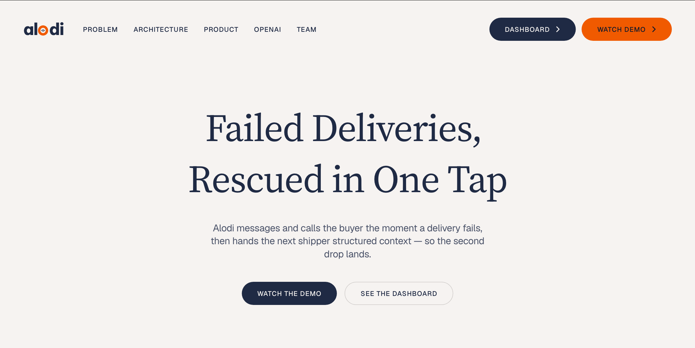
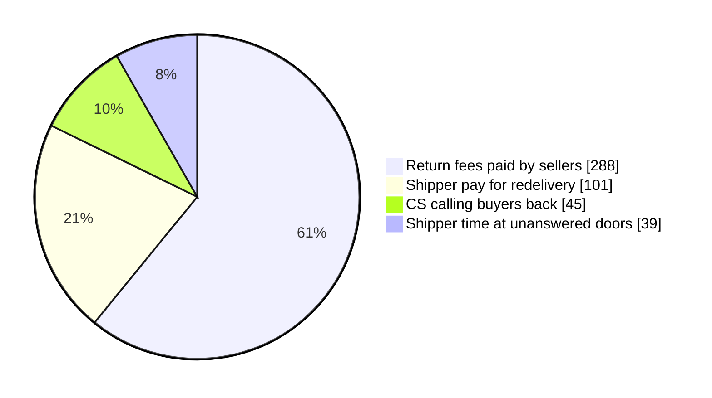
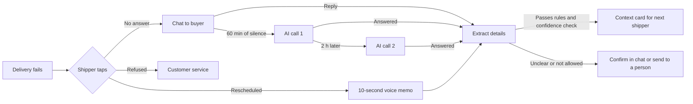
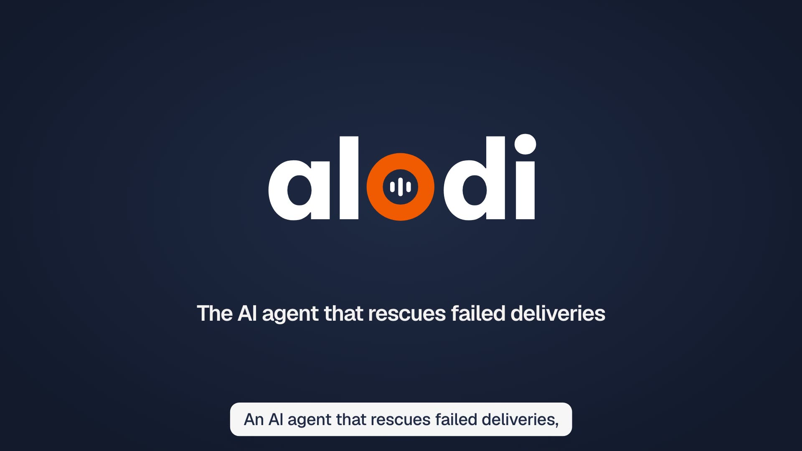
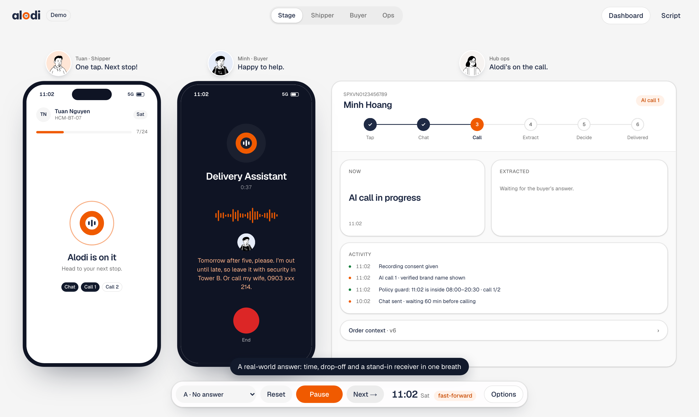
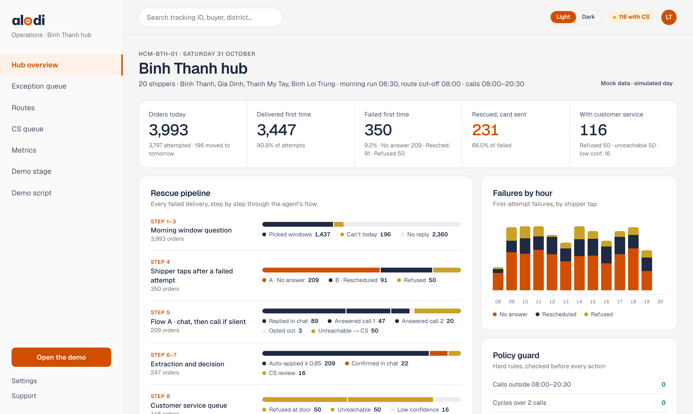
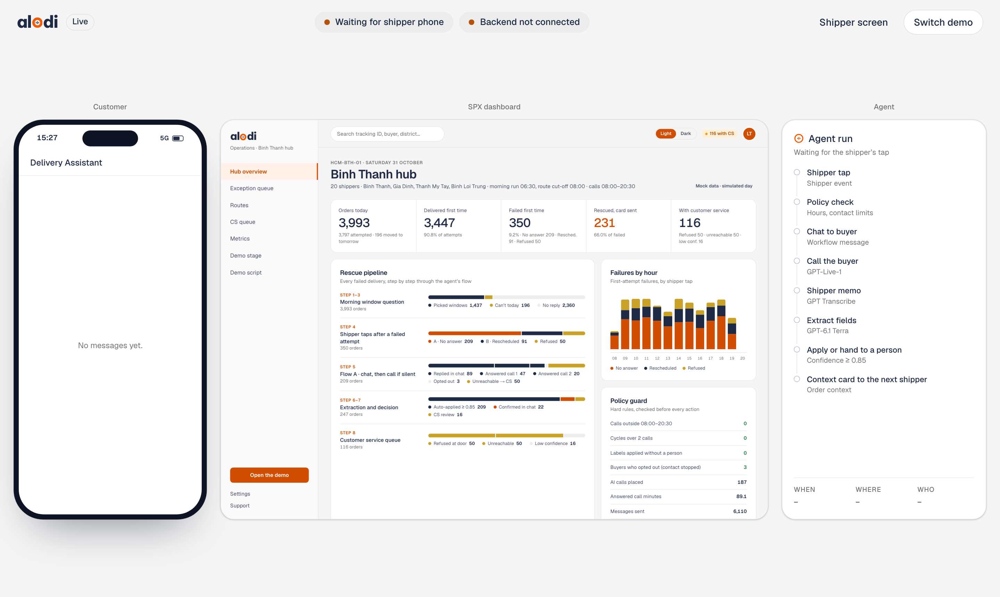
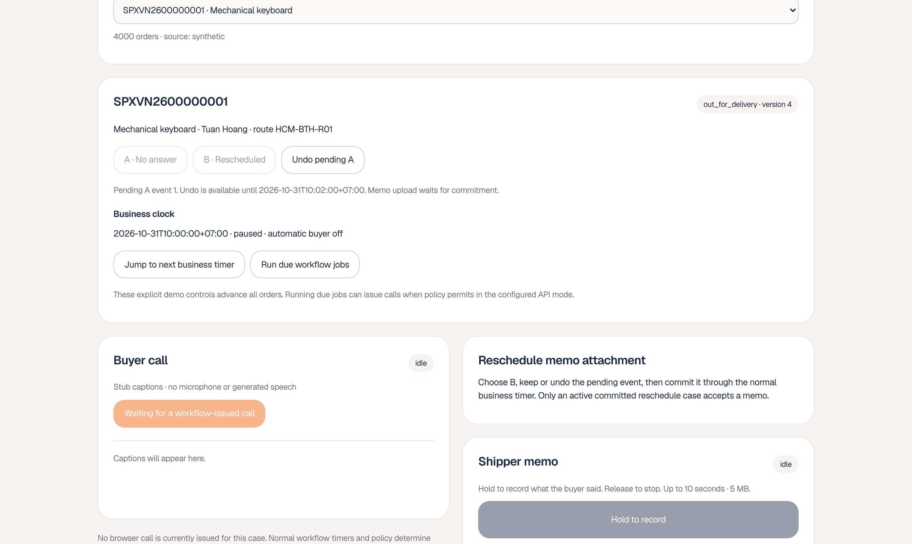
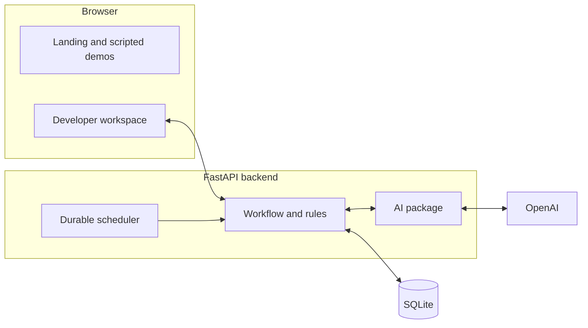
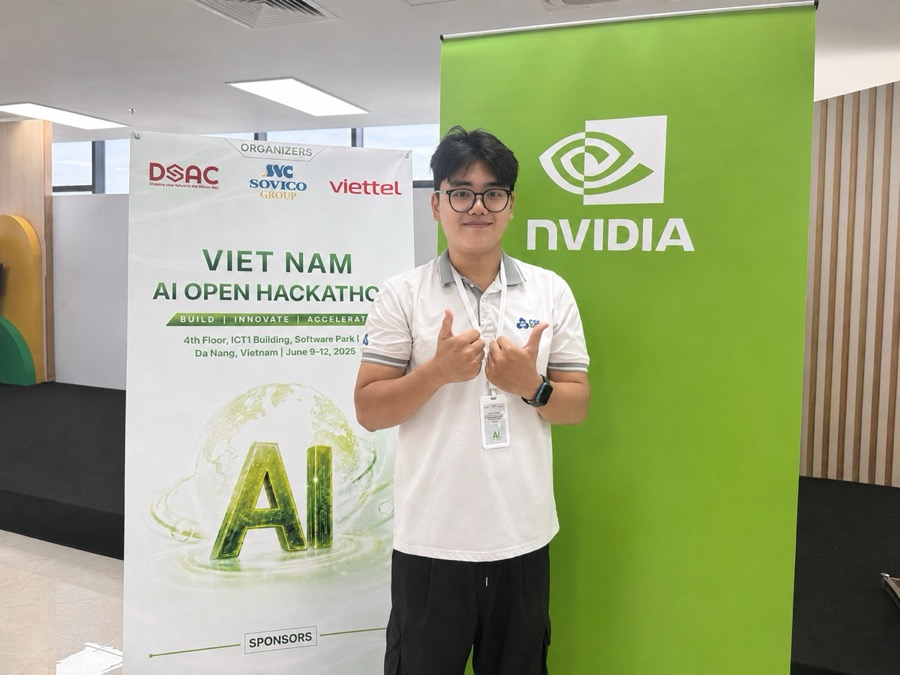

<p align="center">
  
</p>

<h1 align="center">alodi</h1>

<p align="center">
  <b>Make the second drop land.</b><br/>
  An AI agent that rescues failed deliveries for Vietnamese e-commerce.<br/>
  The shipper taps once. Alodi reaches the buyer, and the next attempt arrives knowing when, where and who.
</p>

<p align="center">
  <a href="https://alodi-ai-system.vercel.app"><b>Open the website</b></a> ·
  <a href="https://alodi-ai-system.vercel.app/demo"><b>Try the demo</b></a> ·
  <a href="web/public/video/alodi-story.mp4"><b>Watch the film</b></a> ·
  <a href="submission/Develarper_Alodi_Sea-OpenAI-Regional-Codex-Hackathon-2026_Brief.pdf"><b>Read the write-up</b></a> ·
  <a href="#quick-start"><b>Quick start</b></a>
</p>

<p align="center"><sub>Team Develarper · Sea × OpenAI Regional Codex Hackathon, Vietnam · 31 October 2026</sub></p>

---

## Why Alodi

A failed delivery is a time negotiation that happens off the system. Shopee buyers can't choose a delivery time, so it gets agreed by phone, if someone picks up. When the call is missed, everything that would fix the next attempt shrinks into one error code. The second attempt repeats the first.

| | | Source |
|---|---|---|
| **40,000 VND** | return fee per failed order, charged to the seller | Shopee policy §7.1, GHN |
| **8–12%** | of orders refused at the door, nationwide | VECOM, Nguoi Lao Dong, 19 Jul 2025 |
| **0** | delivery windows a Shopee buyer can choose | Shopee Help Center 79559 |
| **2–3 contacts, 5 days** | the frame a carrier has to rescue an order | Shopee Help Center 79569 |
| **≈ 5 callers** | full-time, per area, to phone 320 buyers twice a day | Team estimate |

## The business case

For one area of 20 shippers and 4,000 orders a day. Every input and formula is in the [numbers document](submission/Develarper_Alodi_Sea-OpenAI-Regional-Codex-Hackathon-2026_Numbers.pdf).

**What the area loses today: about 473M VND a month**



**What Alodi could give back**

| Scenario | Rescue rate | Recovered / month | Running cost | **Net / month** | Share of loss | Net / year |
|---|---:|---:|---:|---:|---:|---:|
| Conservative | 40% | 75.5M | 27.3M | **48.3M VND** | 10% | 0.58B |
| Base | 45% | 119.7M | 27.3M | **92.4M VND** | 20% | 1.11B |
| Best-in-class | 65% | 214.7M | 27.3M | **187.4M VND** | 40% | 2.25B |

Today's rescue rate is taken as 25%. A one-time server costs 75–98M VND. The OpenAI API is about 7.2M VND of the running cost.

<details>
<summary><b>How far to trust these numbers</b></summary>

None of these figures has been measured in real operations.

- **Status:** the loss is modelled, the running cost is estimated from list prices, and the savings are projected. The best-in-class case uses a vendor's published range (Shipsy, 50–65%).
- **Return fee:** about 288M VND of the loss assumes sellers pay up to 40,000 VND to return each failed order. Shopee's return policy (§7.1) makes sellers responsible for that cost, and the cap comes from GHN's guide. Shopee Help Center article 79569 says sellers pay no shipping on failed deliveries, so this assumption needs confirming.
- **Failure rate:** the model uses the low end of VECOM's refusal range, 8%, as a stand-in for all failed deliveries.
- **Survey:** everything in `prep/06-survey/` is generated placeholder data, not findings, until the interview export replaces it.
- **Quality targets:** time to context under 10 seconds, extraction F1 of at least 0.90 and under 2% wrong automatic updates are targets, not results.

</details>

### Who gets what

| | Today | With Alodi |
|---|---|---|
| **Shipper** | Calls twice, waits at the door, repeats the trip | One tap, then on to the next stop |
| **Buyer** | Missed calls and a parcel sent back | Asked by chat, then a call, within permitted hours |
| **Next shipper** | One error code | A card with when, where and who |
| **Seller** | Pays for the return and loses the sale | Fewer returns |
| **Carrier** | About five callers per area | Staff handle only refusals and unclear answers |

## How it works

| | Step | What happens |
|---|---|---|
| 1 | **Tap** | The shipper picks No answer, Rescheduled or Refused, with a 2-minute undo |
| 2 | **Reach** | Chat at once. After 60 minutes of silence an AI call, and a second 2 hours later |
| 3 | **Understand** | The answer becomes a time window, a drop-off point and a stand-in receiver |
| 4 | **Decide** | Rules check it. Clear answers apply; the rest is confirmed in chat or goes to a person |
| 5 | **Redeliver** | The next shipper sees the context card |



### Business rules

The agent's output is a proposal. Rules in the backend decide whether it can be applied, not the prompt.

| Rule | Value |
|---|---|
| Undo window after a tap | 2 minutes |
| Call hours | 08:00–20:30 |
| Calls per cycle | 2 at most |
| Redeliveries | 2 at most |
| Rescheduling limit | 5 days |
| Automatic update | Only if each extracted field has confidence of at least 0.85 |
| Buyer says stop | All contact ends |
| Refused order | Goes to customer service with no buyer contact |

A disclosure plays before each call, and the call won't connect without the buyer's consent.

## The product

<p align="center">
  <a href="web/public/video/alodi-story.mp4"></a>
  <br/><sub><b>The story film (2:05).</b> One parcel, one missed call, one rescue. Click to open.</sub>
</p>

<table>
  <tr>
    <td width="50%"><br/><b>Judges' demo.</b> Shipper app, buyer's call and operations, in sync on a fast-forward clock.</td>
    <td width="50%"><br/><b>Hub dashboard.</b> Pipeline by business step, policy guard, exception queue and routes.</td>
  </tr>
  <tr>
    <td><br/><b>Live stage.</b> A real phone drives the rescue; customer, dashboard and agent follow.</td>
    <td><br/><b>Backend workspace.</b> Real orders, business timers and calls issued by policy.</td>
  </tr>
</table>

### How it compares

| | **Alodi** | ClickPost | Shipsy | AfterShip Agent | GHTK |
|---|---|---|---|---|---|
| Main market | **Vietnam** | India | India | Global | Vietnam |
| Trigger | **Shipper's one tap** | Carrier NDR code | NDR event | Tracking exception | Recipient books a slot |
| Reaches the buyer by | **Marketplace chat, then AI call** | SMS, email, WhatsApp, IVR, voice | Automated CX agent | Drafted message for approval | App, hotline |
| Context for the next attempt | **Typed fields with confidence and audit** | Reattempt or return instruction | Not disclosed | Suggested fix | Time-window note |
| Person approves high-stakes calls | **Required** | Not disclosed | Not disclosed | Yes | Call-centre agent |

From public product pages. See the [project report](submission/Develarper_Alodi_Sea-OpenAI-Regional-Codex-Hackathon-2026_Report.pdf), chapter 11.

## Built on OpenAI



| Model or API | Job | Endpoint | Status |
|---|---|---|---|
| **GPT-Live-1** | Natural voice calls in Vietnamese | `v1/live/sessions` | In this build |
| **GPT-6.1 Terra** | Extracts the fields with Structured Outputs | `v1/responses` | In this build |
| **GPT Transcribe** | Turns the shipper's memo into text | `v1/audio/transcriptions` | In this build |
| **Decisions API on GPT-6 Luna** | Triages every message cheaply | `v1/decisions` | Production design |
| **Agents SDK, Evals** | Orchestration, traces and release gates | Responses API | Production design |
| **gpt-oss-20b** | Offline fallback on the area server | Local | Production design |

OpenAI keys stay on the server. In live mode, call audio goes to OpenAI.

| Layer | Used |
|---|---|
| Web | Next.js 16, React 19, Tailwind CSS 4, Motion, Lenis |
| Backend | Python 3.12, FastAPI, SQLAlchemy, SQLite, Alembic |
| Tooling | uv, Ruff, pytest, ESLint, GitHub Actions |
| Film | HTML scenes with GSAP, Playwright, FFmpeg, Kokoro-82M voices |

## Status

| | What it covers |
|---|---|
| **Working, local** | Backend with SQLite, scheduler, rules, audit trail and customer-service decisions, on 4,000 made-up orders across 20 routes. 193 automated tests pass, with OpenAI simulated |
| **Implemented, live use needs a key** | GPT Live calls, GPT Transcribe memos and GPT-6.1 Terra extraction |
| **Working, developer screen** | `/dev/integrated` runs real orders against the backend: a No answer tap opens a case, the 60-minute timer fires and a policy-checked call is issued |
| **Scripted, mock data** | `/demo` tells the full story with sound and no backend; `/console` and `/metrics` use mock data |
| **Interface only** | `/live` and `/live/shipper` stay empty until connected to the backend |
| **Production design, not built** | Decisions API, Agents SDK, Evals gating, gpt-oss-20b, real phone lines, Zalo messages, carrier integration |

This is an unauthenticated demo. It doesn't call real phone numbers and it isn't production-ready. Tests don't measure live speech or extraction accuracy.

## Quick start

You need [uv](https://docs.astral.sh/uv/), Node.js and, for voice memos, FFmpeg.

```bash
# Backend: stub responses, no API key
cp .env.example .env
uv sync --project api --frozen --python 3.12
uv run --project api --frozen --python 3.12 alodi-api     # http://localhost:8000/health

# Web, in a second terminal
cd web && npm ci && npm run dev                           # http://localhost:3000
```

On Windows, `.\scripts\start-api.ps1` does the backend steps.

To try the real workflow, open <http://localhost:3000/dev/integrated> and connect to `http://localhost:8000`. If an action is rejected before 08:00 business time, use **Jump to next business timer** and **Run due workflow jobs**.

<details>
<summary><b>Live calls and memos</b></summary>

Set these in `.env` and restart the backend. Live mode makes paid OpenAI requests, and call audio goes to OpenAI.

```dotenv
AI_MODE=live
OPENAI_API_KEY=
DEMO_CLOCK_SPEED=1
```

`DEMO_CLOCK_SPEED` only applies to a new database. See [the AI service guide](ai/README.md#integrated-host), which also covers privacy limits and the integration contract.

</details>

<details>
<summary><b>Deploy</b></summary>

The website deploys to Vercel with **Root Directory** `web`, framework Next.js and no environment variables. Only the web app is deployed: the demos are scripted, the **Live demo** button points visitors to the stage, and `/dev` pages return 404. On the machine running the live demo, set `NEXT_PUBLIC_LIVE_READY=1` so the button opens `/live`.

</details>

<details>
<summary><b>Pages</b></summary>

| Route | What it is |
|---|---|
| `/` | Landing page |
| `/start` | Choose the live or judges' demo |
| `/demo` | Scripted stage: shipper app, buyer phone, operations panel |
| `/demo/shipper`, `/demo/buyer`, `/demo/console` | The same demo, one screen per window |
| `/live`, `/live/shipper` | Live demo interface |
| `/console` | Operations dashboard |
| `/metrics` | Output metrics and savings calculator |
| `/script` | Demo script |
| `/dev/integrated` | Real backend workspace, development only |
| `/dev/ai` | Standalone AI test lab, development only |

</details>

<details>
<summary><b>Checks</b></summary>

These are the commands CI runs. Memo tests need FFmpeg and FFprobe on your `PATH`.

```bash
uv run --project api --frozen ruff check api
uv run --project api --frozen ruff check --isolated --select E4,E7,E9,F ai
uv run --project api --frozen pytest -q api/tests ai/tests

cd web
npm run lint && npm run build
node scripts/check-voice-audio.mjs
node scripts/check-voice-lifecycle.mjs
node scripts/check-integrated-contract.mjs
```

</details>

## Roadmap

| When | Milestone | Done when |
|---|---|---|
| **Oct 2026** | MVP demo | Demo screens and a working backend |
| **Nov 2026** | Full build | Demo connected to the backend, real call audio, at least 200 eval samples |
| **Q1 2027** | Shadow mode | One area, real events, no buyer contact; agent compared with CS decisions |
| **Q2 2027** | Real channels | Chat and calls for risky orders, zero rule violations |
| **H2 2027** | Region | 5–20 hubs, cost per case on target |
| **2028** | National | 20–100 hubs, break-even |

## Documents

| Document | |
|---|---|
| [Project write-up](submission/Develarper_Alodi_Sea-OpenAI-Regional-Codex-Hackathon-2026_Brief.pdf) | Five pages: problem, product, OpenAI, value, sources |
| [Project report](submission/Develarper_Alodi_Sea-OpenAI-Regional-Codex-Hackathon-2026_Report.pdf) | The full design, data, competitors and roadmap |
| [Numbers document](submission/Develarper_Alodi_Sea-OpenAI-Regional-Codex-Hackathon-2026_Numbers.pdf) | Every input, formula and source |
| [Pitch deck](submission/Develarper_Alodi_Sea-OpenAI-Regional-Codex-Hackathon-2026_Pitch.pptx) | 15 slides, with the skit and film embedded |

## Repository

```text
web/          Next.js app: landing page, demos, dashboard, developer screens
api/          FastAPI backend: workflow, rules, scheduler, database, tests
ai/           GPT voice, memo and extraction package, with tests
scripts/      Windows startup and check helpers
submission/   Write-up, report, numbers document and pitch deck
prep/
  01-pitch/      Deck source, charts, skit and film
  02-technical/  Diagrams, cost model, mock data, report builders
  03-design/     Design tokens and screenshots
  04-brand/      Logo, marks, app icons, fonts
  05-assets/     Team portraits and logos
  06-survey/     Survey codebook and placeholder responses
```

## Sources

Checked 31 October 2026.

- Shopee Help Center: [Return &amp; Refund Policy §7.1](https://help.shopee.vn/portal/4/article/77251) · [delivery time, 79559](https://help.shopee.vn/portal/4/article/79559) · [contacts and rescheduling, 79569](https://help.shopee.vn/portal/4/article/79569)
- GHN: [who pays return shipping](https://ghn.vn/blogs/tip-ban-hang/tra-hang-shopee-ai-chiu-phi) · [shipper pay per order](https://ghn.vn/blogs/tip-ban-hang/mot-don-hang-shipper-shopee-duoc-bao-nhieu-tien)
- Nguoi Lao Dong, 19 Jul 2025: [VECOM refusal rates](https://tuoitre.vn/nld/nhuc-nhoi-nan-bom-hang-19625071822023801.htm)
- Shipsy: [NDR management, rescue rates (vendor claim)](https://shipsy.ai/insights/what-is-ndr-non-delivery-report-management)
- OpenAI: [GPT-Live-1](https://developers.openai.com/api/docs/models/gpt-live-1) · [GPT-6.1 Terra](https://developers.openai.com/api/docs/models/gpt-6.1-terra) · [Decisions API](https://openai.com/index/decisions-api)

## Team

<table>
  <tr>
    <td align="center" width="25%"><br/><b>Nomura Yoshio</b><br/><sub>Team Lead, Project Presenter</sub></td>
    <td align="center" width="25%"><br/><b>Long Quan Ton</b><br/><sub>Product Manager, AI Engineer</sub></td>
    <td align="center" width="25%"><br/><b>Khanh Tuong Huynh</b><br/><sub>Applied AI Software Engineer</sub></td>
    <td align="center" width="25%"><br/><b>Thanh Loi Tran</b><br/><sub>Data Engineer, Backend Developer</sub></td>
  </tr>
</table>

## Credits

Illustrated people: Notionists by Zoish (CC0) via DiceBear. Interface sounds: Kenney (CC0). Voices: Kokoro-82M (Apache-2.0). Photos: CC0 via Wikimedia Commons, credited in the deck. Film media: [`story/CREDITS.md`](prep/01-pitch/video/story/CREDITS.md) and [`skit/CREDITS.md`](prep/01-pitch/video/skit/CREDITS.md).

<sub>All people, orders and records in this repository are fictional or synthetic.</sub>
