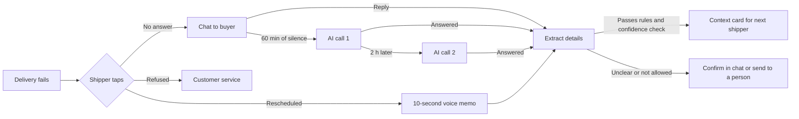

# Alodi

**Make the second drop land.**

Alodi is an AI agent that rescues failed deliveries in Vietnamese e-commerce. When a shipper can't complete a delivery, they tap one button. Alodi contacts the buyer, works out when, where and who to deliver to, and gives the next shipper that information on a context card. People keep the high-stakes decisions.

Built by Team **Develarper** for the [Sea × OpenAI Regional Codex Hackathon, Vietnam](https://codexhackathon.sea.com/) (31 October 2026, Ho Chi Minh City).

## The problem

Shopee buyers can't choose a delivery time (Shopee Help Center, article 79559), so the time gets agreed by phone, if someone picks up. When that fails, the context is lost and the parcel may go back to the seller.

VECOM puts refusals at 8–12% of orders nationwide (Nguoi Lao Dong, 19 Jul 2025). Our cost model estimates that one area with 20 shippers and 4,000 orders a day loses about 473M VND a month. See [What the numbers mean](#what-the-numbers-mean) for the assumptions.

## How it works



The agent's output is a proposal. Rules in the backend decide whether it can be applied, not the prompt:

| Rule | Value |
| --- | --- |
| Undo window after a tap | 2 minutes |
| Call hours | 08:00–20:30 |
| Calls per cycle | 2 at most |
| Redeliveries | 2 at most |
| Rescheduling limit | 5 days |
| Automatic update | Only if each extracted field has confidence of at least 0.85 |
| Buyer says stop | All contact ends |
| Refused order | Goes to customer service with no buyer contact |

A disclosure plays before each call, and the call won't connect without the buyer's consent.

## What is built and what isn't

| Status | What |
| --- | --- |
| **Working, local** | Backend with a SQLite database, scheduler, rules, audit trail and customer service decisions, seeded with 4,000 made-up orders on 20 routes |
| **Implemented, live use needs an OpenAI key** | GPT Live calls in Vietnamese, GPT Transcribe voice memos and GPT-6.1 Terra extraction with Structured Outputs |
| **Working, developer screen** | `/dev/integrated` runs real orders and workflow against the backend, with No answer, Rescheduled and Undo buttons. Refused works through the API, but has no button on this screen |
| **Scripted, mock data** | `/demo` and its single-screen views tell the full story on a fast-forward clock, with no backend |
| **Mock data** | `/console` and `/metrics` |
| **Interface only** | `/live` and `/live/shipper` show empty screens until they are connected to the backend |
| **Production design, not built** | Decisions API on GPT-6 Luna, Agents SDK, Evals gating, the gpt-oss-20b offline fallback, real phone lines, Zalo messages and carrier integration |

This is a local, unauthenticated demo. It doesn't call real phone numbers and it isn't production-ready. Automated tests simulate OpenAI, so they don't measure live speech or extraction accuracy.

## Run it

You need [uv](https://docs.astral.sh/uv/), Node.js and, for voice memos, FFmpeg. uv installs Python 3.12 if needed.

**1. Start the backend** from the repository root. The default settings use stub responses and need no API key.

```powershell
# Windows: also creates .env from .env.example if it's missing
.\scripts\start-api.ps1
```

```bash
# macOS or Linux
cp .env.example .env
uv sync --project api --frozen --python 3.12
uv run --project api --frozen --python 3.12 alodi-api
```

Check it at <http://localhost:8000/health>. The first start seeds the demo data, and later starts keep it.

**2. Start the web app** in a second terminal.

```bash
cd web
npm ci
npm run dev
```

Open <http://localhost:3000>.

**3. Try the workflow.** Open <http://localhost:3000/dev/integrated>, enter `http://localhost:8000` as the API address, and connect. This screen only works under `npm run dev`. If an action is rejected before 08:00 business time, use **Jump to next business timer** and **Run due workflow jobs** to move the clock forward.

### Live calls and memos

Set these in `.env` and restart the backend. `.env` is ignored by Git, and the key stays on the server.

```dotenv
AI_MODE=live
OPENAI_API_KEY=
DEMO_CLOCK_SPEED=1
```

`DEMO_CLOCK_SPEED` only applies to a new database. To change an existing one, follow [the AI service guide](ai/README.md#integrated-host), which also covers privacy limits and the integration contract. Live mode makes paid OpenAI requests, and call audio goes to OpenAI.

## Pages

| Route | What it is |
| --- | --- |
| `/` | Landing page |
| `/start` | Choose the live or judges' demo |
| `/demo` | Scripted stage with the shipper app, buyer phone and operations panel |
| `/demo/shipper`, `/demo/buyer`, `/demo/console` | The same demo, one screen per window |
| `/live`, `/live/shipper` | Live demo interface, not connected yet |
| `/console` | Operations dashboard on mock data |
| `/metrics` | Output metrics and projected-savings calculator |
| `/script` | Demo script |
| `/dev/integrated` | Real backend workspace, development only |
| `/dev/ai` | Standalone AI test lab, separate from the real workflow |

## What the numbers mean

All figures are for one area, per month. None has been measured in real operations.

| Figure | Value | Status |
| --- | --- | --- |
| Loss today | About 473M VND (447–499M) | Modelled |
| Running cost | About 27M VND, plus a one-time server | Estimate from list prices |
| Net saving, best case | About 187M VND, 40% of the loss | Projected from a vendor's 65% rescue rate |
| Net saving, base case | About 92M VND | Projected |
| Net saving, conservative case | About 48M VND | Projected |

- **Return fee:** about 288M VND of the loss assumes sellers pay up to 40,000 VND to return each failed order. Shopee's return policy (§7.1) makes sellers responsible for that cost, and the cap comes from GHN's guide. Shopee Help Center article 79569 says sellers pay no shipping on failed deliveries, so this assumption needs confirming.
- **Failure rate:** the model uses the low end of VECOM's refusal range, 8%, as a stand-in for all failed deliveries.
- **Survey:** everything in `prep/06-survey/` is mock data, not findings.
- **Quality targets:** time to context under 10 seconds, extraction F1 of at least 0.90 and under 2% wrong automatic updates are targets, not results.

Every input and formula is in the [numbers document](submission/Develarper_Alodi_Sea-OpenAI-Regional-Codex-Hackathon-2026_Numbers.pdf), generated by [`cost_model.py`](prep/02-technical/cost-model/cost_model.py).

## Checks

These are the commands CI runs. Memo tests need FFmpeg and FFprobe on your `PATH`.

```bash
uv sync --project api --frozen --python 3.12
uv run --project api --frozen ruff check api
uv run --project api --frozen ruff check --isolated --select E4,E7,E9,F ai
uv run --project api --frozen pytest -q api/tests ai/tests

cd web
npm ci
npm run lint
npm run build
node scripts/check-voice-audio.mjs
node scripts/check-voice-lifecycle.mjs
node scripts/check-integrated-contract.mjs
```

## Repository

```text
web/          Next.js app: landing page, demos, dashboard, developer screens
api/          FastAPI backend: workflow, rules, scheduler, database, tests
ai/           GPT voice, memo and extraction package, with tests
scripts/      Windows startup and check helpers
submission/   Pitch deck, brief, project report and numbers document
prep/
  01-pitch/      Demo plan, pitch script, slides, charts, videos
  02-technical/  PRD, diagrams, cost model, mock data
  03-design/     Design system and screenshots
  04-brand/      Logo, marks, app icons, fonts
  05-assets/     Team portraits and logos
  06-survey/     Survey codebook and mock responses
CLAUDE.md     Project rules for type, colour, language and banned patterns
```

Start with the [project report](submission/Develarper_Alodi_Sea-OpenAI-Regional-Codex-Hackathon-2026_Report.pdf) for the overview, or the [PRD](prep/02-technical/PRD.md) for the full specification. Some planning documents describe the intended design, so where they disagree with this README, trust the code and this README.

## Team

| Name | Role |
| --- | --- |
| Nomura Yoshio | Team Lead, Presenter |
| Long Quan Ton | AI Engineer, Solution Architect |
| Khanh Tuong Huynh | AI Engineer, Deployment Engineer |
| Thanh Loi Tran | Data Engineer, Backend Developer |
