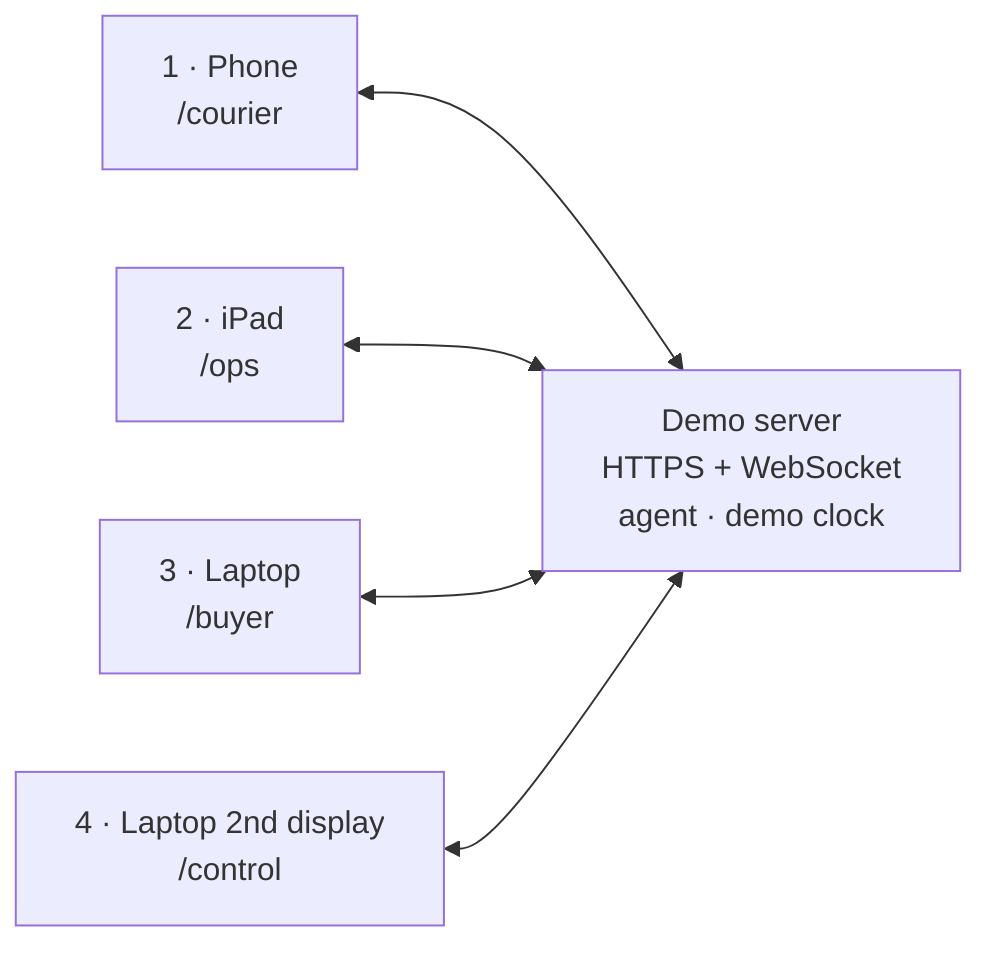

# 1 · Live demo — four screens

The 3-minute stage demo on 31 October 2026. Everything runs live on four screens, which share one server and one demo clock. The demo clock fast-forwards (60 minutes ≈ 6 seconds). No real phone number is ever dialled, and every person, address and phone number is fictional.

Technical setup, failure plan and the mock data pack: [`../02-technical/PRD.md`](../02-technical/PRD.md) §19–20.

---

## 1. The four screens

| # | Screen | Device | Route | Held by | On the projector? | What it shows |
| --- | --- | --- | --- | --- | --- | --- |
| 1 | **Courier app** | Phone, portrait, installed as an app | `/courier` | Presenter, playing courier **Tuan** (route R07, 200 stops) | Mirrored for close-ups | Today’s stops, window notes, **A / B / C** with the 2-minute undo ring, 10-second voice memo, context card, Delivered |
| 2 | **Carrier ops dashboard** (“what SPX sees”) | iPad, landscape, on a stand | `/ops` | Updates by itself; a teammate acts as **CS** | Corner mirror, or on cue | Area KPIs (4,000 orders, 20 couriers), live case timeline across the 8 steps, timers on the demo clock, policy checks, live transcript, extracted fields with confidence, card pushed, CS queue with Approve |
| 3 | **Buyer’s phone** | Laptop, in a phone frame | `/buyer` | Teammate, playing buyer **Minh** (headset mic) | **Main projection** | Chat with 4 window buttons and “Can’t receive today”, incoming AI call, live transcript line |
| 4 | **Demo control** | Laptop’s second display | `/control` | Presenter’s assistant | No | Scenario picker, Reset, clock speed / pause / jump, device status dots, QR codes, Auto-buyer, Offline mode |

Stage layout: the projector shows screen 3 (buyer). The iPad stands beside the presenter and is mirrored into a corner of the projector. The phone is mirrored for the tap close-ups. Screen 4 faces the assistant only.

## 2. The flow on stage (scenario A_main)

Follows the business flow in [`../02-technical/diagrams/alodi-flow.png`](../02-technical/diagrams/alodi-flow.png). Buyer: Minh Hoang · 6L air fryer · COD 1,290,000 VND · Tower B, Sky Garden · stop 37 of 200.

| Flow step | Demo clock | 1 · Phone (courier) | 2 · iPad (ops) | 3 · Laptop (buyer) | 4 · Control |
| --- | --- | --- | --- | --- | --- |
| 1 · Morning load | Sat 06:30 | Route R07 appears | “4,000 orders loaded · 20 couriers · 4 windows” | — | Scenario A_main, clock 06:28, speed 600× |
| 2 · Window question | 06:32 | — | Case: “Window question sent” | Bubble with **4 windows** + “Can’t receive today” | — |
| Branch | 08:00 cut-off | — | “No reply · deliver as planned” | Buyer ignores it | Jump to 10:00 |
| 4 · Delivery fails | 10:02 | Presenter taps **A · No answer** | Event **pending**, 2:00 undo ring | — | — |
| Undo ends | 10:04 | “Alodi is on it” | Committed → chat sent; timer “AI call 1 in 60:00” | “We just missed you. When and where should we come back?” | — |
| 5 · Flow A | 11:04 | Waiting state | Clock fast-forwards; policy check OK · 08:00–20:30 · call 1 of 2 | **Incoming call** rings | Jump to next timer |
| AI call | 11:04–11:05 | — | Live transcript; consent: yes | Buyer answers and speaks; AI voice from the laptop speakers | — |
| Extraction | 11:05 | — | Fields fill: window 0.94 · drop-off 0.88 · backup 0.91 → **Auto-applied** | Confirmation bubble | — |
| 7 · Save + card | 11:05 | **Context card** slides in | Card pushed · attempt 1 of 2 | — | — |
| Next day | Sun 17:22 | Tap **Delivered** | Case closed; counters update | “Delivered” | Jump to Sun 17:20 |
| Boundary | — | (new scenario) tap **C · Refused** | CS queue: suggested label, not applied → teammate taps **Approve return** | Nothing (no contact) | Scenario REFUSE |

## 3. Run of show (3:00)

Speakers follow [`2-PITCH-SCRIPT.md`](2-PITCH-SCRIPT.md); lines are filled in there.

| Time | Speaker | Beat | 1 · Phone | 2 · iPad | 3 · Laptop |
| --- | --- | --- | --- | --- | --- |
| 0:00 | Nomura Yoshio | Problem in one sentence | — | Area overview | — |
| 0:25 | Nomura Yoshio | “Four screens, all live” | Route | Case list | Empty chat |
| 0:35 | Long Quan Ton | Morning window question | — | Question sent → no reply | 4 windows |
| 0:55 | Long Quan Ton | 10:02, one tap | **Tap A** | Pending ring | — |
| 1:05 | Long Quan Ton | Undo ends, chat goes out | “Alodi is on it” | Timer 60:00 | Chat bubble |
| 1:15 | Long Quan Ton | Policy check, the call | — | Check OK | **Rings** |
| 1:25 | Khanh Tuong Huynh | The buyer answers | — | Transcript | Buyer speaks |
| 1:50 | Khanh Tuong Huynh | Three fields, auto-applied | — | Fields fill | Confirmation |
| 2:05 | Thanh Loi Tran | Saved with audit, card pushed | **Card** | Attempt 1 of 2 | — |
| 2:15 | Long Quan Ton | Next day, delivered | **Delivered** | Closed | “Delivered” |
| 2:25 | Khanh Tuong Huynh | Refusal: a person decides | **Tap C** | CS approves | — |
| 2:45 | Nomura Yoshio | The money and the close | — | Output view | Lockup |

## 4. Extra scenarios (if time allows)

| Scenario | 1 · Phone | 2 · iPad | 3 · Laptop |
| --- | --- | --- | --- |
| **B_memo** · rescheduled | Tap B on stop 41 → hold and say: “She wants tomorrow before ten, leave it at Tower A reception” | Memo → transcript → fields → card | Confirmation |
| **A_midway** · reply before the call | Tap A on stop 63 | Timer running → “pending call 1 cancelled” | Buyer types “after 5 tomorrow” |
| **A_noanswer** · two missed calls | Tap A on stop 58 | Call 1 missed, call 2 missed → CS | Buyer declines twice |
| **CANT_TODAY** | Stop 70 leaves today’s route | “Moved to Mon 2 Nov · reason saved” | Buyer taps “Can’t receive today” + reason |
| **A_lowconf** · vague answer | Tap A on stop 52 | 0.52 / 0.41 → confirm in chat → CS | “Maybe afternoon… or tonight, anywhere is fine” |

## 5. AI call dialogue (A_main)

Assistant: warm female voice; greeting and consent are pre-recorded. Buyer: teammate with a headset, natural and a little rushed.

1. **Assistant** *(pre-recorded)*: Hello, this is the automated delivery assistant calling about your air fryer. This call is recorded so we get the delivery right — is that okay?
2. **Buyer**: Sure, go ahead.
3. **Assistant**: Our courier missed you this morning. Tomorrow we have 8 to 10, 10 to 12, 2 to 5, or 5 to 8 in the evening. Which works for you?
4. **Buyer**: Tomorrow after five, please. I’m out until late, so leave it with security in Tower B. Or call my wife.
5. **Assistant**: Confirming: Sunday 1 November, 5 to 8 pm, left with Tower B security, and your wife if needed. Is that right?
6. **Buyer**: That’s right.
7. **Assistant** *(pre-recorded)*: Thank you. Have a good afternoon.

Extracted: window 1 Nov 17:00–20:00 (0.94) · drop-off Tower B security (0.88) · backup receiver wife (0.91) → auto-applied.

## 6. If asked “is this real?”

> “The flow, the rules, the timers and the four screens are live and in sync. The buyer is played by a teammate, and no real number is dialled. In production the models run on a server at each area and the channels become Shopee Chat, Zalo and a branded phone line.”

If the fast path is used (PRD §19.3 B), add: “the buyer’s answers and the AI voice are scripted for the demo; the flow, rules and sync are what we built.”

## 7. Checklist

**Day before**
- [ ] Server up, domain and HTTPS working; backup tunnel on a teammate laptop tested.
- [ ] Three full rehearsals on the real phone, iPad and laptop over the hotspot; backup video recorded.

**One hour before**
- [ ] All devices on the demo hotspot; spare hotspot charged.
- [ ] `/courier` and `/ops` installed to the home screen; iPad auto-lock *Never*, Guided Access on; phone Do Not Disturb.
- [ ] Microphones allowed (phone memo, laptop call); headset on the buyer actor; laptop audio to the venue PA.
- [ ] `/control`: four green dots, scenario A_main, clock Sat 06:28, speed 600×.
- [ ] Run A_main once, then **Reset**.
- [ ] Offline mode and Auto-buyer tested.
- [ ] Output view shows numbers labelled *projected* or *mock* until the eval replaces them.

**Failure plan (short)**

| Failure | Do |
| --- | --- |
| A device drops | It reconnects and reloads its screen; keep talking |
| Hotspot dies | Spare hotspot |
| Model APIs slow | `/control` → Offline mode |
| Room too noisy for the call | `/control` → Auto-buyer |
| Everything fails | Play the 2-minute video (`3-DEMO-VIDEO.md`) |
