# Alodi — Product Requirements Document

| | |
| --- | --- |
| Product | **Alodi** — an AI agent that rescues failed last-mile deliveries |
| Version | 2.0 · 30 October 2026 |
| Team | Develarper — Nomura Yoshio (team lead, presenter) · Long Quan Ton (AI engineer, solution architect) · Khanh Tuong Huynh (AI engineer, deployment) · Thanh Loi Tran (data engineer, backend) |
| Release | MVP live demo on **31 October 2026** (mock data, cloud APIs) → shadow-mode pilot at one hub → production inside a carrier (SPX) |
| Sizing basis | One area (hub) = **20 couriers, 4,000 orders a day** (team estimate) |
| Source of truth | [`diagrams/alodi-architecture.pdf`](diagrams/alodi-architecture.pdf) · [`diagrams/alodi-flow.pdf`](diagrams/alodi-flow.pdf) |
| Companion files | [`mock-data/`](mock-data/) (test data) · [`requirements.txt`](requirements.txt) · [`package.json.example`](package.json.example) · [`.env.example`](.env.example) |

This is the only technical document. It replaces the earlier `ARCHITECTURE`, `FLOW`, `DATA_MODEL`, `API`, `TECH_STACK`, `BUILD_PLAN`, `EVAL_AND_METRICS` and `LIVE_DEMO_SETUP` notes; everything they contained is in here.

---

## Contents

**Part A — Business analysis**

- 1 · [Problem and opportunity](#1-problem-and-opportunity)
- 2 · [Goals, non-goals and success metrics](#2-goals-non-goals-and-success-metrics)
- 3 · [Stakeholders, actors and personas](#3-stakeholders-actors-and-personas)
- 4 · [Scope](#4-scope)
- 5 · [Business process](#5-business-process)
- 6 · [Business rules and timings](#6-business-rules-and-timings)
- 7 · [Functional requirements](#7-functional-requirements)
- 8 · [Non-functional requirements](#8-non-functional-requirements)
- 9 · [Use cases](#9-use-cases)
- 10 · [Use case diagram](#10-use-case-diagram)

**Part B — System design**

- 11 · [Domain model — class diagram](#11-domain-model--class-diagram)
- 12 · [Data model — ERD and tables](#12-data-model--erd-and-tables)
- 13 · [State machine](#13-state-machine)
- 14 · [Sequence diagrams](#14-sequence-diagrams)
- 15 · [API and interfaces](#15-api-and-interfaces)

**Part C — Architecture**

- 16 · [System architecture](#16-system-architecture)
- 17 · [Data flow](#17-data-flow)
- 18 · [Production architecture on cloud](#18-production-architecture-on-cloud)

**Part D — Live demo**

- 19 · [Live demo](#19-live-demo)
- 20 · [Mock data and test pack](#20-mock-data-and-test-pack)
- 21 · [Demo-day tech stack — what, why and how](#21-demo-day-tech-stack--what-why-and-how)
- 22 · [Build plan](#22-build-plan)

**Part E — Quality and delivery**

- 23 · [Evaluation and metrics](#23-evaluation-and-metrics)
- 24 · [Acceptance criteria](#24-acceptance-criteria)
- 25 · [Traceability matrix](#25-traceability-matrix)
- 26 · [Assumptions, dependencies, constraints](#26-assumptions-dependencies-constraints)
- 27 · [Risks](#27-risks)
- 28 · [Release plan](#28-release-plan)
- 29 · [Glossary](#29-glossary)
- 30 · [Sources](#30-sources)

---

# Part A — Business analysis

## 1. Problem and opportunity

**Problem statement.** When a delivery fails, the fix is usually a small piece of information: *“after five”*, *“leave it with security in Tower B”*, *“call my wife”*. Today the courier and the buyer exchange it on the phone and it is lost. Shopee buyers cannot choose a delivery time at all, so the order is retried blindly or sent back to the seller.

| Fact | Figure | Source line |
| --- | --- | --- |
| Return shipping paid by the seller per failed order (max) | ₫40,000 | Shopee Return & Refund Policy §7.1 |
| Orders refused nationwide | 8–12% (up to 20% remote, 25–30% in sale season) | VECOM; Tran Anh Tung (UEF), Nguoi Lao Dong, Jul 2025 |
| Delivery windows a buyer can choose | 0 | Shopee Help Center, article 79559 |
| Shopee redelivery frame | 2–3 contacts, reschedule within 5 days | Shopee Help Center, article 79569 |
| Monthly loss, one area (20 couriers, 4,000 orders a day) | ₫447–499M (modelled) | §18.8 |
| People needed to phone 800 buyers a day | ≈ 13 (estimate) | 800 × 2 calls × 4 min |

**At the size of one area (20 couriers, 4,000 orders a day)** the mock simulation in §20 gives 350 failed first attempts a day (9.2%). Each one is a possible ₫40,000 return fee and about two manual phone calls.

**Opportunity.** An autonomous agent can run the redelivery conversation at scale, inside rules the marketplace already defines, and hand the result to the next courier as structured data, while people keep every decision that affects money or a buyer’s record.

**Vision.** *Make the second drop land.* One courier tap, one well-timed conversation, one context card for the next attempt.

## 2. Goals, non-goals and success metrics

### 2.1 Goals

| ID | Goal |
| --- | --- |
| G1 | Capture the buyer’s availability **before** the first attempt (morning window question). |
| G2 | Turn a failed attempt into **structured context** (window, drop-off, backup receiver, address fix) for the next attempt, with no typing by the courier. |
| G3 | Run the rescue conversation **autonomously** inside hard rules (hours, contact caps, Shopee’s 5-day frame). |
| G4 | Keep **people in control** of refusals, labels, returns and ambiguous answers. |
| G5 | Make every decision **measurable and auditable**. |

### 2.2 Non-goals (this release)

- Replacing the carrier’s route planner, courier app or CS tools. Alodi plugs into them.
- Dialling real phone numbers or sending real Shopee or Zalo messages in the demo.
- Labelling buyers (“suspected bomb”) or returning goods automatically.
- Payments, refunds, map-based address validation.
- Fine-tuning models before the demo.

### 2.3 Success metrics

| Metric | Definition | Target | Type |
| --- | --- | --- | --- |
| **Time-to-context** | Buyer’s answer (or courier tap) → context card visible on the courier app and the ops dashboard | median < 10 s on the chat path | Measured |
| **Extraction accuracy** | Per-field F1 on a hand-written held-out set (chat, call transcript, memo) | ≥ 0.90 | Measured |
| **Safe autonomy** | % of cases resolved without a person; error rate inside that group; high-stakes actions without approval; calls outside hours | report %; < 2%; **0**; **0** | Measured |
| **Money** | Return fees avoided + CS hours saved − agent cost per case | positive per case | Projected |
| Rescue rate (pilot only) | Failed orders delivered on a later attempt | above the ~25% industry baseline | Pilot |

## 3. Stakeholders, actors and personas

### 3.1 Stakeholders

| Stakeholder | Interest |
| --- | --- |
| Carrier operations (SPX hub manager) | Fewer returns, fewer wasted attempts, less CS load |
| Seller | No ₫40,000 return fee, no lost sale |
| Marketplace (Shopee) | Buyer experience, policy compliance |
| Buyer | Parcel at a convenient time and place; no spam; no wrong label |
| Courier | Fewer failed stops, no typing |
| Customer service (CS) | Only the cases that need a person, with the whole story |
| Competition judges | Real autonomy, measurable results, honest claims |

### 3.2 Actors

| Actor | Kind | Role |
| --- | --- | --- |
| **Courier** | Primary, person | Delivers; taps Delivered / A / B / C; records a voice memo |
| **Buyer** | Primary, person | Answers the window question, chats, answers AI calls |
| **CS agent** | Primary, person | Handles escalations, approves labels and returns, takes hotline call-backs |
| **Dispatcher / ops viewer** | Secondary, person | Watches the live ops dashboard |
| **Demo operator** | Secondary, person (demo only) | Picks scenarios, controls the demo clock |
| **Scheduler** | System | Fires timed jobs: morning run, undo commit, calls, cut-off |
| **Alodi Agent** | System | Decides the next step for each order and calls tools |
| **Route planner (SPX)** | External system | Feasible delivery windows |
| **OMS / Order DB (SPX)** | External system | Today’s orders |
| **Chat gateway** (Shopee Chat, Zalo) | External system | Sends and receives buyer messages |
| **Call gateway + TTS** | External system | Places AI calls, speaks |
| **ASR** | External system | Speech to text |
| **LLM** | External system | Tool calling, extraction |

### 3.3 Personas

| Persona | Snapshot | Needs | Frustrations |
| --- | --- | --- | --- |
| **Tuan Nguyen, courier**, 28, route R07 of the Binh Thanh hub, 200 stops a day | Rides with the phone on the handlebar | One-tap outcomes; the right time and place before arriving | Calling the same buyer three times; typing notes on a bike |
| **Minh Hoang, buyer**, 34, office worker | Away 08:00–18:00; his wife is home some days | Choose when; leave it with security; no spam | Unknown numbers; couriers arriving at noon |
| **Lan, CS agent**, hub hotline | Handles escalations | Only real exceptions, with the full story | Re-asking buyers what couriers already heard |
| **Hub manager** | Owns cost and SLA | Rescue rate, cost per case | No view of why orders fail |

## 4. Scope

### 4.1 In scope — MVP demo (31 October)

- Morning load of orders + 4 fixed windows; window question to every buyer in the area.
- Courier app: stops, window notes, A / B / C / Delivered with a 2-minute undo, 10-second voice memo, context card.
- Flow A (chat → AI call 1 → AI call 2 → CS), Flow B (memo → ASR → extraction), button C (straight to CS).
- Extraction with per-field confidence; auto-apply at ≥ 0.85; confirm in chat; CS review.
- Policy guard; redelivery counter (max 2); 5-day horizon.
- Ops dashboard on the iPad: live timeline, transcript, extraction, card, CS queue.
- Buyer phone on the laptop: chat and an in-browser AI call.
- Demo control: scenarios, fast-forward clock, device status, offline and auto-buyer modes.
- Event log and the four metrics.
- Mock data pack for one area (20 couriers, 4,000 orders) and 20 scripted test cases (§20).

### 4.2 Out of scope — MVP

Real SPX APIs, real Shopee or Zalo sending, SIP calls, PostgreSQL / Redis / Temporal, self-hosted models, login and SSO, multi-hub tenancy, billing.

### 4.3 Later phases

Pilot: shadow mode at one hub. Production: SPX routing and order APIs, Shopee Chat API, Zalo ZNS, a SIP trunk with a verified brand name, Vietnamese ASR and TTS, self-hosted LLM, PostgreSQL, Redis + Temporal, object storage, model gateway — see §18.

## 5. Business process

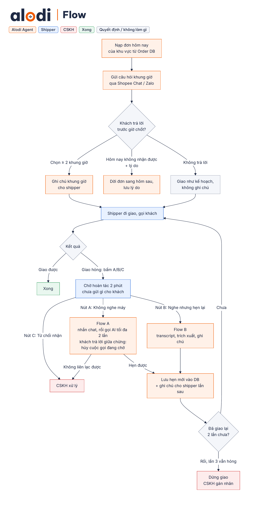

Legend in the diagram: **orange** = Alodi Agent · **blue** = courier · **red** = CS · **green** = done · **grey** = decision or do nothing.

### 5.1 The eight steps

| # | Step | What happens | Talks to |
| --- | --- | --- | --- |
| 1 | **Load today’s orders + windows** | Every morning, for the whole delivery area: pull today’s orders and the feasible windows | Route planner, OMS |
| 2 | **Ask the buyer for a window** | Message the buyer: pick **≥ 2 windows**, or “can’t receive today” + a reason | LLM (writes the message), Shopee Chat / Zalo |
| — | *Did the buyer reply before the route cut-off?* | Three outcomes → | |
| 3 | **Picked ≥ 2 windows** | Write a window note for the courier | Courier app |
| — | **Can’t receive today** | Save the reason, move the order to tomorrow | Alodi DB |
| — | **No reply** | Deliver as planned, no note | — |
| 4 | **Courier delivers and calls the buyer** | The courier sees any note; on failure taps **A / B / C** → **2-minute undo**: the event is *pending* and nothing is sent | Courier app, timers |
| — | **C · Refused** | Straight to CS (step 8), no buyer contact | CS dashboard |
| 5 | **Flow A · No answer** | Chat after the undo window → 60 min no reply → **AI call 1** → +2 h → **AI call 2** (08:00–20:30 only) → two calls fail → CS. A reply or call-back mid-way cancels the pending call | Chat, AI call + TTS, ASR, extraction, timers |
| 6 | **Flow B · Answered but rescheduled** | 10-second courier memo (demo) or call recording (production) → ASR → mask PII → extract; missing fields → confirm in chat | File storage, ASR, PII masking, extraction |
| 7 | **Save the new appointment + note** | Store `rescue_result`, push the context card to the courier app | Alodi DB, courier app |
| — | *Redelivered twice already?* | No → back to step 4 on the new appointment. Yes, and the 3rd attempt failed → step 8 | |
| 8 | **CS handles and labels (a person)** | Stop delivery; CS decides the label and the return | CS dashboard, hotline |

### 5.2 Flowchart (editable)

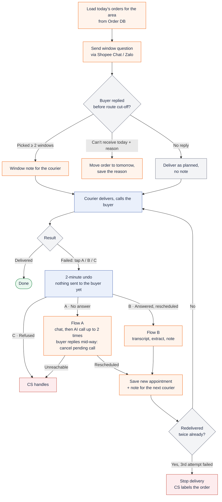

### 5.3 Main case on a timeline (scenario A)

| Demo clock | Event |
| --- | --- |
| Sat 31 Oct 06:30 | Morning load: 4,000 orders for the hub + 4 windows from the route planner |
| 06:32 | Window question with 08:00–10:00 · 10:00–12:00 · 14:00–17:00 · 17:00–20:00 + “Can’t receive today” |
| 08:00 | Route cut-off: no reply → deliver as planned |
| 10:02 | Tuan at stop 37 of 200, two calls unanswered → taps **A · No answer** |
| 10:04 | Undo window ends → chat: “We just missed you. When and where should we come back?” |
| 11:04 | 60 min of silence → **AI call 1** (policy guard: inside 08:00–20:30, call 1 of 2) |
| 11:04–11:05 | 74-second call: consent → “Tomorrow after five… Tower B security… or call my wife” → read-back → confirmed |
| 11:05 | Extraction: window 1 Nov 17:00–20:00 (0.94), drop-off Tower B security (0.88), backup receiver wife (0.91) → auto-applied |
| 11:05 | Context card on the courier app; confirmation chat to the buyer |
| Sun 1 Nov 17:22 | Courier arrives with the card → **Delivered** on attempt 2 |

## 6. Business rules and timings

| ID | Rule | Value | Enforced by |
| --- | --- | --- | --- |
| BR-01 | The morning run covers every order in the delivery area | ~06:30 | Scheduler |
| BR-02 | Windows offered come only from the route planner (demo: 4 fixed) | 4 | Tool `ask_window` |
| BR-03 | A window answer is valid only with **≥ 2 windows** | 2 | Agent |
| BR-04 | “Can’t receive today” moves the order to the next day and stores the reason | — | Agent |
| BR-05 | No reply by the route cut-off → deliver as planned, no note | ~08:00 | Scheduler |
| BR-06 | Every failed-outcome tap is **pending for 2 minutes**; nothing reaches the buyer before it commits | 2 min | Scheduler |
| BR-07 | **C · Refused** → straight to CS, **no buyer contact** | — | Policy guard |
| BR-08 | The Flow A chat goes out as soon as the undo window ends | — | Agent |
| BR-09 | AI call 1 only after **60 min** of silence after the chat | 60 min | Scheduler + guard |
| BR-10 | AI call 2 **2 h** after call 1 | 2 h | Scheduler + guard |
| BR-11 | Calls only **08:00–20:30**; a call due outside moves to the next 08:00 | — | Policy guard |
| BR-12 | **At most 2 calls** per rescue cycle | 2 | Policy guard |
| BR-13 | A buyer reply or call-back cancels any pending call | — | Agent |
| BR-14 | Extracted fields auto-apply only if **every field ≥ 0.85** and nothing conflicts | 0.85 | Policy guard |
| BR-15 | Missing or low-confidence fields → ask the buyer in chat; still unclear → CS | — | Agent |
| BR-16 | An address change outside the hub’s service area always needs a person | — | Policy guard |
| BR-17 | **At most 2 redeliveries**; the 3rd failed attempt stops delivery → CS labels | 2 | Policy guard |
| BR-18 | Reschedule horizon **≤ 5 days** (Shopee) | 5 days | Policy guard |
| BR-19 | Labels (“suspected bomb”, “undeliverable”) and returns are **suggested** by the agent and **applied only by a person** | — | CS dashboard |
| BR-20 | Buyer opt-out (“stop”) ends all contact | — | Policy guard |
| BR-21 | Recording consent is asked at the start of every call | — | Call tool |
| BR-22 | Before every scheduled job, reload the order state and re-run the guard | — | Scheduler |
| BR-23 | PII is masked before any LLM call; raw audio and transcripts kept ≤ 30 days | 30 days | Privacy layer |
| BR-24 | Every change to an order’s context is versioned with actor and time | — | Data layer |
| BR-25 | Target call length ≈ 90 s; one rephrase, then end and continue in chat | 90 s | Call tool |

Since 1 July 2025 Ho Chi Minh City has no district level; the `district` field holds the ward, and BR-16 is checked against the hub’s list of wards.

## 7. Functional requirements

Priority: **M** = must for the demo, **S** = should, **C** = could / later.

### 7.1 Order intake and morning question

| ID | Requirement | Priority |
| --- | --- | --- |
| FR-01 | The system shall load today’s orders for a delivery area from the OMS (demo: `mock-data/orders.json`) at the morning run. | M |
| FR-02 | The system shall load feasible windows from the route planner (demo: `mock-data/windows.json`). | M |
| FR-03 | The agent shall send each buyer a window question with the windows as quick replies and a “Can’t receive today” option. | M |
| FR-04 | The system shall accept a reply of ≥ 2 windows and store it in `availability_reply`. | M |
| FR-05 | The system shall accept “can’t receive today” with a free-text reason, move the order to the next day and store the reason. | M |
| FR-06 | At the route cut-off, orders without a reply shall be marked “deliver as planned”. | M |
| FR-07 | For orders with chosen windows, the system shall push a window note to the courier’s stop. | M |
| FR-08 | Production may limit the window question to risky orders (high COD, earlier failures) by configuration, to save message cost. | C |

### 7.2 Courier app

| ID | Requirement | Priority |
| --- | --- | --- |
| FR-10 | The courier app shall list today’s stops in route order with any window note or context card. | M |
| FR-11 | On a stop the courier shall record the outcome with one tap: **Delivered**, **A · No answer**, **B · Answered, rescheduled**, **C · Refused**. | M |
| FR-12 | A failed outcome shall be created as *pending* with a visible 2-minute countdown and an **Undo** action. | M |
| FR-13 | For B the app shall record a voice memo of up to 10 seconds and upload it. | M |
| FR-14 | The app shall show a context card in real time when the agent saves a new appointment. | M |
| FR-15 | The app shall show its connection status and restore its state after a reconnect. | M |
| FR-16 | The app shall be installable to the home screen (PWA) and usable one-handed. | S |

### 7.3 Agent and rescue flows

| ID | Requirement | Priority |
| --- | --- | --- |
| FR-20 | The agent shall keep one state machine per order (§13) and decide the next action from the current state and the latest event. | M |
| FR-21 | Flow A: after commit, the agent shall send a rescue chat asking when and where to come back. | M |
| FR-22 | Flow A: after 60 min without a reply the agent shall place AI call 1; if unanswered, AI call 2 two hours later. | M |
| FR-23 | Flow A: if both calls fail, the case shall go to CS and buyer call-backs shall route to the hotline. | M |
| FR-24 | Any buyer reply or call-back during Flow A shall cancel pending calls and continue to extraction. | M |
| FR-25 | Flow B: the memo shall be transcribed, PII-masked and extracted. | M |
| FR-26 | Button C shall escalate to CS with a suggested label and no buyer contact. | M |
| FR-27 | After saving an appointment, the system shall increment the attempt counter; on the 3rd failed attempt it shall stop delivery and escalate to CS. | M |
| FR-28 | Every tool call shall pass the policy guard; blocked calls shall be logged as `policy_block`. | M |

### 7.4 AI call

| ID | Requirement | Priority |
| --- | --- | --- |
| FR-30 | The call shall open with a pre-recorded greeting that says it is an automated assistant and asks for recording consent. | M |
| FR-31 | Dynamic questions (windows, read-back) shall be spoken with TTS. | M |
| FR-32 | The buyer’s speech shall be transcribed as they speak. | M |
| FR-33 | The assistant shall read back the understood appointment and ask for confirmation. | M |
| FR-34 | Target call length ≤ 90 s; the call ends after confirmation or two failed clarifications. | S |
| FR-35 | If consent is refused, the call ends and the case continues by chat. | M |

### 7.5 Extraction

| ID | Requirement | Priority |
| --- | --- | --- |
| FR-40 | The extractor shall output `time_window`, `drop_location`, `alt_receiver`, `address_correction`, `cannot_receive`, `opt_out` in a strict JSON schema, with a confidence per field. | M |
| FR-41 | Dates beyond the 5-day horizon shall be rejected. | M |
| FR-42 | Every field ≥ 0.85 and no conflict → auto-apply; otherwise confirm in chat; then CS review. | M |
| FR-43 | When answers from different channels conflict, the latest wins only if its confidence ≥ 0.85; otherwise ask again. | S |

### 7.6 Ops dashboard and CS

| ID | Requirement | Priority |
| --- | --- | --- |
| FR-50 | The ops dashboard shall show a live timeline of the eight steps for each case, including pending events, timers and policy checks. | M |
| FR-51 | It shall show the conversation and live transcript, extracted fields with confidence, and the card pushed to the courier. | M |
| FR-52 | It shall list cases that need a person (low confidence, two missed calls, refused, 3rd failure) with the reason and the agent’s suggestion. | M |
| FR-53 | A CS agent shall be able to apply an appointment, approve a label or return, or claim a case; the action is logged with their name. | M |
| FR-54 | It shall show hub KPIs and the four output metrics from the event log. | S |
| FR-55 | Light and dark themes. | C |

### 7.7 Buyer channel (simulated in the demo)

| ID | Requirement | Priority |
| --- | --- | --- |
| FR-60 | The buyer view shall show agent messages and quick-reply windows and accept free text. | M |
| FR-61 | It shall ring for an AI call, offer Answer / Decline, stream the buyer’s microphone and play the assistant’s voice. | M |
| FR-62 | A buyer reply of “stop” shall set opt-out. | M |

### 7.8 Demo control, audit and metrics

| ID | Requirement | Priority |
| --- | --- | --- |
| FR-70 | The operator shall pick a scenario, reset, and control a server-side fast-forward clock (speed, pause, jump). | M |
| FR-71 | The operator shall see each device’s connection status and open devices by QR code. | S |
| FR-72 | Auto-buyer and offline-replay modes shall be available as fallbacks. | S |
| FR-73 | Every state change shall append an event with actor, time, type and payload. | M |
| FR-74 | The four output metrics shall be computable from the event log and the eval run. | M |
| FR-75 | Reset shall reload the mock data pack (§20) so every rehearsal starts from the same state. | M |

## 8. Non-functional requirements

| ID | Category | Requirement | Measure |
| --- | --- | --- | --- |
| NFR-01 | Performance | Event fan-out from one device to the others | p95 < 300 ms over a 4G hotspot |
| NFR-02 | Performance | Time-to-context on the chat path | median < 10 s |
| NFR-03 | Performance | AI call turn latency (buyer stops speaking → assistant starts) | < 2.5 s |
| NFR-04 | Reliability | A reconnecting device restores its full screen from the server | 100% of reconnects, < 3 s |
| NFR-05 | Reliability | Scheduled jobs survive a restart (production: durable timers) | Production |
| NFR-06 | Reliability | The demo continues if a model API fails (offline replay) | Fallback tested |
| NFR-07 | Accuracy | Per-field F1 on the held-out set | ≥ 0.90 |
| NFR-08 | Accuracy | Calibration: fields with confidence ≥ 0.85 are correct | ≥ 95% |
| NFR-09 | Safety | Calls outside 08:00–20:30, contacts after opt-out or refusal, third calls, unapproved labels | **0** |
| NFR-10 | Privacy | PII masked before every LLM call; raw audio and transcripts encrypted (production) with a 30-day TTL | Audit |
| NFR-11 | Privacy | Only extracted JSON leaves the trusted zone; logs store references, not raw content | Review |
| NFR-12 | Compliance | Recording consent on every call; opt-out honoured; Shopee 5-day frame; Vietnam’s Personal Data Protection Law (§18.6) | Test cases + legal review |
| NFR-13 | Security | HTTPS / WSS everywhere; secrets in environment variables; no keys in the browser | Review |
| NFR-14 | Auditability | Every context change versioned with actor and timestamp | 100% |
| NFR-15 | Usability | Courier: one tap per outcome, targets ≥ 48 px, one-handed; iPad: targets ≥ 44 px, nothing hover-only | Review |
| NFR-16 | Accessibility | Text contrast AA; `prefers-reduced-motion` respected; charts carry text labels | Review |
| NFR-17 | Localisation | Buyer-facing language Vietnamese; product UI English; Vietnamese ASR and TTS in production | Demo + pilot |
| NFR-18 | Portability | Same interfaces in demo and production (SQLite → PostgreSQL, demo scheduler → Temporal, cloud API → self-hosted model) | Architecture |
| NFR-19 | Capacity | One area: 4,000 orders, ~6,100 messages, ~190 calls and ~350 rescue cases a day; platform: 100 areas (400,000 orders a day) without redesign | Load test (§18.2) |
| NFR-20 | Cost | Agent cost per case measured; monthly cost and net saving per hub reported (§18.8) | Report |
| NFR-21 | Observability | Event log, metrics, traces; production: Prometheus + Grafana + OpenTelemetry | — |
| NFR-22 | Compatibility | iPhone Safari (iOS 17+), iPadOS Safari, desktop Chrome | Device test |
| NFR-23 | Availability (production) | 99.9% for courier events and the agent during 06:00–21:00; RPO ≤ 5 min; RTO ≤ 1 h | §18.5 |

## 9. Use cases

### 9.1 List

| ID | Use case | Primary actor | Priority |
| --- | --- | --- | --- |
| UC-01 | Load today’s orders and windows | Scheduler | M |
| UC-02 | Ask the buyer for delivery windows | Alodi Agent | M |
| UC-03 | Answer the window question | Buyer | M |
| UC-04 | Add window notes to the route | Alodi Agent | M |
| UC-05 | Record the delivery outcome (Delivered / A / B / C) | Courier | M |
| UC-06 | Undo an outcome within 2 minutes | Courier | M |
| UC-07 | Rescue an unanswered delivery (Flow A) | Alodi Agent | M |
| UC-08 | Conduct an AI call | Alodi Agent | M |
| UC-09 | Answer the AI call | Buyer | M |
| UC-10 | Reschedule from a voice memo (Flow B) | Courier | M |
| UC-11 | Extract delivery context | Alodi Agent | M |
| UC-12 | Confirm unclear details in chat | Alodi Agent | M |
| UC-13 | Save the appointment and push the context card | Alodi Agent | M |
| UC-14 | Handle an escalated case | CS agent | M |
| UC-15 | Approve a label or return | CS agent | M |
| UC-16 | Opt out of contact | Buyer | M |
| UC-17 | Monitor live operations | Dispatcher | M |
| UC-18 | Run the live demo | Demo operator | M |
| UC-19 | Review metrics | Hub manager | S |
| UC-20 | Enforce policy (included by UC-07, UC-08, UC-12, UC-13) | Policy guard | M |

### 9.2 Specifications

#### UC-01 · Load today’s orders and windows
| | |
| --- | --- |
| Actor | Scheduler |
| Trigger | 06:30 every day |
| Main flow | 1. Read today’s orders for the hub from the OMS. 2. Read the feasible windows from the route planner. 3. Create or refresh `orders` rows (status `scheduled`). 4. Log `orders_loaded`. 5. Start UC-02 for each order. |
| Alternative | 1a. OMS unavailable → retry with back-off; alert ops at 06:45. |
| Postconditions | All of today’s orders known with windows |

#### UC-02 · Ask the buyer for delivery windows
| | |
| --- | --- |
| Actor | Alodi Agent (started by the scheduler) |
| Preconditions | UC-01 done; buyer has not opted out |
| Main flow | 1. Read the order and the 4 windows. 2. Compose a short message with the windows as quick replies plus “Can’t receive today”. 3. Policy guard approves. 4. Chat gateway sends it. 5. Create `availability_reply` with `slots_offered`. 6. Log `slots_sent`. |
| Alternative | 3a. Buyer opted out → nothing sent; log `policy_block`. |
| Postconditions | Question sent and recorded |
| Rules | BR-01, BR-02, BR-20 |

#### UC-03 · Answer the window question
| | |
| --- | --- |
| Actor | Buyer |
| Preconditions | UC-02 sent |
| Main flow | 1. Buyer taps ≥ 2 windows. 2. System stores `answer_type = windows`. 3. UC-04 adds a note to the stop. 4. Confirmation sent. |
| Alternatives | 1a. “Can’t receive today” + reason → order moved to the next day (BR-04). 1b. Only one window → agent asks for one more (BR-03). 1c. No reply by the cut-off → deliver as planned (BR-05). 1d. Buyer writes “stop” → UC-16. |
| Postconditions | Availability known, or the default plan kept |

#### UC-04 · Add window notes to the route
| | |
| --- | --- |
| Main flow | 1. For each order with `answer_type = windows`, build a note (“Prefers 14:00–17:00 or 17:00–20:00”). 2. Push it to the courier app on the stop. 3. Log `note_pushed`. |

#### UC-05 · Record the delivery outcome
| | |
| --- | --- |
| Actor | Courier |
| Preconditions | Courier is at the stop and has called the buyer |
| Main flow | 1. Courier taps an outcome. 2. Delivered → order closed. 3. A / B / C → `shipper_event` created as **pending**, `commit_at = now + 2 min`; the ops dashboard shows it. 4. At commit time the scheduler reloads the state (BR-22) and commits. 5. A → UC-07; B → UC-10; C → UC-14 with a suggested label. |
| Alternative | 3a. Courier undoes (UC-06) → event `undone`, nothing sent. |
| Postconditions | Rescue started or order closed |
| Rules | BR-06, BR-07 |

#### UC-06 · Undo an outcome
| | |
| --- | --- |
| Main flow | 1. Courier taps Undo before `commit_at`. 2. Event status `undone`; the commit job is cancelled. 3. Stop returns to “out for delivery”. |
| Alternative | 1a. After `commit_at` → Undo is gone; the courier contacts CS. |

#### UC-07 · Rescue an unanswered delivery (Flow A)
| | |
| --- | --- |
| Actor | Alodi Agent |
| Preconditions | Event A committed; cycle ≤ 2; no opt-out |
| Main flow | 1. Send the rescue chat. 2. Schedule call 1 at +60 min. 3. No reply → guard checks the hour and the count → UC-08 call 1. 4. Buyer answers → UC-11. |
| Alternatives | 2a. Buyer replies in chat before the call → cancel the call → UC-11. 3a. Outside 08:00–20:30 → move to the next 08:00. 3b. Call 1 missed → call 2 at +2 h → UC-08. 3c. Call 2 missed → UC-14, hotline routing on. 3d. Buyer calls back → hotline, cancel the pending call. |
| Postconditions | Context extracted, or case with CS |
| Rules | BR-08 … BR-13, BR-20 |

#### UC-08 · Conduct an AI call
| | |
| --- | --- |
| Actor | Alodi Agent |
| Preconditions | Guard approved; attempt ≤ 2 |
| Main flow | 1. Call gateway rings the buyer (demo: the laptop). 2. Pre-recorded greeting + consent question. 3. Buyer consents. 4. TTS asks for a window and drop-off. 5. ASR transcribes the answer. 6. Agent reads back what it understood. 7. Buyer confirms. 8. Call ends; masked transcript stored; UC-11. |
| Alternatives | 3a. Consent refused → end, continue by chat. 5a. Unclear → one rephrase; still unclear → end, UC-12. 1a. No answer within ~30 s → “missed”. |
| Postconditions | Transcript available, or call logged as missed |
| Rules | BR-11, BR-12, BR-21, BR-23, BR-25 |

#### UC-09 · Answer the AI call
UC-08 from the buyer’s side: Answer or Decline; speak; confirm or correct the read-back.

#### UC-10 · Reschedule from a voice memo (Flow B)
| | |
| --- | --- |
| Actor | Courier |
| Preconditions | Event B tapped |
| Main flow | 1. Courier holds Record and repeats what the buyer said (≤ 10 s). 2. Upload. 3. ASR → transcript → mask PII. 4. UC-11. |
| Alternative | 3a. ASR fails → ask the buyer in chat (UC-12). |
| Postconditions | Context extracted |

#### UC-11 · Extract delivery context
| | |
| --- | --- |
| Actor | Alodi Agent |
| Preconditions | Masked text from chat, call or memo |
| Main flow | 1. Call the extractor with the strict schema. 2. Validate (date ≤ 5 days). 3. All fields ≥ 0.85, no conflict → UC-13. |
| Alternatives | 3a. Missing or low fields → UC-12. 3b. Address outside the service area → UC-14. 3c. `opt_out = true` → UC-16. 3d. `cannot_receive` → move the order, store the reason. |
| Postconditions | `rescue_result` with a decision |
| Rules | BR-14 … BR-16, BR-18 |

#### UC-12 · Confirm unclear details in chat
| | |
| --- | --- |
| Main flow | 1. Agent asks one targeted question with options (two concrete windows). 2. Buyer answers. 3. UC-11 again. |
| Alternative | 2a. Still unclear, or no answer in 30 min → UC-14 with reason `low_confidence`. |

#### UC-13 · Save the appointment and push the context card
| | |
| --- | --- |
| Main flow | 1. Save `rescue_result` (version +1, actor). 2. Increment the attempt counter. 3. Push the card to the courier app and the ops dashboard. 4. Send a confirmation to the buyer. 5. Log `card_pushed`. |
| Alternative | 2a. The counter would pass 2 → UC-14 (stop delivery). |
| Rules | BR-17, BR-24 |

#### UC-14 · Handle an escalated case
| | |
| --- | --- |
| Actor | CS agent |
| Triggers | Refused (C); two missed calls; low confidence; address outside the area; 3rd failure |
| Main flow | 1. Case appears in the CS queue with the reason, transcript, extraction and the agent’s suggestion. 2. CS reviews and may call the buyer from the hotline. 3. CS applies an appointment, claims the case, or goes to UC-15. 4. Action logged with the CS agent’s name; courier and ops updated. |

#### UC-15 · Approve a label or return
| | |
| --- | --- |
| Preconditions | Agent suggested a label; case with CS |
| Main flow | 1. CS opens the suggestion (e.g. “suspected bomb”). 2. Reviews the history. 3. Approves or rejects. 4. If approved, the label is set by CS and the return starts. |
| Rules | BR-19 |

#### UC-16 · Opt out of contact
| | |
| --- | --- |
| Actor | Buyer |
| Main flow | 1. Buyer writes “stop” (or similar). 2. Extractor sets `opt_out`. 3. All pending messages and calls are cancelled. 4. The order continues without contact (deliver as planned, or CS). |
| Rules | BR-20 |

#### UC-17 · Monitor live operations
| | |
| --- | --- |
| Actor | Dispatcher, judges (iPad) |
| Main flow | 1. Open `/ops`. 2. Watch the case timeline, timers, policy checks, conversation, extraction and card update live. 3. Open a case for detail. |

#### UC-18 · Run the live demo
| | |
| --- | --- |
| Actor | Demo operator |
| Main flow | 1. Open `/control`; check three device dots. 2. Choose a scenario; Reset (reloads the mock data pack). 3. Set clock speed; start. 4. Courier, buyer and ops act; the operator jumps the clock when needed. 5. Reset between scenarios. |
| Alternatives | A device disconnects → it recovers from `GET /state`. API failure → offline mode. Noisy room → auto-buyer. |

#### UC-19 · Review metrics
| | |
| --- | --- |
| Actor | Hub manager |
| Main flow | 1. Open `/metrics`. 2. See time-to-context, F1, safe autonomy (measured) and money (projected, with sliders). |

## 10. Use case diagram

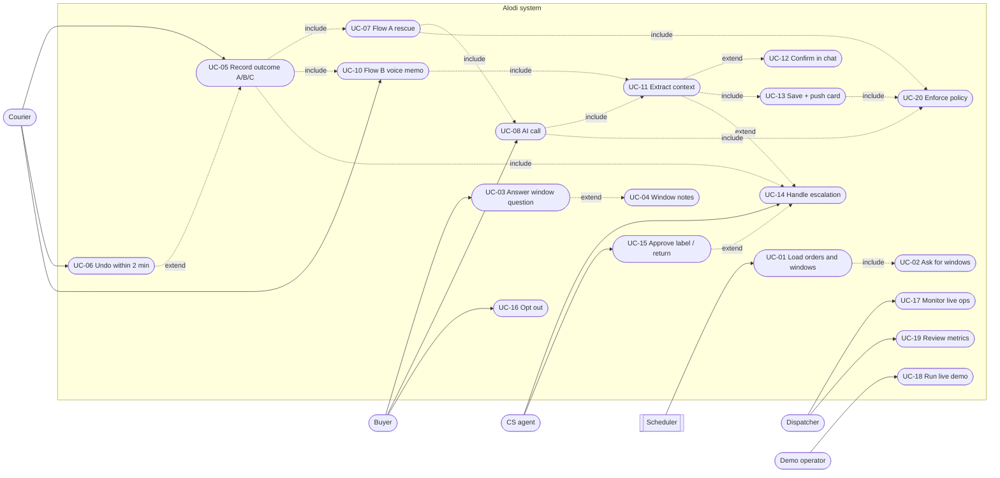

Mermaid has no native UML use case diagram: actors are rounded nodes, use cases are stadiums, `include` and `extend` are dashed arrows.

---

# Part B — System design

## 11. Domain model — class diagram

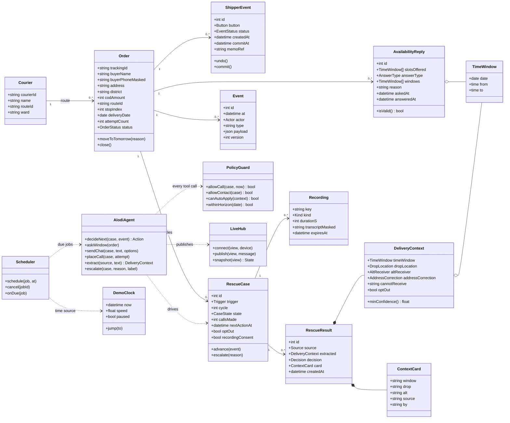

Enumerations: `OrderStatus` {scheduled, out_for_delivery, delivered, moved, with_cs, labelled} · `AnswerType` {windows, cannot_today, no_reply} · `Button` {A, B, C, DELIVERED} · `EventStatus` {pending, committed, undone} · `Trigger` {NO_ANSWER, RESCHEDULE, REFUSED} · `Source` {chat, ai_call, shipper_memo, cs} · `Decision` {auto_applied, needs_review, escalated_cs, cs_applied} · `Actor` {agent, buyer, courier, cs, system} · `Kind` {call, memo}.

## 12. Data model — ERD and tables

Demo: SQLite (one file). Production: PostgreSQL. Same tables; JSON columns become `JSONB`.

### 12.1 ERD

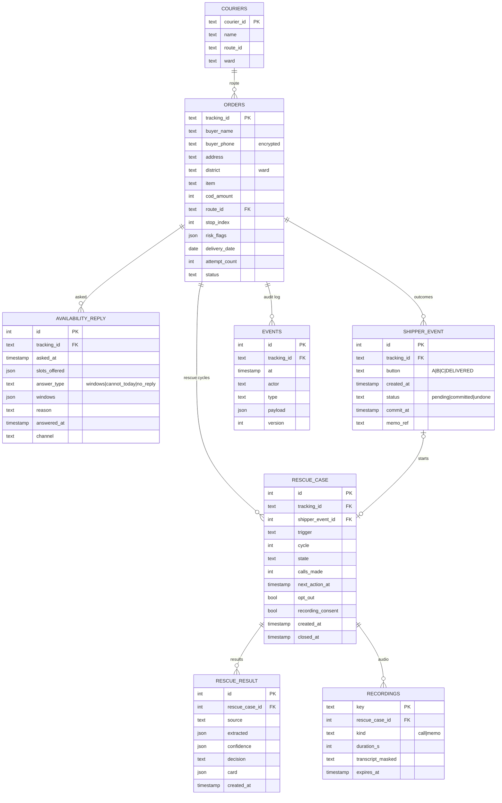

### 12.2 Tables

#### `couriers` (seed in the demo, SPX staff directory in production)

| Column | Type | Notes |
| --- | --- | --- |
| `courier_id` | text PK | `C01` … `C20` |
| `name` | text | |
| `route_id` | text | `HCM-BTH-R01` … `R20` |
| `ward` | text | Main ward served |

#### `orders` (seed in the demo, mirror of the SPX OMS in production)

| Column | Type | Notes |
| --- | --- | --- |
| `tracking_id` | text PK | e.g. `SPXVN0123456789` |
| `buyer_name` | text | |
| `buyer_phone` | text | encrypted at rest; shown masked everywhere (`0912 *** 678`); demo uses `TEST-0001` … |
| `address` | text | |
| `district` | text | the ward (HCMC has no district level since 1 Jul 2025) |
| `item` | text | |
| `cod_amount` | integer | VND, 0 if prepaid |
| `route_id` | text | e.g. `HCM-BTH-R07` |
| `stop_index` | integer | position in today’s route (1–200) |
| `risk_flags` | json | e.g. `["high_cod","failed_before"]` |
| `delivery_date` | date | |
| `attempt_count` | integer | attempts so far (for the 2-redelivery rule) |
| `status` | text | `scheduled · out_for_delivery · delivered · moved · with_cs · labelled` |

#### `availability_reply` (steps 2–3)

| Column | Type | Notes |
| --- | --- | --- |
| `id` | integer PK | |
| `tracking_id` | text FK | |
| `asked_at` | timestamp | |
| `slots_offered` | json | route-planner windows; demo: `["08:00/10:00","10:00/12:00","14:00/17:00","17:00/20:00"]` |
| `answer_type` | text | `windows · cannot_today · no_reply` |
| `windows` | json | windows picked (≥ 2) |
| `reason` | text | when `cannot_today` |
| `answered_at` | timestamp | null if no reply |
| `channel` | text | `shopee_chat · zalo` |

#### `shipper_event` (step 4, the tap)

| Column | Type | Notes |
| --- | --- | --- |
| `id` | integer PK | |
| `tracking_id` | text FK | |
| `button` | text | `A` no answer · `B` answered, rescheduled · `C` refused · `DELIVERED` |
| `created_at` | timestamp | |
| `status` | text | `pending` (undo window) · `committed` · `undone` |
| `commit_at` | timestamp | `created_at + 2 min` |
| `memo_ref` | text | key of the voice memo for B |

#### `rescue_case` (one per failed attempt that enters a rescue cycle)

| Column | Type | Notes |
| --- | --- | --- |
| `id` | integer PK | |
| `tracking_id` | text FK | |
| `shipper_event_id` | integer FK | the tap that started it |
| `trigger` | text | `NO_ANSWER · RESCHEDULE · REFUSED` |
| `cycle` | integer | 1–2 |
| `state` | text | state from §13 |
| `calls_made` | integer | ≤ 2 |
| `next_action_at` | timestamp | next scheduled job |
| `opt_out` | boolean | buyer said “stop” |
| `recording_consent` | boolean / null | |
| `created_at`, `closed_at` | timestamp | |

#### `rescue_result` (step 7)

| Column | Type | Notes |
| --- | --- | --- |
| `id` | integer PK | |
| `rescue_case_id` | integer FK | |
| `source` | text | `chat · ai_call · shipper_memo · cs` |
| `extracted` | json | §12.4 |
| `confidence` | json | per field |
| `decision` | text | `auto_applied · needs_review · escalated_cs · cs_applied` |
| `card` | json | §12.5 |
| `created_at` | timestamp | |

#### `events` (append-only audit and metrics log)

| Column | Type | Notes |
| --- | --- | --- |
| `id` | integer PK | |
| `tracking_id` | text | |
| `at` | timestamp | demo clock time |
| `actor` | text | `agent · buyer · courier · cs · system` |
| `type` | text | `orders_loaded · slots_sent · reply · note_pushed · event_pending · event_undone · event_committed · chat_sent · call_1 · call_2 · call_cancelled · transcript · extracted · confirm_asked · card_pushed · policy_block · escalated · cs_decision · delivered · opt_out` |
| `payload` | json | details, durations, confidences |
| `version` | integer | order-context version after this event |

Every metric in §23 is computed from `events`.

#### `recordings` (metadata; files live in a folder or object storage)

| Column | Type | Notes |
| --- | --- | --- |
| `key` | text PK | file path or object key |
| `rescue_case_id` | integer FK | |
| `kind` | text | `call · memo` |
| `duration_s` | integer | |
| `transcript_masked` | text | PII-masked transcript |
| `expires_at` | timestamp | created + 30 days |

### 12.3 Order Context Object (what the agent reasons over and the dashboard shows)

```json
{
  "tracking_id": "SPXVN0123456789",
  "version": 3,
  "trigger": "NO_ANSWER",
  "rescue_cycle": 1,
  "delivery_attempt": 1,
  "channel": "ai_call",
  "contact_log": [
    { "at": "2026-10-31T10:04:00+07:00", "type": "chat_sent" },
    { "at": "2026-10-31T11:04:00+07:00", "type": "call_1", "result": "answered", "duration_s": 74 }
  ],
  "slots_offered": ["08:00/10:00", "10:00/12:00", "14:00/17:00", "17:00/20:00"],
  "extracted": {
    "time_window": { "date": "2026-11-01", "from": "17:00", "to": "20:00" },
    "drop_location": { "type": "security_desk", "note": "Tower B security" },
    "alt_receiver": { "relation": "wife", "phone_masked": "0903 *** 214" },
    "address_correction": null
  },
  "confidence": { "time_window": 0.94, "drop_location": 0.88, "alt_receiver": 0.91 },
  "decision": "auto_applied",
  "consent": { "recording": true, "opt_out": false },
  "raw_ref": "conv_8f21a",
  "updated_by": "agent"
}
```

| Field | Values |
| --- | --- |
| `trigger` | `PRE_DELIVERY · NO_ANSWER · RESCHEDULE · REFUSED` |
| `channel` | `chat_shopee · zalo · ai_call · shipper_memo` |
| `decision` | `pending · auto_applied · needs_review · escalated_cs · cs_applied` |
| `updated_by` | `agent · buyer · courier · cs · system` |
| `raw_ref` | pointer to the raw audio or transcript in the trusted store, never the content |

### 12.4 Extraction schema (Structured Outputs, strict)

```json
{
  "name": "delivery_context",
  "strict": true,
  "schema": {
    "type": "object",
    "additionalProperties": false,
    "required": ["time_window", "drop_location", "alt_receiver", "address_correction", "cannot_receive", "opt_out"],
    "properties": {
      "time_window": {
        "type": ["object", "null"],
        "additionalProperties": false,
        "required": ["date", "from", "to", "confidence"],
        "properties": {
          "date": { "type": "string", "description": "YYYY-MM-DD, within 5 days" },
          "from": { "type": "string", "description": "HH:MM" },
          "to": { "type": "string", "description": "HH:MM" },
          "confidence": { "type": "number" }
        }
      },
      "drop_location": {
        "type": ["object", "null"],
        "additionalProperties": false,
        "required": ["type", "note", "confidence"],
        "properties": {
          "type": { "type": "string", "enum": ["hand_to_buyer", "security_desk", "reception", "neighbour", "locker", "other"] },
          "note": { "type": "string" },
          "confidence": { "type": "number" }
        }
      },
      "alt_receiver": {
        "type": ["object", "null"],
        "additionalProperties": false,
        "required": ["relation", "phone_masked", "confidence"],
        "properties": {
          "relation": { "type": "string" },
          "phone_masked": { "type": "string" },
          "confidence": { "type": "number" }
        }
      },
      "address_correction": {
        "type": ["object", "null"],
        "additionalProperties": false,
        "required": ["text", "same_district", "confidence"],
        "properties": {
          "text": { "type": "string" },
          "same_district": { "type": "boolean" },
          "confidence": { "type": "number" }
        }
      },
      "cannot_receive": {
        "type": ["object", "null"],
        "additionalProperties": false,
        "required": ["reason"],
        "properties": { "reason": { "type": "string" } }
      },
      "opt_out": { "type": "boolean" }
    }
  }
}
```

**Normalisation rules** (used for the gold labels in §20.7): “after HH” → HH:00–20:00 · “before HH” → 08:00–HH:00 · “morning” → 08:00–12:00 · “afternoon” → 14:00–17:00 · “evening / tonight” → 17:00–20:00 (or “after HH” if a time is given) · a corrected answer (“… actually, evening”) keeps only the last value · relative dates resolve against the demo date (Sat 31 Oct 2026).

**Decision rule.** Every non-null field with `confidence ≥ 0.85` and no conflict with earlier answers → `auto_applied`; otherwise ask the buyer in chat; still unclear → `needs_review` (CS). An address correction with `same_district = false` always needs a person.

### 12.5 Context card (pushed to the courier)

```json
{
  "tracking_id": "SPXVN0123456789",
  "window": "Sun 1 Nov, 17:00–20:00",
  "drop": "Tower B security desk",
  "alt": "Wife · 0903 *** 214",
  "source": "AI call 1 · 11:04",
  "by": "agent"
}
```

## 13. State machine

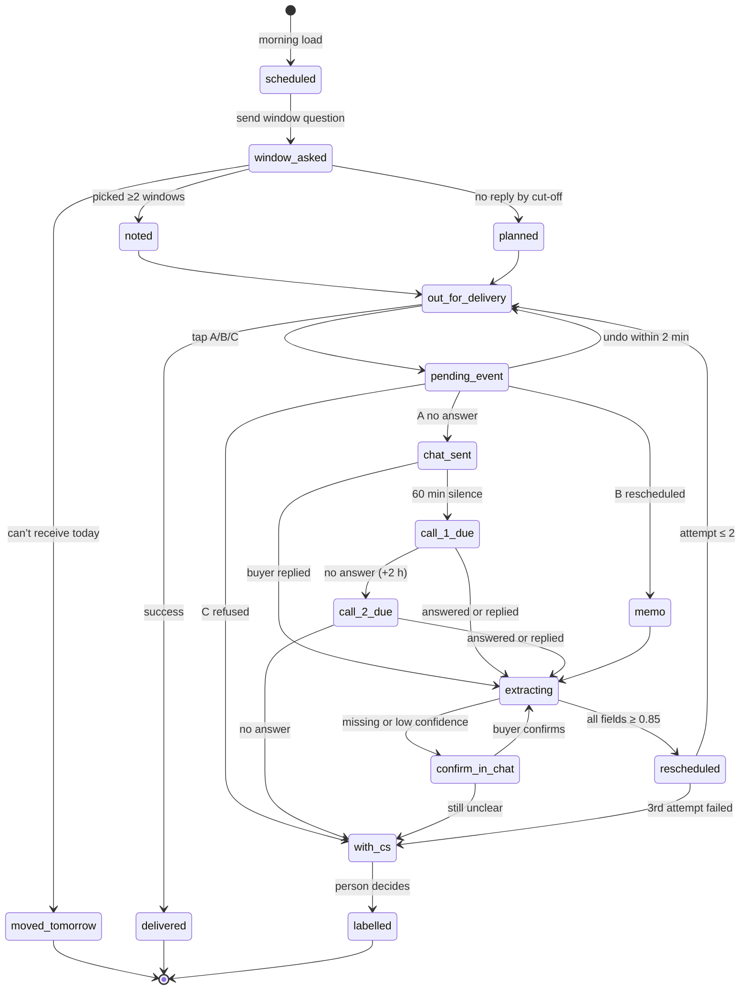

Any state with pending contact also has an implicit transition to `planned` (no further contact) when `opt_out` becomes true.

## 14. Sequence diagrams

### 14.1 Morning window question (steps 1–3)

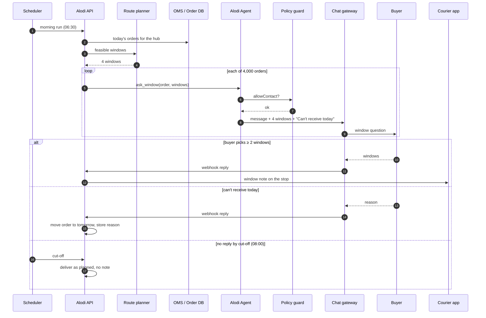

### 14.2 Flow A — no answer, rescued by an AI call (steps 4, 5, 7)

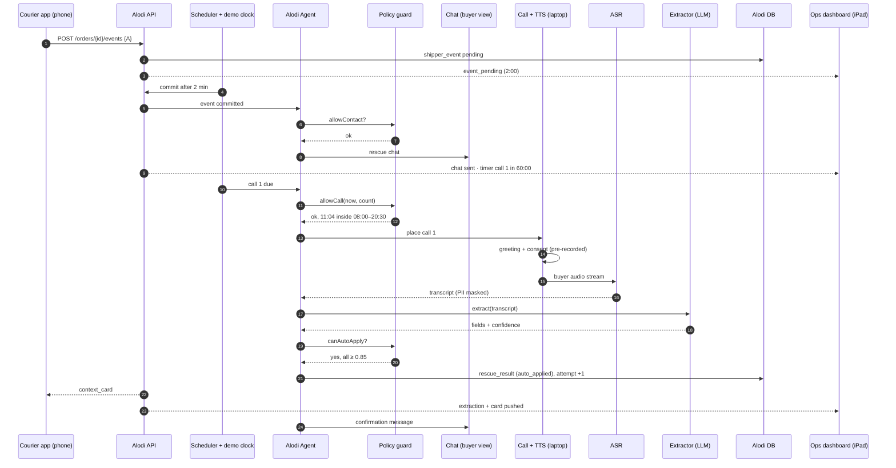

### 14.3 Flow A — buyer replies mid-way, pending call cancelled

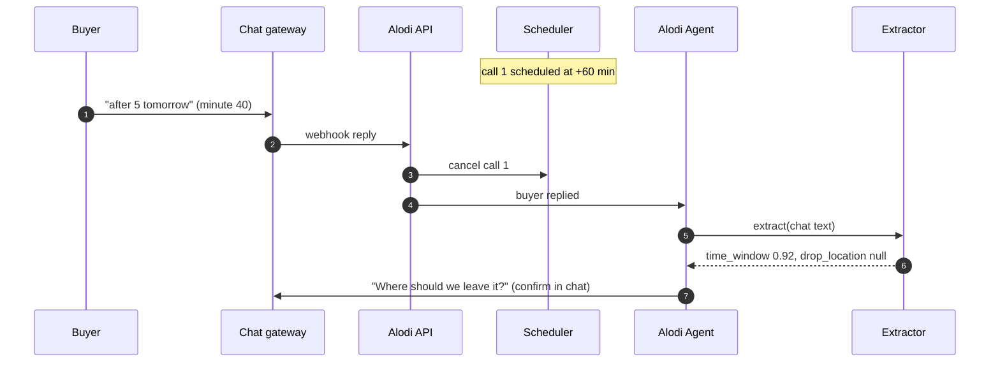

### 14.4 Flow B — voice memo

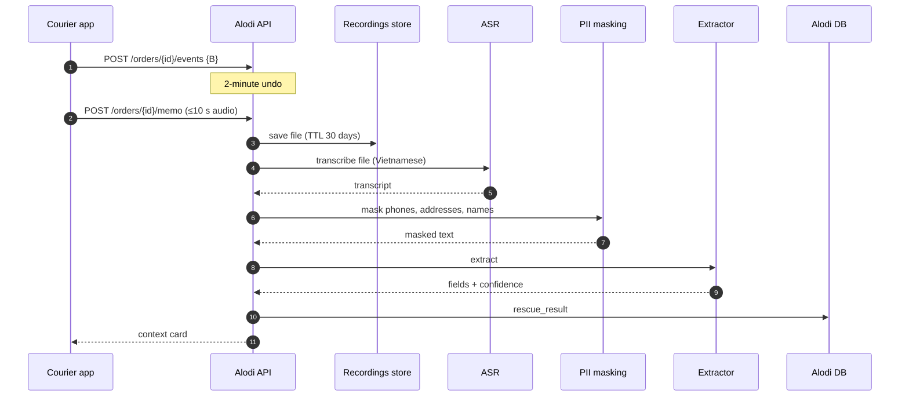

### 14.5 Refused → CS (steps 4 → 8)

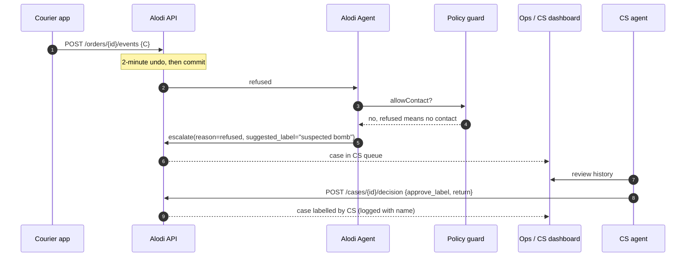

### 14.6 Three devices staying in sync

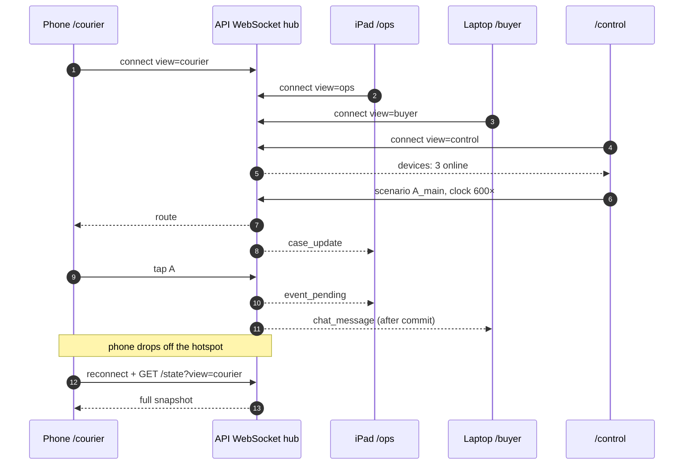

## 15. API and interfaces

FastAPI service (`api`), JSON over HTTPS, plus WebSockets for live updates. All times ISO-8601 with `+07:00`. In the demo, “now” is the demo clock.

### 15.1 REST

| Method | Path | Caller | Purpose |
| --- | --- | --- | --- |
| `POST` | `/jobs/morning-load` | scheduler | Step 1: load today’s orders + windows for a hub |
| `GET` | `/orders?route_id=&date=` | courier app, dashboard | Today’s stops with any window note or context card |
| `GET` | `/orders/{tracking_id}` | dashboard | Order + Order Context Object + events |
| `POST` | `/orders/{tracking_id}/events` | courier app | `{ "button": "A" \| "B" \| "C" \| "DELIVERED" }` → `pending` event (2-min undo) |
| `POST` | `/events/{id}/undo` | courier app | Undo within 2 minutes |
| `POST` | `/orders/{tracking_id}/memo` | courier app | 10-second memo (multipart; `audio/mp4` from iPhone Safari, `audio/webm` from Chrome/Android) |
| `POST` | `/webhooks/chat` | chat gateway | Buyer reply: free text or quick-reply payload |
| `POST` | `/webhooks/call` | call gateway | Call status, audio or transcript chunks, end of call |
| `GET` | `/cases?state=review,with_cs` | dashboard | CS queue |
| `POST` | `/cases/{id}/decision` | dashboard (CS) | `{ "action": "apply" \| "approve_label" \| "return" \| "claim", "payload": {…}, "by": "cs:lan" }` |
| `GET` | `/metrics` | dashboard | The four output metrics from `events` |
| `GET` | `/state?view=courier\|ops\|buyer\|control` | every device | Full snapshot for that screen, on load and after every reconnect |
| `GET` / `POST` | `/demo/clock` | `/control` | Read or set the clock: `{ "speed": 600, "paused": false }`, `{ "jump": "next_timer" \| "2026-11-01T17:20" }` |
| `POST` | `/demo/scenario` | `/control` | Reset DB + clock to a scenario: `A_main · B_memo · REFUSE · A_lowconf · A_noanswer · A_midway · CANT_TODAY` |
| `POST` | `/demo/simulate` | `/control` | `{ "speed": 600 }` — replay `mock-data/day-plan.json` so hub counters move like a real day |
| `POST` | `/demo/mode` | `/control` | `{ "auto_buyer": true, "offline": false }` |
| `GET` | `/demo/devices` | `/control` | Connected devices and last ping per view |

Example — courier taps A:

```http
POST /orders/SPXVN0123456789/events
{ "button": "A", "at": "2026-10-31T10:02:00+07:00" }

201 Created
{ "event_id": 41, "status": "pending", "commit_at": "2026-10-31T10:04:00+07:00" }
```

### 15.2 WebSocket — `/ws?view=courier|ops|buyer|control&device=<id>`

One socket per device. The server sends only what that view needs, plus `clock` ticks to everyone. Clients send `{ "type": "ping" }` every 5 s; on reconnect they call `GET /state` and replay nothing.

| View | Receives |
| --- | --- |
| `courier` (phone) | `route`, `note`, `event_pending`, `event_committed`, `context_card`, `clock` |
| `ops` (iPad) | everything: `case_update`, `timer`, `policy_check`, `chat_message`, `call_state`, `transcript`, `extraction`, `context_card`, `case_escalated`, `clock` |
| `buyer` (laptop) | `chat_message`, `call_state`, `clock` |
| `control` | `devices`, `clock`, `case_update` |

Server → client messages:

```json
{ "type": "event_pending", "tracking_id": "…", "button": "A", "commit_at": "2026-10-31T10:04:00+07:00" }
{ "type": "event_committed", "tracking_id": "…", "button": "A" }
{ "type": "chat_message", "tracking_id": "…", "from": "agent", "text": "…", "options": ["08:00–10:00", "10:00–12:00", "14:00–17:00", "17:00–20:00", "Can’t receive today"] }
{ "type": "call_state", "tracking_id": "…", "attempt": 1, "status": "ringing|connected|ended|missed", "line": { "who": "ai", "text": "…" } }
{ "type": "transcript", "tracking_id": "…", "who": "buyer", "text": "…", "final": true }
{ "type": "extraction", "tracking_id": "…", "fields": [ { "key": "time_window", "value": "…", "confidence": 0.94 } ], "decision": "auto_applied" }
{ "type": "context_card", "tracking_id": "…", "card": { "window": "…", "drop": "…", "alt": "…" } }
{ "type": "case_escalated", "tracking_id": "…", "reason": "two_calls_unanswered" }
{ "type": "timer", "tracking_id": "…", "label": "AI call 1", "due": "2026-10-31T11:04:00+07:00" }
{ "type": "policy_check", "tracking_id": "…", "rule": "call_hours", "ok": true, "detail": "11:04 inside 08:00–20:30" }
{ "type": "clock", "now": "2026-10-31T11:04:00+07:00", "speed": 600 }
```

Client → server: `{ "type": "ping" }`, `{ "type": "action", "name": "tap", "tracking_id": "…", "button": "A" }`, `{ "type": "action", "name": "reply", "tracking_id": "…", "text": "…" }`, `{ "type": "action", "name": "cs_decision", … }`. REST and socket actions call the same handlers.

### 15.3 Call audio socket — `/ws/call?case={tracking_id}` (laptop ↔ API)

| Direction | Frames |
| --- | --- |
| laptop → API | binary PCM16 mono 16 kHz, 20 ms frames from the buyer’s mic; JSON `{ "type": "answer" \| "decline" \| "hangup" }` |
| API → laptop | binary PCM16 mono 24 kHz chunks (OpenAI TTS) or a pre-recorded phrase; JSON `{ "type": "line", "who": "ai", "text": "…" }`, `{ "type": "end" }` |

The API forwards mic frames to the ASR, gives final transcripts to the agent and pushes `transcript` messages to the iPad.

### 15.4 Agent tools (LLM function calling)

| Tool | Arguments | Returns |
| --- | --- | --- |
| `ask_window` | `tracking_id`, `slots[]` (from the route planner) | message id |
| `send_chat` | `tracking_id`, `text`, `options[]?` | message id |
| `place_call` | `tracking_id`, `attempt` (1–2), `script` (fixed opener + dynamic questions) | call id |
| `extract` | `source` (`chat` · `call` · `memo`), `text` (PII-masked) | `delivery_context` (§12.4) |
| `escalate` | `tracking_id`, `reason`, `suggested_label?` | case id |

The policy guard wraps every tool call: a call outside 08:00–20:30, a third call, or any contact after opt-out or refusal is rejected and logged as `policy_block`.

### 15.5 External interfaces (production)

| Interface | Direction | Notes |
| --- | --- | --- |
| SPX order API | SPX → Alodi | Today’s orders per hub; to be agreed with the carrier |
| SPX routing API | SPX ↔ Alodi | Feasible windows; route updates for moved orders |
| Courier app SDK / deep link | Alodi ↔ SPX driver app | Taps, memo upload, card display |
| Shopee Chat API | Alodi ↔ Shopee | Window question, rescue chat, replies by webhook |
| Zalo ZNS | Alodi → Zalo | Approved templates; fallback channel |
| SIP trunk with brand name | Alodi ↔ telco | Outbound AI calls, call-backs to the hotline |
| CS ticketing | Alodi → SPX CS | Escalated cases and decisions |

---

# Part C — Architecture

## 16. System architecture

### 16.1 Reference diagram (eight steps, demo vs production)

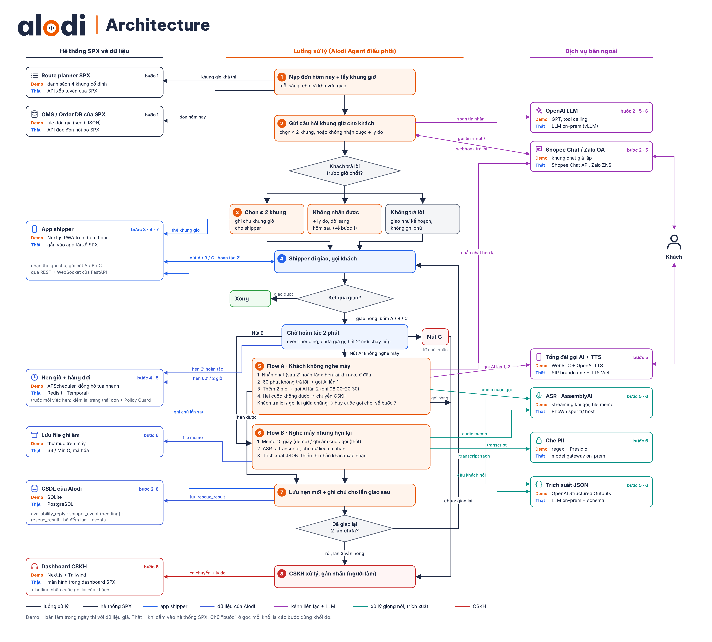

**How to read it.** Three columns: **SPX systems and data** (left), **the processing flow run by the Alodi Agent** (centre, steps 1–8), **external services** (right). Each component has two lines: **Demo** = what we build for competition day on mock data; **Production** = what it becomes inside SPX. The “step” tag in a box’s corner says which flow steps use it.

| Edge colour | Meaning |
| --- | --- |
| Dark navy | Processing flow, SPX systems |
| Blue | Courier app and Alodi data |
| Purple | Contact channels + LLM |
| Teal | Speech processing, extraction |
| Red | Customer service |

### 16.2 Principles

1. **One agent, many tools.** A single Alodi Agent runs a state machine per order and calls tools (ask for a window, send chat, AI call, extract, escalate). The policy guard is code, not a model.
2. **Replace nothing.** Alodi reads SPX orders, routes and courier events and writes context back. Windows come from the route planner, so the agent never promises what dispatch can’t keep.
3. **People own high-stakes decisions.** Refusals, labels, returns and ambiguous answers go to CS.
4. **Every scheduled action re-checks the world.** Before any timer fires, the job reloads the order and runs the policy guard.
5. **PII stays in.** Raw audio and transcripts are stored encrypted with a 30-day TTL; only masked text reaches an LLM; only extracted JSON leaves.
6. **Same shape in demo and production.** Implementations swap behind the same interfaces (cloud API → self-hosted model, SQLite → PostgreSQL, demo scheduler → Temporal).
7. **Fail open.** If Alodi is down, the courier app and CS work exactly as they do today; Alodi only adds context.

### 16.3 Components — demo vs production

#### SPX systems and data (left column)

| Component | Steps | Demo | Production | Notes |
| --- | --- | --- | --- | --- |
| **Route planner SPX** | 1 | `mock-data/windows.json` (4 fixed windows) | SPX routing API | Feasible windows |
| **OMS / Order DB SPX** | 1 | `mock-data/orders.json` (4,000 orders) | SPX internal order API | Today’s orders, COD, address |
| **Courier app** | 3 · 4 · 7 | Next.js PWA on a **real phone** (`/courier`) | Inside the SPX driver app | Gets the note card; sends A / B / C (undo 2′) via REST + WebSocket |
| **Timers + job queue** | 4 · 5 | In-process scheduler on the fast-forward demo clock | Redis + Temporal (durable timers) | Before every job: reload order + policy guard |
| **Recording storage** | 6 | `data/recordings/` on the server | Object storage (S3 / MinIO), encrypted | Memo and call audio, 30-day TTL |
| **Alodi database** | 2–8 | SQLite | PostgreSQL (HA) | Tables in §12 |
| **CS dashboard** | 8 | Next.js on the **iPad** (`/ops`) | A screen inside the SPX dashboard | Escalations with reason; hotline takes call-backs |

#### Alodi Agent (centre)

| Part | Responsibility |
| --- | --- |
| **Agent loop (the brain)** | Per-order state machine + LLM tool calling; decides the next step from the state and the latest event |
| **Tool · ask for a window** | Step-2 message from route-planner windows; ≥ 2 options as quick-reply buttons |
| **Tool · send chat** | Sends and receives through the chat gateway |
| **Tool · AI call** | Places the call (max 2 per cycle); pre-recorded fixed phrases + TTS for dynamic parts; ASR on the buyer’s speech |
| **Tool · extract** | Transcript or chat → JSON with per-field confidence (strict schema) |
| **Tool · escalate** | Opens a CS case with a reason and an optional suggested label |
| **Policy guard** | Call hours 08:00–20:30, ≤ 2 calls per cycle, ≤ 2 redeliveries, 5-day horizon, opt-out, recording consent, 0.85 threshold, refused → no contact, human approval for labels |

#### External services (right column)

| Service | Steps | Demo | Production |
| --- | --- | --- | --- |
| **LLM** | 2 · 5 · 6 | OpenAI API: tool calling | Self-hosted open-weight LLM served with vLLM (cloud API with masked text as fallback) |
| **Shopee Chat / Zalo OA** | 2 · 5 | Simulated chat on the **laptop** (`/buyer`) | Shopee Chat API; Zalo ZNS with approved templates |
| **AI call + TTS** | 5 | In-browser call on the laptop + OpenAI TTS | SIP trunk with a verified brand name + Vietnamese TTS |
| **ASR** | 5 · 6 | AssemblyAI streaming for the English stage call; Vietnamese file transcription for memos | PhoWhisper (VinAI), self-hosted |
| **PII masking** | 6 | Regex + Presidio | Model gateway, in the trusted zone |
| **JSON extraction** | 5 · 6 | OpenAI Structured Outputs | Self-hosted LLM + the same schema |

**Language note (found during research).** AssemblyAI’s real-time model does not list Vietnamese: its multilingual streaming covers English, Spanish, French, German, Italian and Portuguese. The stage call is in English, so it works for the demo. For Vietnamese calls use turn-by-turn file transcription (AssemblyAI pre-recorded or OpenAI transcription, both accept Vietnamese) or PhoWhisper in production.

### 16.4 Container view

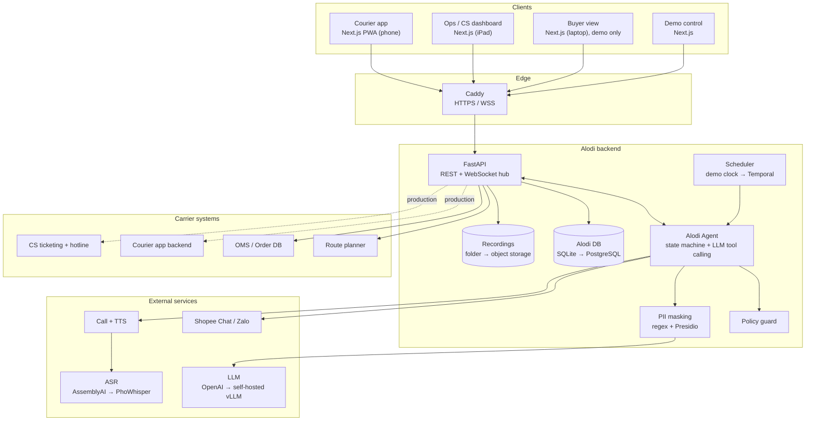

### 16.5 Environments

| Environment | Topology |
| --- | --- |
| **Demo (31 Oct)** | One VM, Docker Compose: `caddy` (HTTPS/WSS), `web` (Next.js), `api` (FastAPI + agent + scheduler + demo clock), SQLite, recordings folder; OpenAI + AssemblyAI; three devices on a 4G hotspot — §19 |
| **Pilot (shadow mode)** | §18 option 1 in Vietnam; agent runs on real events but never contacts buyers; its decisions are logged next to CS decisions |
| **Production** | §18: Kubernetes per region, PostgreSQL HA, Redis + Temporal, object storage, GPU pool (vLLM, PhoWhisper, TTS), model gateway, SIP trunk, Shopee Chat API, Zalo ZNS |

### 16.6 Security and privacy (all environments)

- Recording consent in the pre-recorded opening of every call; refusal ends the call and continues by chat or CS.
- Phone numbers, addresses and names masked before any LLM call; raw audio and transcripts encrypted with a 30-day TTL.
- Every write to an order’s context is versioned with an actor (agent, buyer, courier, CS) and a timestamp.
- Opt-out checked before every job.
- No real number is dialled in the demo; demo phones are `TEST-0001` … `TEST-2000`.

## 17. Data flow

### 17.1 Context diagram (DFD level 0)

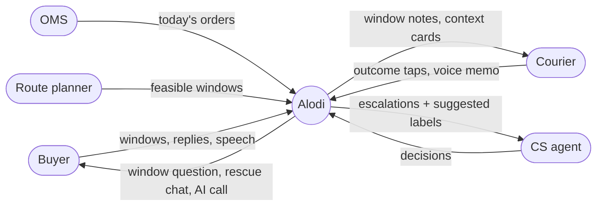

### 17.2 DFD level 1

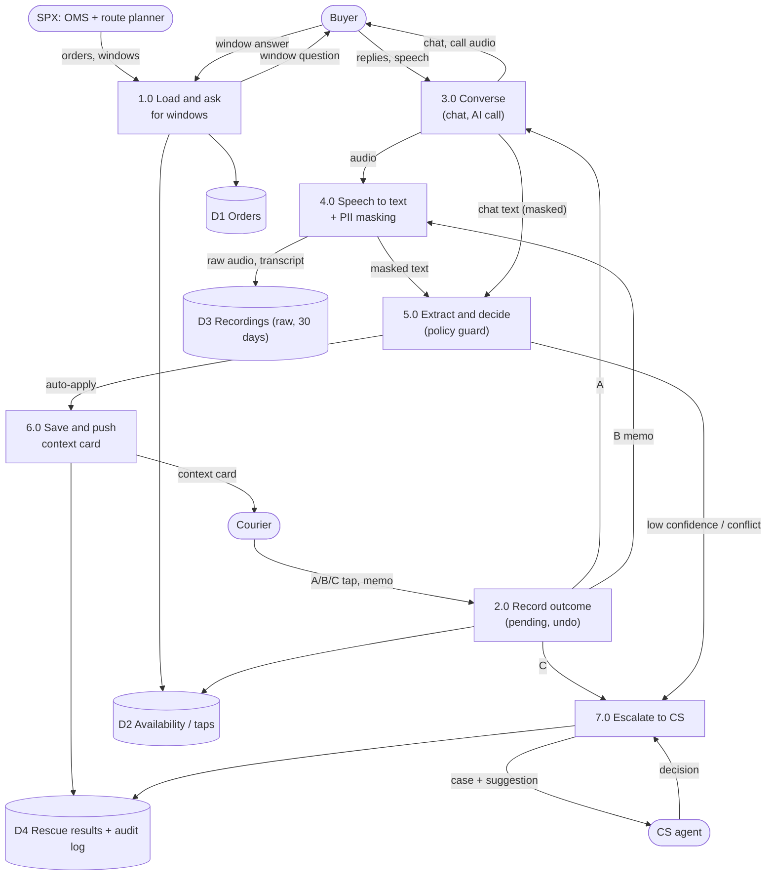

### 17.3 Data classification and retention

| Data | Class | Where | Retention | Leaves the trusted zone? |
| --- | --- | --- | --- | --- |
| Buyer phone, name, address | Personal | `orders` (phone encrypted) | Carrier policy | Masked only |
| Raw call and memo audio | Personal, sensitive | Recordings store | 30 days | No |
| Raw transcript | Personal | Recordings store | 30 days | No |
| Masked transcript | Pseudonymised | `recordings.transcript_masked` | 30 days | To the LLM (demo: cloud; production: self-hosted) |
| Extracted JSON, context card | Operational | `rescue_result` | Order lifetime | Yes, to the courier app and SPX |
| Event log | Operational | `events` | Kept for metrics (monthly partitions) | Aggregates only |

## 18. Production architecture on cloud

Sized for the team’s estimate of **one area (hub) = 20 couriers and 4,000 orders a day**, and checked for growth to **100 areas (400,000 orders a day)**. Prices and the cost model are in §18.8.

### 18.1 Load model

Daily numbers for one area come from the mock simulation (§20.4, fixed seed); the 100-area column multiplies them.

| Quantity | One area / day | 100 areas / day | Peak to design for |
| --- | --- | --- | --- |
| Orders | 4,000 | 400,000 | Morning load of 4,000 orders per area in < 1 min |
| Window questions sent | 3,993 (all orders) or ~550 (risky orders only, FR-08) | ~399,300 | 06:30–07:00 → ~2.2 msg/s per area, ~220 msg/s total (gateway quota) |
| Buyer replies in the morning | 1,633 | ~163,300 | ~2 replies/s total |
| Messages sent (all kinds) | 6,110 | ~611,000 | |
| Courier taps | ~4,150 | ~415,000 | 20 couriers × 1 stop per ~3.3 min → ~6/min per area, ~600/min total |
| Failed first attempts (rescue cases) | 350 (9.2%) | ~35,000 | |
| AI calls placed / answered | 187 / 67 | ~18,700 / ~6,700 | Busiest hour ≈ 15% of calls → ~60–90 concurrent calls total |
| Answered call minutes | ~89 | ~8,900 | 100 ASR streams + 100 SIP channels |
| Voice memos | 91 (678 s) | ~9,100 | |
| LLM requests (agent + extraction) | ~2,400 | ~240,000 | ~20 req/s peak at 100 areas |
| Rows in `events` | ~20,000 | ~2,000,000 | ~730M rows a year → partition by month |
| Audio stored (Opus 16 kb/s, 30-day TTL) | ~12 MB/day, ~360 MB live | ~36 GB live | |
| WebSocket connections | ~25 | ~2,500 | |
| CS cases | 116 | ~11,600 | Refused 50 · unreachable 50 · low confidence 16 per area |

One area is a small workload. The design questions are data residency, telephony, cost per case, and growing to many areas without re-architecture, not raw throughput.

### 18.2 Reference deployment

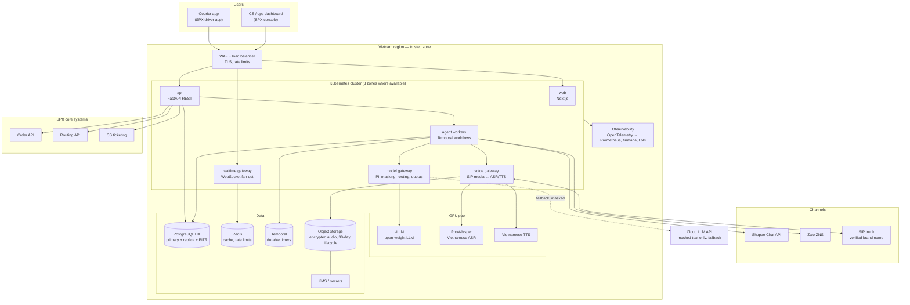

### 18.3 Service catalogue

| Service | What it does | Runs as | Scale unit | One hub | 100 hubs |
| --- | --- | --- | --- | --- | --- |
| `web` | Ops / CS screens (and courier web view if not embedded) | Next.js container | Stateless pods | 2 pods | 3–4 pods |
| `api` | REST, webhooks, auth | FastAPI + Uvicorn | Stateless pods | 2 pods | 4–6 pods |
| `realtime` | WebSocket fan-out per view, `/state` snapshots | FastAPI or a small Go/Node service + Redis pub/sub | Connections | 2 pods | 3 pods |
| `agent-workers` | State machine, tool calls, policy guard | Temporal workers (Python SDK) | Task queue lag | 2 pods | 6–10 pods |
| `voice-gateway` | Bridges SIP media to ASR and TTS, plays fixed phrases, enforces consent | FreeSWITCH or Asterisk + Python media bridge, or the SIP provider’s media-stream API | Concurrent calls | 1 pod | 50 channels |
| `model-gateway` | PII masking, prompt templates, model routing (self-hosted → cloud fallback), cost metering | Python service | Requests/s | shared | shared |
| `vLLM` | LLM for agent decisions and extraction | GPU node | Tokens/s | shared or cloud API | 1–2 GPUs |
| `PhoWhisper` | Vietnamese ASR for calls and memos | GPU node (shared with TTS) | Streams | shared or cloud API | 1 GPU |
| `TTS` | Vietnamese voice for dynamic phrases | GPU or vendor API | Characters/s | vendor API | 1 GPU or vendor |
| PostgreSQL | System of record | Managed or Patroni on VMs | Storage, IOPS | 2 vCPU / 8 GB, 50 GB | 8 vCPU / 32 GB, 1 TB, read replica |
| Redis | Pub/sub, rate limits, idempotency keys | Managed or Sentinel | Memory | 1 GB | 4 GB |
| Temporal | Durable timers and retries (60-min, 2-h, 2-min undo) | Self-hosted on Kubernetes (PostgreSQL persistence) or Temporal Cloud | Workflows | 1 small cluster | same cluster, more history shards |
| Object storage | Audio, eval sets, exports | S3-compatible with SSE-KMS, lifecycle 30 days | GB | < 1 GB | ~20 GB |

### 18.4 Where to host — options

| | Option 1 · **Vietnam public cloud** (recommended for the pilot) | Option 2 · **Carrier private cloud per region** (target at scale) | Option 3 · Singapore public cloud |
| --- | --- | --- | --- |
| Where | A Vietnamese cloud (e.g. Viettel IDC, FPT Cloud, VNG Cloud) or the AWS Hanoi Local Zone | SPX data centres, next to the order and routing systems | AWS / GCP / Azure Singapore |
| PII residency | In Vietnam | In Vietnam | Outside Vietnam → cross-border transfer filing for every flow |
| LLM / ASR | Cloud APIs with masked text first; GPU when volume justifies (FPT AI Factory lists H100 from $2.54/GPU-hour, Vietnam and Japan data centres) | Self-hosted GPU pool | Cloud APIs |
| Pros | Fast to start, compliant residency, managed services vary by vendor | Lowest latency to SPX systems, full control, matches the architecture diagram’s production line | Richest managed services |
| Cons | Fewer managed services than big regions; the AWS Hanoi Local Zone offers EC2, EBS and S3 One Zone-IA but managed databases may need to stay in Singapore (check AWS’s Local Zone service list) | Needs carrier ops team and GPU procurement | Residency and transfer-assessment burden for buyer audio and phone numbers |

Recommendation: **pilot on option 1**, keep raw audio, transcripts and phone numbers in Vietnam, send only masked text to model APIs, and file the transfer impact assessment for that flow. For cost, the recommended production unit is a **local-first server per hub** (§18.8.2): models run on site and the cloud is used only for fallback and backup.

### 18.5 Reliability and disaster recovery

| Concern | Design |
| --- | --- |
| Availability target | 99.9% for courier events and the agent during operating hours (06:00–21:00) |
| Durable timers | Temporal workflows hold every 2-min, 60-min and 2-h timer; a pod or node loss does not lose a timer |
| Idempotency | Every tap, webhook and tool call carries an idempotency key; workers can retry safely |
| Re-check before act | Each timer re-reads the order and runs the policy guard (BR-22), so late or duplicate timers do nothing harmful |
| Database | Primary + synchronous replica in another zone; WAL archived to object storage → **RPO ≤ 5 min**, **RTO ≤ 1 h** |
| Degraded modes | LLM down → template messages + regex extraction, everything goes to CS · SIP down → chat only · Shopee Chat down → Zalo ZNS · Alodi down → couriers and CS work as today (fail open) |
| Releases | Blue-green for `api` and `web`; workflow versioning in Temporal so in-flight cases finish on the old code |
| Backups and drills | Daily snapshot, monthly restore test, quarterly zone-failure game day |

### 18.6 Security and compliance

| Area | Control |
| --- | --- |
| Identity | CS and ops log in with the carrier’s SSO (OIDC); roles: `courier`, `cs`, `ops`, `admin`; courier tokens issued by the driver app |
| Network | Private subnets; only the load balancer is public; service-to-service mTLS; egress allow-list (chat, SIP, model APIs) |
| Encryption | TLS 1.2+ everywhere; KMS envelope encryption for `buyer_phone`, audio and raw transcripts; keys rotated yearly |
| Secrets | Secrets manager or sealed secrets; nothing in images or the browser |
| Audit | `events` is append-only; CS decisions carry the person’s ID; exports to write-once storage |
| PII to models | Model gateway masks phones, house numbers and names before any prompt; prompts and responses logged masked |
| Abuse | Per-buyer contact caps (BR-12, BR-20) enforced in the guard and again at the gateway; rate limits per hub |
| **Vietnam PDPL** | The Personal Data Protection Law (Law 91/2025/QH15) took effect on 1 January 2026. Sending personal data abroad needs a transfer impact assessment filed with the Ministry of Public Security (A05) within 60 days of the transfer. Fines for cross-border violations reach 5% of the previous year’s revenue. Alodi’s default is to keep PII in Vietnam and send only masked text |
| **Cybersecurity data localisation** | Decree 53/2022 can require covered companies to store users’ personal data in Vietnam for at least 24 months; residency in option 1 or 2 avoids the question |
| Telecom | Calls under a registered brand name; recording consent at the start; respect the buyer’s opt-out and call-hour rules (BR-11, BR-20) |
| Assurance | Data protection impact assessment before the pilot; penetration test before production; quarterly access review |

### 18.7 Observability and operations

| Signal | Examples | Tool |
| --- | --- | --- |
| Business | Time-to-context p50/p90, auto-applied share, CS queue size, policy blocks, rescue rate, cost per case | Grafana dashboards from `events` |
| Service | p95 latency per endpoint, WebSocket connections, Temporal task-queue lag, error rate | Prometheus + OpenTelemetry |
| AI | LLM latency and tokens, extraction confidence distribution, ASR word error rate on a weekly sample | Model gateway metrics |
| Logs | Structured JSON, masked, 30-day retention | Loki or OpenSearch |
| Alerts | Morning load not finished by 06:45; queue lag > 60 s; a call outside 08:00–20:30 attempted (must be 0); SIP failure rate > 5% | Alertmanager → on-call |
| Delivery pipeline | GitHub Actions → container registry → Argo CD (GitOps) → staging → production; eval suite (§23) must pass before a prompt or model change ships | |

### 18.8 Cost, loss and savings for one area (estimate)

All numbers come from [`cost-model/cost_model.py`](cost-model/cost_model.py) (`python3 -I cost_model.py`; output in `cost_model_output.json`). One area = 20 couriers, 4,000 orders a day, 30 days a month, ₫26,000 = $1. Prices were checked on 30 October 2026. Every input is typed: **Sourced** (public document) · **Vendor** (company claim) · **Listed price** (shop or provider price list) · **Estimate** (team assumption). Savings are **projected**. The headline uses the **best-in-class** rescue rate published by Shipsy (vendor) until the pilot measures Alodi’s own.

**Headline (best-in-class, local-first):** the area loses **₫473M a month**. Alodi costs **₫75–98M once** and **₫21M a month** to run (4.4% of the loss), and cuts **41% of the loss: ≈ ₫194M a month, ≈ ₫2.3B a year**.

#### 18.8.1 What one area loses today, per month

| Loss item | Formula | Per month | Inputs and sources |
| --- | --- | --- | --- |
| Return fees paid by sellers | 4,000 × 8% failed = 320/day; 75% not rescued = 240/day; × ₫40,000 × 30 | **₫288.0M** | Fee: Shopee Return & Refund Policy §7.1 (Sourced). Fail rate: VECOM 8–12%, low end (Sourced). Rescue 25%: Shipsy industry 20–30% (Vendor) |
| Courier pay for redelivery attempts | 320 × 1.5 extra attempts × ₫6,000–8,000 × 30 | **₫86.4–115.2M** | Pay per order: GHN blog (Sourced, not an official Shopee figure). 1.5 attempts inside Shopee’s 2–3 contact attempts, Help Center 79569 (Estimate) |
| Courier time lost when the buyer doesn’t answer | 320 × 5 min (two calls + waiting) × courier hourly cost × 30 | **₫27.4–51.3M** | Courier income ₫8–15M a month, Glints Vietnam (Sourced, job-market article); 26 days × 9 h; 5 min per failed stop (Estimate) |
| Hub / CS staff calling buyers back | 320 × 2 calls × 4 min × ₫35,000/h × 30 | **₫44.8M** | Calls and minutes: 2 calls × 4 min per failed order, as in §1 (Estimate); ₫35,000/h (Estimate) |
| **Total** | | **₫447–499M a month** (midpoint **₫473M**) | |
| **Per year** | × 12 | **≈ ₫5.7B** | |

At VECOM’s 12% upper rate every line scales by 1.5×: about ₫670–749M a month. Not counted: the seller’s lost sale, packaging, ad spend, damaged goods, and buyers losing COD after three failures (Shopee Help Center 79196).

#### 18.8.2 The optimised setup: local-first, one server per area

Volume per area is small: about 2,400 LLM requests, 100 minutes of speech and 134 call minutes a day. One workstation with two 16 GB GPUs runs all of it, so recurring cloud cost almost disappears.

| Job | Runs on | Model or service | Why |
| --- | --- | --- | --- |
| Agent decisions + extraction | Local GPU 1 | **gpt-oss-20b** (OpenAI open-weight model, runs in ~16 GB with MXFP4), served by vLLM or Ollama | Stays in the OpenAI ecosystem, no per-token cost, buyer text never leaves the area |
| Vietnamese speech to text | Local GPU 2 | **PhoWhisper** (VinAI, open source) | Vietnamese-trained; free; audio stays on the server |
| Assistant voice | Local CPU / GPU 2 + files | Pre-recorded fixed phrases; **Piper** `vi_VN-vais1000-medium` for dynamic text; OpenAI `gpt-4o-mini-tts` for dynamic lines where quality matters | Fixed phrases cost nothing; dynamic lines are short |
| Fallback when the local model is unsure or down | Cloud | OpenAI API (`gpt-5-mini`), masked text only, ~10% of requests | Keeps accuracy up without paying for every request |
| Database, timers, queue, files | Local | PostgreSQL, Redis, Temporal, MinIO in Docker Compose | Same software as the cloud design, one box |
| Off-site backup | AWS | Amazon S3, encrypted nightly dump (~10 GB) | Disaster recovery for about $2 a month |
| Calls | Telco | Viettel Mobile SIP trunk | Domestic rates, local brand name |
| Messages | Zalo | ZNS templates, risky orders only (FR-08) | The only per-message cost left |

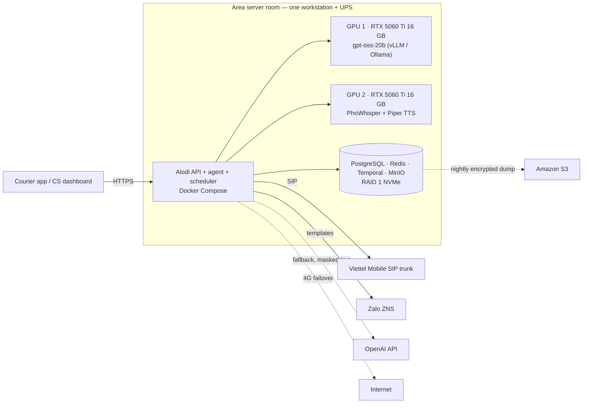

#### 18.8.3 One-time infrastructure per area (not counted in the monthly figures)

| Item | VND | Source |
| --- | --- | --- |
| 2 × NVIDIA RTX 5060 Ti 16 GB | ₫32.8–42.0M | Phong Vu listing: ₫16.4–21.0M each (Listed price) |
| Workstation: 12–16-core CPU, 64 GB RAM, 2 × 2 TB NVMe in RAID 1, 1000 W PSU, case | ₫35–45M | Estimate (memory prices are high in 2026) |
| Online UPS 1.5–2 kVA | ₫5–8M | Estimate |
| 4G/5G failover router | ₫2–3M | Estimate |
| **Total per area** | **₫75–98M** | |

A single RTX 5090 (32 GB) would also work, but it lists at about ₫115–119M in Vietnam (Phong Vu) because of the GDDR7 shortage, so two 16 GB cards are cheaper. The software build (₫0.4–0.6B, once for all areas) is not included either.

#### 18.8.4 Monthly running cost

| Cost item | Per month | Basis and source |
| --- | --- | --- |
| Local models (gpt-oss-20b, PhoWhisper, Piper) | ₫0 | Open weights, run on the area server |
| OpenAI API fallback | ₫0.2M | 10% of 6.0M input + 0.72M output tokens a day at $0.25 / $2.00 per 1M (GPT-5 mini, third-party price lists) |
| OpenAI TTS for dynamic phrases | ₫0.6M | ~52 min a day × ~$0.015/min (gpt-4o-mini-tts, third-party price list) |
| Viettel Mobile SIP trunk | ₫3.2M | ≤ 134 billed min a day × ₫780/min off-net + ₫50,000 a month per line (Viettel reseller price list, 1 s + 1 s billing; confirm a 2026 quote) |
| Zalo ZNS, risky orders only | ₫11.2M | ~1,250 messages a day (547 risky orders + replies + 484 rescue messages) × ₫300 per transactional template (oazns.vn and worldfone price tables; official list at zalo.solutions) |
| Electricity | ₫0.8M | ~350 W average × 24 h × 30 days + UPS loss ≈ 272 kWh × ₫3,000 (EVN business tariff ≈ ₫2,666 normal, ₫5,025 peak) |
| Business fibre with static IP | ₫0.8M | Estimate |
| Off-site backup on Amazon S3 | ₫0.1M | ~10 GB, encrypted |
| Remote operations, 0.1 FTE shared across areas | ₫3.6M | Estimate |
| Hardware upkeep reserve | ₫0.4M | 5% of hardware a year |
| **Total** | **₫20.9M a month** (4.4% of the loss) | |

With the window question sent to **all** 4,000 buyers by ZNS, the total is **₫64.6M** (ZNS alone ₫55.0M). For comparison, the AWS-managed design (EKS, RDS Multi-AZ, Bedrock, Transcribe, Connect, 1-year commitment) costs **₫68.4M** with risky-only messaging, so local-first is about **70% cheaper**.

#### 18.8.5 Savings and the share of the loss cut (excluding one-time setup)

| Saving item (projected) | Conservative | Base | **Best-in-class (headline)** |
| --- | --- | --- | --- |
| Rescue rate after a failed attempt (today 25%) | 40% (+15 pts) | 45% (+20 pts) | **65% (+40 pts)** |
| Return fees avoided | ₫57.6M | ₫76.8M | **₫153.6M** |
| Redelivery attempts avoided (1.5 → 1.35 → 1.2 per failed order) | ₫0 | ₫10.1M | **₫20.2M** |
| Courier door time saved | ₫0 | ₫5.9M | **₫11.8M** |
| CS calls handled by the agent (40% / 60% / 65% of cases) | ₫17.9M | ₫26.9M | **₫29.1M** |
| **Gross saving / month** | ₫75.5M | ₫119.7M | **₫214.7M** |
| Gross as % of the monthly loss (₫473M) | 16.0% | 25.3% | **45.4%** |
| Running cost / month | ₫20.9M | ₫20.9M | **₫20.9M** |
| **Net saving / month** | ₫54.6M | ₫98.8M | **₫193.8M** |
| **Net as % of the monthly loss** | 11.5% | 20.9% | **41.0%** |
| **Net saving / year** | ₫655M | ₫1.19B | **₫2.33B** |
| Infrastructure pays back in | ~7 weeks | ~4 weeks | **~2 weeks** |

Where the best-in-class figure comes from: Shipsy reports an industry-average rescue rate of 20–30% and best-in-class 50–65% (vendor). The headline assumes Alodi reaches the top of that range, 65%. ClickPost reports 15–40% fewer returns with automated outreach (vendor). The theoretical ceiling, where every loss disappears and only the running cost remains, is about 95%. That is not achievable, because refused orders get no contact (BR-07) and some buyers are truly unreachable.

#### 18.8.6 What to say

1. **One area loses about ₫473M a month (≈ ₫5.7B a year)** from failed deliveries: ₫288M of it is return fees, the rest is redelivery, courier time and CS calls.
2. **Alodi costs ₫75–98M once and ₫21M a month (about 4% of what is lost).**
3. **At best-in-class rescue it cuts 41% of the loss: ≈ ₫194M a month, ≈ ₫2.3B a year.** The base case is 21% (≈ ₫99M a month).
4. Local-first is about 70% cheaper to run than the AWS-managed design, because inference was the part that grew with tokens and minutes.
5. All savings are projected until the pilot measures Alodi’s real rescue rate.

#### 18.8.7 Self-hosted models: limits

- **Quality:** gpt-oss-20b and PhoWhisper must pass the same eval (§23) as the cloud models before they replace them; the 10% cloud fallback covers low-confidence cases.
- **Real-time calls:** PhoWhisper is a Whisper-style model, so it transcribes each buyer turn after a short pause rather than word by word. Expect 1–2 s per turn on a 16 GB card.
- **Availability:** one box is a single point of failure. The UPS, RAID 1, 4G failover and nightly S3 backup cover most of it. If the box is down, couriers and CS work as they do today, because Alodi fails open (§16.2).
- **Scale:** at 4,000 orders a day the GPUs are still mostly idle. One server can serve 2–3 nearby areas over the network.

### 18.9 Growing from one hub to many

| Stage | Hubs | What changes |
| --- | --- | --- |
| Pilot | 1 | Local-first server at the hub (§18.8.2), shadow mode; OpenAI API as fallback |
| Region | 5–20 | Hub becomes a tenant key on every table and topic; per-hub config (windows, cut-off, call hours); ZNS throttling to risky orders |
| National | 20–100 | Second region (north / south); GPU pool for vLLM + PhoWhisper (one local-first server can serve 2–3 nearby areas, §18.8.7); monthly partitions on `events`; read replica for dashboards |
| Beyond | 100+ | Shard Temporal namespaces per region; dedicated SIP capacity; in-app VoIP from the driver app instead of the mobile network |

---

# Part D — Live demo

## 19. Live demo

### 19.1 What the judges see

Three real devices on stage, all live and in sync:

- The presenter taps on a **phone**, as the courier.
- The agent runs on the server.
- An **iPad**, the carrier’s ops dashboard, and a **laptop**, the buyer’s phone on the projector, update by themselves.

The demo clock fast-forwards, so 60 minutes pass in about 6 seconds. No real number is ever dialled, and every person, address and phone number is fictional (§20).

What we say if asked “is this real?”:

> “The flow, the rules, the timers and the three screens are live and in sync. The AI runs on cloud APIs and a teammate plays the buyer. In production the models move into the carrier’s own infrastructure, and the channels become Shopee Chat, Zalo and a branded phone line.”

If the fast path (§19.3 B) is used, we add: *“the buyer’s answers and the AI voice are scripted for the demo; the flow, the rules and the sync are what we built.”*

### 19.2 Screens

| Device | Held by | Route | Shows | Inputs |
| --- | --- | --- | --- | --- |
| **Phone** (portrait) | Presenter, as courier Tuan (route R07) | `/courier` | Today’s 200 stops, window notes, **A / B / C** with the 2-minute undo ring, 10-second memo recorder, context card, Delivered | Taps, voice memo |
| **iPad** (landscape, on a stand) | Nobody; a teammate acts as CS when needed | `/ops` | Carrier ops dashboard: hub KPIs (4,000 orders), live case timeline over steps 1–8, agent actions, timers on the demo clock, policy checks, transcript, extracted fields with confidence, card pushed, CS queue with Approve / Claim | Touch, CS actions only |
| **Laptop** (projected) | Teammate, as buyer Minh (headset mic) | `/buyer` | The buyer’s phone in a frame: chat with window buttons, incoming AI call, live transcript line | Taps, typing, **speaking during the call** |
| Laptop, second display | Presenter’s assistant | `/control` | Scenario picker, Reset, clock speed / pause / jump, device dots, QR codes, auto-buyer, offline mode | Clicks, keys |

Screen layout: the projector shows the laptop (buyer). The iPad stands next to the presenter and is mirrored into a corner of the projector (AirPlay or a document camera). The phone can be mirrored the same way for close-ups.

### 19.3 Demo architecture — two ways to build it

#### A. Full build (target): server owns everything

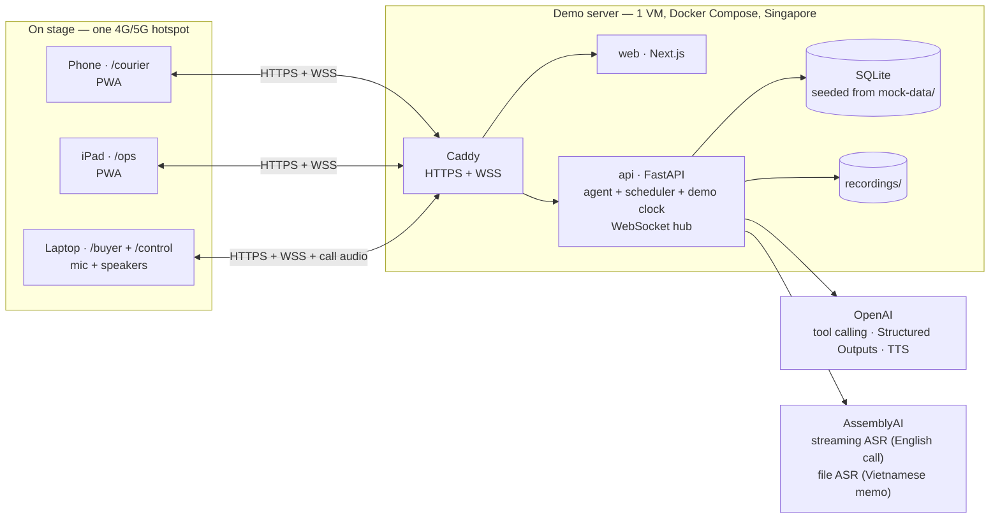

- **The server is the single source of truth.** State, timers and the demo clock live in the API. Devices never talk to each other; every change goes device → API → WebSocket fan-out → all devices.
- **HTTPS is required.** iOS Safari only allows the microphone on a secure origin. Use a real domain with Caddy’s automatic TLS (`demo.alodi.app` in the examples is a placeholder; use any domain you control), never a LAN IP.
- Effort: milestones M0–M16 in §22.3, about 2 weeks for four people.

#### B. Fast path (fits before 31 October): relay the existing demo engine

The current web build already has a complete scenario player (`web/src/lib/demo/engine.ts`). One tab drives and broadcasts the whole state; other tabs render it. Today the transport is `BroadcastChannel`, which only works inside one browser. Swapping it for a **WebSocket relay** makes the same engine run across the three devices with almost no UI risk.

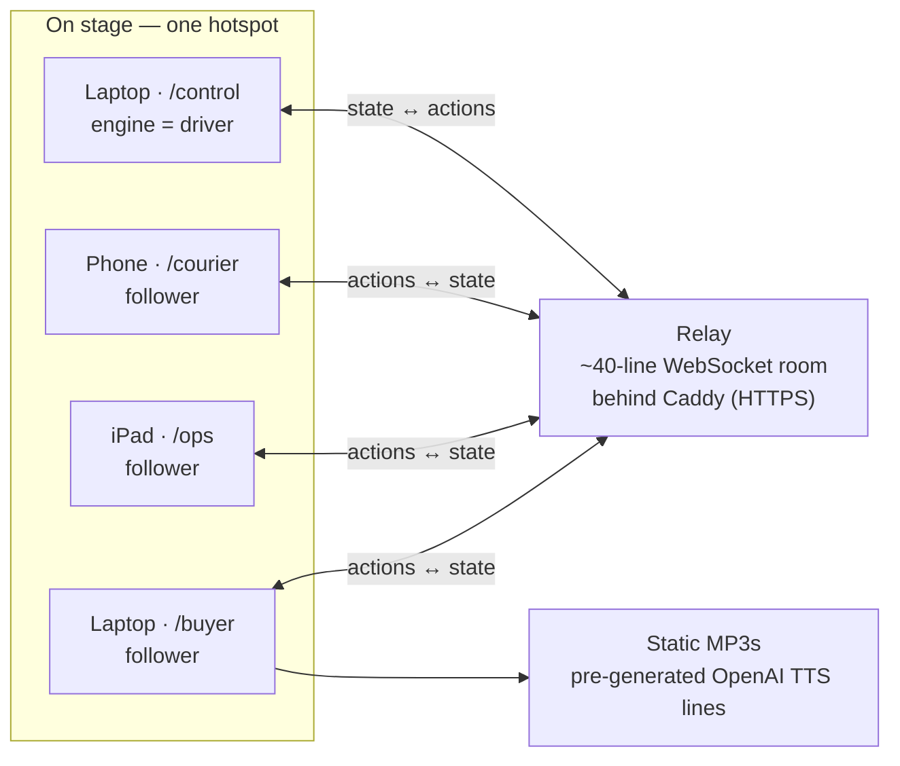

| Step | Work | Est. | Owner |
| --- | --- | --- | --- |
| 1 | Relay server (§21.4 L) on the VM behind Caddy | 2–3 h | Khanh |
| 2 | `RelayChannel` drop-in for `BroadcastChannel` in `engine.ts` (§21.4 L) | 2–3 h | Long Quan |
| 3 | Device routes: `/courier` = existing courier screen full-screen; `/buyer` = existing buyer phone in its frame; `/ops` = dashboard case view laid out for iPad landscape; `/control` = controls + QR | 4–6 h | Nomura + Long Quan |
| 4 | Audio: pre-generate every assistant line with OpenAI TTS into MP3s, played on the laptop instead of `speechSynthesis` | 2 h | Khanh |
| 5 | New-flow details in `scenarios.ts`: 4 windows and ≥ 2 picks, 2-minute undo, mid-way reply cancels the call, redelivery counter, 4,000-order area numbers | 3–4 h | Thanh Loi |
| 6 | Rehearse on the real phone, iPad and laptop over the hotspot | 2 h | all |

**Decision rule:** build B first. Switch `/buyer` to the real call socket (A, M7) only if it works end to end by the evening of 30 October.

### 19.4 Network and hosting on the day

| Item | Setting |
| --- | --- |
| Server | 1 VM (2 vCPU / 4 GB is enough), Singapore region, Ubuntu 24.04, Docker + Compose |
| Domain | `A` record → VM IP; Caddy issues the certificate on first request |
| Hotspot | A dedicated 4G/5G phone hotspot for all three devices, plus a charged spare; never the venue Wi-Fi |
| Latency budget | Hotspot → Singapore round trip < 100 ms; fan-out p95 < 300 ms (NFR-01) |
| Backup | Same build on a teammate’s laptop with a Cloudflare Tunnel, and a recorded video of the full flow |

### 19.5 What each screen shows, step by step (scenario A_main)

| Flow step | Phone (courier) | iPad (ops) | Laptop (buyer) |
| --- | --- | --- | --- |
| 1 · 06:30 load | Route R07 appears (200 stops) | “4,000 orders loaded · 20 couriers · 4 windows from the route planner” | — |
| 2 · window question | — | Case card: “Window question sent” | Chat bubble with **4 window buttons** + “Can’t receive today” |
| — branch | — | Shows the branch: ≥ 2 windows / can’t today / no reply | Buyer ignores the message |
| 08:00 cut-off | — | “No reply · deliver as planned” | — |
| 4 · 10:02 delivery | Presenter taps **A · No answer** on stop 37 | Event **pending** with a 2:00 undo ring | — |
| undo ends | “Alodi is on it” | Pending → committed; chat sent | “We just missed you. When and where should we come back?” |
| 5 · Flow A | Waiting state | Timer “AI call 1 in 60:00” runs on the demo clock; policy check OK · 08:00–20:30 · call 1 of 2 | Silence, then an **incoming call** |
| AI call | — | Live transcript and audio level; “recording consent: yes” | Buyer answers and **speaks**; the AI voice comes from the laptop speakers |
| extraction | — | Fields fill one by one with confidence bars; decision “auto-applied” | Confirmation bubble |
| 7 · save | **Context card** slides in | Card pushed; `rescue_result` saved; attempt 1 of 2 | — |
| next day | Presenter jumps the clock to Sun 17:20 and taps **Delivered** | Case closes; counters update | “Delivered” system message |

Other scenarios on the devices:

| Scenario | Phone | iPad | Laptop |
| --- | --- | --- | --- |
| **B_memo** | Tap B on stop 41 → hold to record 9 s: “She wants tomorrow before ten, leave it at Tower A reception” | Memo → transcript → fields → card | Confirmation message |
| **REFUSE** | Tap C on stop 44 | CS queue: “Refused · suggested label: suspected bomb (not applied)” → teammate taps **Approve return** | Nothing (no contact) |
| **A_lowconf** | Tap A on stop 52 | Fields 0.52 / 0.41 → “confirm in chat” → CS queue | Vague answer; then two window buttons |
| **A_noanswer** | Tap A on stop 58 | Call 1 missed, call 2 missed → escalated to CS | Buyer declines twice |
| **A_midway** | Tap A on stop 63 | Timer running → “pending call 1 cancelled” | Buyer types “after 5 tomorrow” before the call |
| **CANT_TODAY** | Stop 70 disappears from today’s route | “Moved to Mon 2 Nov · reason saved” | Buyer taps “Can’t receive today” + types a reason |

### 19.6 Demo control (`/control`)

| Control | Effect |
| --- | --- |
| Scenario picker | Loads one of the seven scripted cases (§20.5) |
| Reset | Reloads the mock data pack, clears events, clock to Sat 06:28 |
| Clock speed | 1× · 60× · 600× (60 min ≈ 6 s) · pause |
| Jump | “to next timer”, “to Sun 17:20” |
| Auto-buyer | Plays the recorded buyer answer into the pipeline instead of the live mic |
| Offline mode | Replays cached model outputs and TTS files; no network calls to model APIs |
| Device status | Green / red dot per device (socket connected, last ping) |
| QR codes | Open `/courier` and `/ops` on the phone and iPad |

Keyboard: Space = pause / resume, → = next timer, R = reset, 1–7 = scenario.

### 19.7 Audio path

| Moment | Path |
| --- | --- |
| AI call, assistant speaking | API → OpenAI TTS (PCM 24 kHz) → `/ws/call` → laptop plays it with Web Audio. Fixed phrases (greeting, consent, goodbye) are pre-recorded files served by `web` |
| AI call, buyer speaking | Laptop mic (`getUserMedia`, echo cancellation on) → AudioWorklet → PCM16 16 kHz frames → `/ws/call` → API → AssemblyAI streaming (English) → transcript |
| Courier memo | Phone `MediaRecorder` (iOS records `audio/mp4`) → `POST /orders/{id}/memo` → file transcription with `language_code = "vi"` |
| Fast path | Pre-generated MP3 for every assistant line; buyer lines are spoken by the teammate but the transcript shown is scripted |

Equipment: a headset or lavalier mic for the buyer actor, so the AI voice does not echo into the ASR; laptop audio out to the venue PA.

### 19.8 Device preparation

| Device | Setup |
| --- | --- |
| Phone | Open `https://<domain>/courier` → Share → Add to Home Screen; allow microphone; Do Not Disturb; brightness max; auto-lock off |
| iPad | Open `https://<domain>/ops` → Add to Home Screen; landscape lock; auto-lock **Never**; Guided Access on; stand + charger |
| Laptop | Chrome, `/buyer` full-screen on the projector, `/control` on the laptop’s own display (extended desktop); allow mic; notifications off; audio to the PA |
| All | Same hotspot; open all three before going on stage and check the three green dots on `/control` |

### 19.9 Failure plan

| Failure | Response |
| --- | --- |
| A device drops off the network | It reconnects and reloads its screen from `GET /state` (fast path: the relay re-sends the last state); nothing is lost |
| Hotspot dies | Spare hotspot; devices rejoin |
| OpenAI or AssemblyAI slow or down | `/control` → Offline mode |
| Buyer mic picks up noise | `/control` → Auto-buyer |
| VM unreachable | Switch the domain to the teammate laptop’s Cloudflare Tunnel (prepared the night before) |
| Everything fails | Play the backup video |

### 19.10 Run of show (3 minutes)

The full table with every line, speaker and screen is in [`../01-pitch/1-LIVE-DEMO.md`](../01-pitch/1-LIVE-DEMO.md). In short:

| Time | Beat | Screens |
| --- | --- | --- |
| 0:00 | Problem in one sentence | iPad: 4,000 orders loaded |
| 0:35 | Morning window question; buyer stays silent | Laptop: 4 windows |
| 0:55 | 10:02, tap A | Phone → iPad pending ring |
| 1:05 | Undo ends, chat goes out | Laptop chat; iPad timer |
| 1:15 | 60 min later, the call | Laptop rings; buyer speaks |
| 1:50 | Three fields, all ≥ 0.85, auto-applied | iPad fields |
| 2:05 | Card on the courier’s phone | Phone card |
| 2:15 | Next day, Delivered | Phone, iPad |
| 2:25 | Refusal: no contact, a person approves | Phone C → iPad CS approve |
| 2:45 | What we measure; tagline | iPad metrics; laptop lockup |

### 19.11 Day-of timeline

| When | Who | Task |
| --- | --- | --- |
| T − 24 h | Khanh | VM up, domain resolves, certificate issued; Cloudflare Tunnel backup tested |
| T − 24 h | all | Full rehearsal ×3 on the real devices over the hotspot; record the backup video |
| T − 2 h | Thanh Loi | `POST /demo/scenario A_main`; check seed counts (4,000 orders, 20 couriers) |
| T − 1 h | Nomura | Devices charged, PWAs installed, Guided Access on, mic permissions granted |
| T − 30 min | Long Quan | Run TC-01, TC-03, TC-07, TC-09 from §20.8; then Reset |
| T − 5 min | assistant | `/control`: three green dots, scenario A_main, clock Sat 06:28, speed 600× |

## 20. Mock data and test pack

Everything is fictional: people, addresses, phone numbers and the hub. Tracking IDs keep the SPX shape so the screens look real, and phone numbers are `TEST-0001` … `TEST-2000`, so nothing can be dialled. The generator is deterministic (seed `31102026`); running it again gives the same files and the same numbers as this document.

### 20.1 Files — [`mock-data/`](mock-data/)

| File | Content | Used by |
| --- | --- | --- |
| [`hub.json`](mock-data/hub.json) | Hub `HCM-BTH-01`, four wards, date, cut-off, call hours | Seed, `/ops` header |
| [`couriers.json`](mock-data/couriers.json) | 20 couriers `C01`–`C20`, routes `HCM-BTH-R01`–`R20` | Seed, `/ops` |
| [`windows.json`](mock-data/windows.json) | The 4 route-planner windows | `ask_window` |
| [`orders.json`](mock-data/orders.json) / [`orders.csv`](mock-data/orders.csv) | 4,000 orders in the `orders` schema (§12.2), 200 stops per route | Seed, morning load |
| [`day-plan.json`](mock-data/day-plan.json) | How each simulated buyer and courier behaves through the day | Simulator, load test, `/ops` background activity |
| [`expected-day-summary.json`](mock-data/expected-day-summary.json) | Totals the simulator must reproduce | Test TC-01, §18.1 |
| [`demo-cases.json`](mock-data/demo-cases.json) | The 7 scripted stage scenarios with clock times and expected events | `/demo/scenario`, rehearsal |
| [`utterances.json`](mock-data/utterances.json) | Buyer lines (English for the stage, Vietnamese for tests), gold labels, agent message templates | Auto-buyer, offline mode, prompts |
| [`eval-starter.jsonl`](mock-data/eval-starter.jsonl) | 47 labelled extraction samples (Vietnamese + English, gold `delivery_context`) | Eval §23 |
| [`test-cases.json`](mock-data/test-cases.json) | 20 test cases TC-01 … TC-20 | pytest, rehearsal |
| [`generate.py`](mock-data/generate.py) | The generator | `python3 -I generate.py .` inside `mock-data/` |

### 20.2 Hub, couriers, windows

| Item | Value |
| --- | --- |
| Hub | `HCM-BTH-01` · Binh Thanh hub (fictional) · Ho Chi Minh City |
| Service area (wards) | Binh Thanh · Gia Dinh · Thanh My Tay · Binh Loi Trung |
| Date | Saturday 31 October 2026 |
| Couriers | 20 (`C01`–`C20`), one route each, 200 stops per route, motorbike, shift 08:00–20:30 |
| Demo courier | `C07` **Tuan Nguyen**, route `HCM-BTH-R07` (the phone on stage) |
| Windows | W1 08:00–10:00 · W2 10:00–12:00 · W3 14:00–17:00 · W4 17:00–20:00 |
| Morning run / cut-off | 06:30 / 08:00 |

### 20.3 Orders

| Property | Value |
| --- | --- |
| Orders | 4,000 (3,993 simulated + 7 scripted) |
| Per ward | Thanh My Tay 1,011 · Binh Thanh 1,010 · Gia Dinh 994 · Binh Loi Trung 985 |
| Cash on delivery | 2,412 orders (60.3%); total COD ₫1,702,180,000 |
| `high_cod` (≥ ₫1,000,000) | 421 orders |
| `failed_before` | 142 orders |
| Risky orders (either flag) | 547 (13.7%): the set that gets the morning question under FR-08 |
| Address mix | ~35% apartment units (“Unit 12.08, Tower B, …”), the rest street addresses (“18/4 Phan Van Tri”) |
| Items | 16 everyday items from ₫89,000 (phone case) to ₫3,200,000 (robot vacuum) |

Example row:

```json
{
  "tracking_id": "SPXVN0123456789",
  "buyer_name": "Minh Hoang",
  "buyer_phone": "TEST-1237",
  "buyer_phone_masked": "TEST *** 1237",
  "address": "Unit 12.08, Tower B, Sky Garden, 205 Nguyen Xi",
  "district": "Binh Loi Trung",
  "item": "6L air fryer",
  "cod_amount": 1290000,
  "route_id": "HCM-BTH-R07",
  "stop_index": 37,
  "risk_flags": ["high_cod"],
  "delivery_date": "2026-10-31",
  "attempt_count": 0,
  "status": "scheduled"
}
```

### 20.4 A simulated day

**Assumptions** (team estimates for testing, not measurements):

| Behaviour | Rate |
| --- | --- |
| Morning answer: picks ≥ 2 windows / can’t receive today / no reply | 35% / 5% / 60% |
| First attempt fails: buyer chose windows / buyer did not reply | 5% / 12% |
| Failed tap split A / B / C | 60% / 25% / 15% |
| Flow A: replies to the chat | 40% |
| Flow A: answers call 1 / call 2 | 45% / 35% |
| Extraction auto-applies (chat / call / memo) | 82% / 80% / 85% |
| Confirm-in-chat resolves it | 70% |
| Opt-out after the rescue chat | 1% |

**Result** (`expected-day-summary.json`):

| Count | Value |
| --- | --- |
| Window questions sent | 3,993 |
| Picked windows / can’t receive today / no reply | 1,437 / 196 / 2,360 |
| Attempted today | 3,797 |
| Delivered first time | 3,447 |
| Failed first attempt | **350 (9.2%)** — A 209 · B 91 · C 50 |
| Flow A: replied in chat / call 1 / call 1 answered / call 2 / call 2 answered | 89 / 117 / 47 / 70 / 20 |
| Unreachable → CS | 50 |
| Opt-outs | 3 |
| Voice memos | 91 (678 s) |
| Extraction: auto-applied / confirmed in chat / CS review | 209 / 22 / 16 |
| Rescheduled with a context card | 231 |
| CS queue | 116 — refused 50 · unreachable 50 · low confidence 16 |
| Messages sent | 6,110 |
| Calls placed / answered minutes | 187 / 89.1 |

The 9.2% failure rate sits inside the 8–12% national range. These are the numbers the iPad shows in the hub header during the demo, labelled *simulated*.

### 20.5 Scripted stage scenarios (route R07)

| Scenario | Stop | Tracking ID | Buyer | Item · COD | Path | Expected outcome |
| --- | --- | --- | --- | --- | --- | --- |
| **A_main** | 37 | SPXVN0123456789 | Minh Hoang | 6L air fryer · ₫1,290,000 | No reply → tap A 10:02 → chat 10:04 → call 1 11:04 answered | window 1 Nov 17:00–20:00 (0.94), Tower B security (0.88), wife (0.91) → auto-applied → delivered Sun 17:22 |
| **B_memo** | 41 | SPXVN0123451120 | Lien Pham | Skincare set · prepaid | Tap B 10:40 → 9 s memo | 1 Nov 08:00–10:00 (0.93), Tower A reception (0.90) → auto-applied |
| **REFUSE** | 44 | SPXVN0123450333 | Huy Dang | Mechanical keyboard · ₫1,490,000 | Tap C 11:10 | No contact; suggested “suspected bomb”; CS approves return 11:13 |
| **A_lowconf** | 52 | SPXVN0123457781 | Bao Tran | Robot vacuum · ₫2,150,000 | Tap A 12:20 → call 1 13:22 → vague answer | 0.52 / 0.41 → confirm in chat → CS applies 14:00–17:00 |
| **A_noanswer** | 58 | SPXVN0123458845 | Tai Do | Bluetooth earbuds · ₫420,000 | Tap A 14:30 → calls 15:32 and 17:32 missed | Escalated `two_calls_unanswered` 17:33; no third call |
| **A_midway** | 63 | SPXVN0123452290 | Ha Vo | Rice cooker · ₫650,000 | Tap A 15:10 → chat 15:12 → reply 15:52 | Call 1 (due 16:12) cancelled; confirm drop-off in chat → auto-applied |
| **CANT_TODAY** | 70 | SPXVN0123459012 | Tram Nguyen | Baby formula 900g · ₫389,000 | Morning: can’t receive today, “Out of town until Monday” | Moved to Mon 2 Nov; reason saved; stop removed from R07 |

Each scenario in `demo-cases.json` lists its steps as `{clock, actor, do, expect}`, so the same file drives `/demo/scenario`, the auto-buyer and the rehearsal checks.

### 20.6 Utterance library

| Key | English (stage) | Vietnamese (tests, production) |
| --- | --- | --- |
| A_main · call | “Tomorrow after five, please. I’m out until late, so leave it with security in Tower B. Or call my wife.” | “Mai sau năm giờ chiều nha em. Chị đi làm về trễ, em gửi bảo vệ tòa B giùm chị, không thì gọi vợ anh.” |
| B_memo · memo | “She wants tomorrow before ten, leave it at Tower A reception.” | “Khách hẹn sáng mai trước mười giờ, gửi lễ tân tòa A.” |
| A_lowconf · call | “Maybe in the afternoon… or tonight, anywhere is fine I guess.” | “Chắc buổi chiều… hoặc tối, để đâu cũng được em.” |
| A_midway · chat | “after 5 tomorrow” | “mai sau 5h nha” |
| CANT_TODAY · chat | “Out of town until Monday” | “Em đi công tác tới thứ hai mới về” |

Agent lines (templates in `utterances.json`):

| Key | Text |
| --- | --- |
| window_question | “Hi {first_name}, your {item} arrives today. Pick at least two windows that work, or tell us you can’t receive today.” |
| rescue_chat | “We just missed you. When and where should we come back?” |
| call_greeting (pre-recorded) | “Hello, this is the automated delivery assistant calling about your {item}. This call is recorded so we get the delivery right — is that okay?” |
| call_ask | “Our courier missed you this morning. Tomorrow we have 8 to 10, 10 to 12, 2 to 5, or 5 to 8 in the evening. Which works for you?” |
| call_confirm | “Confirming: {window}, {drop}{alt}. Is that right?” |
| confirm_in_chat | “Just to be sure — which works better: {w1} or {w2}?” |
| confirmation | “Got it: {window}, {drop}. Reply “change” anytime.” |
| opt_out_ack | “Understood. We won’t contact you again about this order.” |

### 20.7 Extraction eval starter set

`eval-starter.jsonl` holds **47 labelled samples**: chat 18 · call 16 · memo 13; 35 built from templates (7 time phrases × 5 drop-offs, with backup receivers rotated) and **12 hard cases** written by hand:

| Hard case | Gold |
| --- | --- |
| “Đừng nhắn nữa, tôi không nhận đâu” / “stop” | `opt_out = true` |
| “Mai chị về quê rồi, thứ hai giao lại nha, buổi chiều” | Mon 2 Nov 14:00–17:00 |
| “Em chuyển nhà rồi, giao qua 45 Phan Đăng Lưu giùm em, chiều mai” | address correction, `same_district = false` → needs a person |
| “Sáng mai hoặc chiều mai đều được, à mà thôi tối đi” | last value wins: 1 Nov 17:00–20:00 |
| “để đâu cũng được” | drop-off `other`, no window |
| “Hôm nay em đi viện, không nhận được” | `cannot_receive` |
| “Khách nói thứ bảy tuần sau mới về” | beyond 5 days → `cannot_receive` |
| “Ờ… để chị coi lại lịch đã” | all null (nothing to extract) |
| “mai 5h chiều, gọi số 0903 xxx 214 nha” | window + backup receiver with unknown relation |
| “Khách ở tầng 12 tòa B chứ không phải tòa A, chiều mai giao” | address correction inside the same building |
| “Trưa mai tầm mười một giờ, đưa bảo vệ cũng được” | 1 Nov 10:00–12:00, security desk |

All 47 are the **dev** split. The **held-out** split (≥ 60 samples, 30% of the final set) must be written by a teammate who never sees the dev results (§23.1). The templated rows are for smoke-testing the pipeline, not for the headline F1.

Example row:

```json
{"id": "S001", "source": "chat", "split": "dev", "kind": "templated",
 "text_vi": "chiều mai sau 5h, gửi bảo vệ tòa B, không có thì gọi vợ anh",
 "text_en": "after 5 pm tomorrow, leave it with Tower B security, or call my wife",
 "gold": {"time_window": {"date": "2026-11-01", "from": "17:00", "to": "20:00"},
          "drop_location": {"type": "security_desk", "note": "Tower B security"},
          "alt_receiver": {"relation": "wife"}, "address_correction": null,
          "cannot_receive": null, "opt_out": false}}
```

### 20.8 Test cases

| ID | Covers | Scenario | Given | When | Then |
| --- | --- | --- | --- | --- | --- |
| TC-01 | AC-01, FR-03 | A_main | 4,000 orders seeded, clock 06:28 | clock passes 06:30 | 4,000 `availability_reply` rows with 4 slots; `/ops` shows “4,000 orders loaded” |
| TC-02 | AC-02, BR-03 | unit | buyer picks only W4 | reply webhook | agent asks for one more window; no note created |
| TC-03 | AC-03, BR-06 | A_main | tap A at 10:02 | Undo at 10:03 | event `undone`; no message to the buyer |
| TC-04 | AC-04, BR-09, BR-10 | A_noanswer | chat 14:32, no reply | clock runs | call 1 at 15:32, call 2 at 17:32, escalation at 17:33 |
| TC-05 | AC-05, BR-11 | unit | tap A at 19:40 (chat 19:42) | call 1 due 20:42 | `policy_block` call_hours; call moved to 08:00 next day |
| TC-06 | AC-06, BR-13 | A_midway | call 1 pending (16:12) | buyer chats at 15:52 | timer cancelled; no call placed |
| TC-07 | AC-07, BR-14 | A_main | call transcript A_main | extract | 0.94 / 0.88 / 0.91 → auto-applied; attempt 1; card on `/courier` < 10 s |
| TC-08 | AC-08, BR-15 | A_lowconf | confidence 0.52 / 0.41 | extract | confirm in chat → `needs_review`, reason `low_confidence` |
| TC-09 | AC-09, BR-07 | REFUSE | tap C | commit | zero buyer contacts; CS case; label suggested, not applied |
| TC-10 | AC-10, BR-19 | REFUSE | suggested label | CS approves | label applied with `cs:<name>` in `events` |
| TC-11 | AC-11, BR-17 | unit | `attempt_count = 2` | 3rd attempt fails | `with_cs`; no new rescue case |
| TC-12 | AC-12, BR-20 | unit | call pending | buyer writes “stop” | `opt_out`; all timers cancelled; no further contact |
| TC-13 | AC-13, NFR-04 | A_main | iPad offline 20 s | reconnect | `/state` restores the same view < 3 s |
| TC-14 | AC-14, NFR-10 | eval | all eval samples | extraction run | logged prompts contain no unmasked phone or house number |
| TC-15 | BR-04, FR-05 | CANT_TODAY | morning question | can’t receive today + reason | moved to next day; reason stored; stop removed |
| TC-16 | FR-13, FR-25 | B_memo | tap B + 9 s memo (`audio/mp4`) | upload | transcript, masked, extracted; card pushed |
| TC-17 | BR-16 | eval | address outside the service area | extract | `same_district = false` → needs review whatever the confidence |
| TC-18 | BR-18 | eval | “next Saturday” | extract | beyond 5 days → `cannot_receive` / CS |
| TC-19 | NFR-01 | A_main | three devices on the hotspot | 20 taps on the phone | `event_pending` on the iPad p95 < 300 ms |
| TC-20 | FR-70, FR-72, FR-75 | control | `/control` | Reset, 600×, offline mode | DB back to seed, clock 06:28, cached outputs replayed |

### 20.9 Loading and resetting

| Action | How |
| --- | --- |
| Seed the database | `python -m app.db.seed --pack ../prep/02-technical/mock-data` (loader in §21.4 J): truncates tables, inserts couriers and orders, sets the clock to `2026-10-31T06:28:00+07:00` |
| Load a scenario | `POST /demo/scenario {"name": "A_main"}`: seed + put the scripted order’s steps on the demo timeline |
| Run the simulated day | `POST /demo/simulate {"speed": 600}`: replays `day-plan.json` in the background so the iPad counters move like a real hub |
| Regenerate the pack | `cd prep/02-technical/mock-data && python3 -I generate.py .` (same seed → same files) |
| Check the pack | `pytest tests/test_mock_pack.py`: 4,000 orders, 20 routes × 200 stops, unique tracking IDs, the 7 scenarios present, summary totals match |

## 21. Demo-day tech stack — what, why and how

Every piece below is something we build or run for 31 October. Logo files are in [`../05-assets/logos/tech/`](../05-assets/logos/tech/). Dependencies: [`requirements.txt`](requirements.txt) (backend), [`package.json.example`](package.json.example) (frontend), settings: [`.env.example`](.env.example).

### 21.1 Overview

| Layer | Technology | Version | Used for | Lives in | Logo |
| --- | --- | --- | --- | --- | --- |
| Frontend framework | **Next.js** App Router + **React** + **TypeScript** | 16.4 / 19.3 / 5 | One app serves landing, `/courier`, `/ops`, `/buyer`, `/control` | `web/src/app/` | `nextjs.svg`, `react.svg`, `typescript.svg` |
| Styling | **Tailwind CSS** + design tokens | 4 | Same design system on every screen | `web/src/app/globals.css` | `tailwindcss.svg` |
| Motion | **Motion** + React `<ViewTransition>` | 12 | Cards sliding in, fields filling, pending ring | components | `motion-framer.svg` |
| Installable apps | Web App Manifest per route | — | Full-screen PWA on phone and iPad | `web/public/*.webmanifest` | — |
| Realtime client | Native **WebSocket** + `GET /state` snapshot | — | Every device mirrors the server; survives drops | `web/src/lib/live.ts` | — |
| Memo recording | `MediaRecorder` | — | 10-second memo (iOS `audio/mp4`, Chrome `audio/webm`) | `web/src/lib/audio/memo.ts` | — |
| Call audio | `getUserMedia` + **AudioWorklet** + Web Audio | — | Mic → PCM16 16 kHz; play TTS PCM 24 kHz | `web/src/lib/audio/` | `webrtc.svg` |
| QR codes | `qrcode` | 1.5 | Open device routes by scanning | `/control` | — |
| API | **Python** + **FastAPI** + **Uvicorn** | 3.12 / 0.115+ / 0.30+ | REST, WebSocket hub, call socket | `api/app/` | `python.svg`, `fastapi.svg` |
| Validation | **Pydantic** v2 + pydantic-settings | 2.8+ | Request models, `.env` settings | `api/app/models.py` | — |
| Database | **SQLite** via **SQLAlchemy** 2 (async, aiosqlite) | 2.0 | Tables in §12 | `api/app/db/` | `sqlite.svg` |
| Scheduler | Own async scheduler on the **demo clock** | — | 2-min undo, 60-min, 2-h timers at 600× | `api/app/scheduler.py` | — |
| Agent | **OpenAI** Responses API, function calling | `openai` 1.40+ | Decide the next step, call tools | `api/app/agent/` | `openai.svg` |
| Extraction | OpenAI **Structured Outputs** (strict JSON schema) | — | `delivery_context` | `api/app/extract.py` | `openai.svg` |
| TTS | OpenAI `gpt-4o-mini-tts` (PCM stream) + pre-recorded phrases | — | Assistant voice on the laptop | `api/app/speech/tts.py` | `openai.svg` |
| ASR | **AssemblyAI** streaming (English call) and file transcription (Vietnamese memo) | `assemblyai` 0.30+ | Speech to text | `api/app/speech/asr.py` | `assemblyai.svg` |
| PII masking | Regex + **Presidio** | 2.2 | Mask before any LLM call | `api/app/privacy/pii.py` | — |
| Tests | **pytest** + pytest-asyncio | 8 | Policy guard, scenarios, mock pack | `api/tests/` | `pytest.svg` |
| Python tooling | **uv**, **ruff** | — | Install, lint | — | `uv.svg` |
| Packaging | **Docker Compose** | v2 | `caddy` + `web` + `api` on one VM | `docker-compose.yml` | `docker.svg` |
| HTTPS / WSS | **Caddy** | 2.8+ | Automatic TLS; required for the mic on iOS | `Caddyfile` | — |
| Fast-path relay | Node **ws** (or FastAPI) | 8 | WebSocket room for the existing engine | `relay/` | — |

Why this stack: one TypeScript app for all screens and one small Python service is the least moving parts for four people in a few days. FastAPI gives REST and WebSockets in one process. SQLite needs no server. A virtual-clock scheduler makes 60-minute timers take 6 seconds. OpenAI covers the agent, extraction and voice with one key.

### 21.2 Set up the demo server in 15 minutes

```bash
# 1. VM (Ubuntu 24.04, 2 vCPU / 4 GB, Singapore) — install Docker
curl -fsSL https://get.docker.com | sh

# 2. DNS: point demo.<your-domain> (A record) to the VM's public IP

# 3. Code + settings
git clone <repo> alodi && cd alodi
cp prep/02-technical/.env.example .env      # fill OPENAI_API_KEY, ASSEMBLYAI_API_KEY, PUBLIC_DOMAIN

# 4. Build and start
docker compose up -d --build

# 5. Seed the mock hub and load the main scenario
docker compose exec api python -m app.db.seed --pack /pack
curl -X POST https://$PUBLIC_DOMAIN/api/demo/scenario -H 'content-type: application/json' -d '{"name":"A_main"}'

# 6. Open on the devices
#    phone  https://$PUBLIC_DOMAIN/courier     iPad  https://$PUBLIC_DOMAIN/ops
#    laptop https://$PUBLIC_DOMAIN/buyer        +    https://$PUBLIC_DOMAIN/control
```

Local development without a domain: `uv run uvicorn app.main:app --reload` in `api/`, `npm run dev` in `web/`; the phone can reach the laptop with `cloudflared tunnel --url http://localhost:3000`, which gives HTTPS.

### 21.3 Containers and HTTPS

`docker-compose.yml`

```yaml
services:
  caddy:
    image: caddy:2.8
    ports: ["80:80", "443:443"]
    volumes:
      - ./Caddyfile:/etc/caddy/Caddyfile:ro
      - caddy_data:/data
    environment: [PUBLIC_DOMAIN]
    depends_on: [web, api]
  web:
    build: ./web
    environment:
      - NEXT_PUBLIC_API_URL=https://${PUBLIC_DOMAIN}/api
      - NEXT_PUBLIC_WS_URL=wss://${PUBLIC_DOMAIN}/ws
  api:
    build: ./api
    env_file: .env
    volumes:
      - ./data:/app/data                               # SQLite + recordings
      - ./prep/02-technical/mock-data:/pack:ro         # mock data pack
volumes:
  caddy_data:
```

`Caddyfile`

```caddyfile
{$PUBLIC_DOMAIN} {
  encode zstd gzip
  handle_path /api/* {
    reverse_proxy api:8000
  }
  handle /ws* {
    reverse_proxy api:8000          # WebSocket upgrade is automatic
  }
  handle {
    reverse_proxy web:3000
  }
}
```

### 21.4 How each piece is used

#### A. FastAPI app and the WebSocket hub

`api/app/live.py` — one hub, per-view fan-out, device registry.

```python
import asyncio, json, time
from fastapi import WebSocket

VIEW_TOPICS = {
    "courier": {"route", "note", "event_pending", "event_committed", "context_card", "clock"},
    "buyer": {"chat_message", "call_state", "clock"},
    "control": {"devices", "clock", "case_update"},
    "ops": None,  # everything
}

class LiveHub:
    def __init__(self) -> None:
        self.sockets: dict[WebSocket, dict] = {}

    async def connect(self, ws: WebSocket, view: str, device: str) -> None:
        await ws.accept()
        self.sockets[ws] = {"view": view, "device": device, "last_ping": time.time()}
        await self.publish({"type": "devices", "devices": self.devices()})

    def disconnect(self, ws: WebSocket) -> None:
        self.sockets.pop(ws, None)

    def devices(self) -> list[dict]:
        return [{"view": m["view"], "device": m["device"], "last_ping": m["last_ping"]} for m in self.sockets.values()]

    async def publish(self, msg: dict) -> None:
        data = json.dumps(msg, ensure_ascii=False)
        targets = [ws for ws, m in self.sockets.items()
                   if VIEW_TOPICS[m["view"]] is None or msg["type"] in VIEW_TOPICS[m["view"]]]
        await asyncio.gather(*(ws.send_text(data) for ws in targets), return_exceptions=True)

hub = LiveHub()
```

`api/app/main.py` — routes that matter for the demo.

```python
from fastapi import FastAPI, WebSocket, WebSocketDisconnect
from .live import hub
from .state import snapshot
from . import events, demo

app = FastAPI(title="Alodi API")

@app.websocket("/ws")
async def ws(ws: WebSocket, view: str, device: str = "unknown"):
    await hub.connect(ws, view, device)
    try:
        while True:
            msg = await ws.receive_json()
            if msg["type"] == "ping":
                hub.sockets[ws]["last_ping"] = demo.clock.wall()
            elif msg["type"] == "action":
                await events.handle_action(msg)        # same handlers as REST
    except WebSocketDisconnect:
        hub.disconnect(ws)

@app.get("/state")
async def state(view: str):
    return await snapshot(view)                      # full screen state for one view

@app.post("/orders/{tracking_id}/events", status_code=201)
async def tap(tracking_id: str, body: events.TapIn):
    return await events.create_pending(tracking_id, body.button)
```

Behind Caddy the browser calls `/api/orders/...` (Caddy strips `/api`) and opens `wss://<domain>/ws?view=ops&device=ipad`.

#### B. Demo clock and scheduler

A wall-clock scheduler such as APScheduler cannot run 60-minute timers in 6 seconds, so the demo uses a small scheduler on a virtual clock. Every job reloads the order and runs the policy guard before it acts (BR-22).

```python
# api/app/clock.py
import time
from datetime import datetime, timedelta

class DemoClock:
    def __init__(self, start: datetime, speed: float = 600) -> None:
        self.base_virtual, self.base_wall, self.speed, self.paused = start, time.monotonic(), speed, False

    def now(self) -> datetime:
        if self.paused:
            return self.base_virtual
        return self.base_virtual + timedelta(seconds=(time.monotonic() - self.base_wall) * self.speed)

    def set(self, *, speed: float | None = None, paused: bool | None = None, jump: datetime | None = None) -> None:
        self.base_virtual, self.base_wall = jump or self.now(), time.monotonic()
        if speed is not None: self.speed = speed
        if paused is not None: self.paused = paused

    def wall(self) -> float:
        return time.time()
```

```python
# api/app/scheduler.py
import asyncio, heapq, itertools
from .clock import DemoClock

class Scheduler:
    def __init__(self, clock: DemoClock) -> None:
        self.clock, self.jobs, self.cancelled, self.seq = clock, [], set(), itertools.count()

    def schedule(self, at, fn, *args) -> int:
        job_id = next(self.seq)
        heapq.heappush(self.jobs, (at, job_id, fn, args))
        return job_id

    def cancel(self, job_id: int) -> None:
        self.cancelled.add(job_id)

    def next_due(self):
        live = [j for j in self.jobs if j[1] not in self.cancelled]
        return min(live)[0] if live else None          # used by "jump to next timer"

    async def run(self) -> None:
        while True:
            now = self.clock.now()
            while self.jobs and self.jobs[0][0] <= now:
                at, job_id, fn, args = heapq.heappop(self.jobs)
                if job_id not in self.cancelled:
                    asyncio.create_task(fn(*args))     # each job re-checks state + guard itself
            await asyncio.sleep(0.05)
```

The 2-minute undo is `scheduler.schedule(created_at + 2 min, commit_event, event_id)`; Undo calls `scheduler.cancel(job_id)`. The clock is broadcast to all devices every 500 ms as `{type: "clock"}`.

#### C. Policy guard (plain code, unit-tested)

```python
# api/app/policy.py
from datetime import datetime, time, timedelta
from .settings import S   # values from .env: CALL_WINDOW_START=08:00 …

class Blocked(Exception):
    def __init__(self, rule: str, detail: str):
        super().__init__(f"{rule}: {detail}")
        self.rule, self.detail = rule, detail

def allow_contact(case) -> None:
    if case.opt_out:
        raise Blocked("opt_out", "buyer said stop")
    if case.trigger == "REFUSED":
        raise Blocked("refused", "refused orders get no contact")

def allow_call(case, now: datetime) -> datetime:
    """Return when the call may happen; raise if it may not happen at all."""
    allow_contact(case)
    if case.calls_made >= S.max_calls_per_cycle:
        raise Blocked("max_calls", f"{case.calls_made} calls already")
    start, end = time.fromisoformat(S.call_window_start), time.fromisoformat(S.call_window_end)
    if now.time() < start:
        return now.replace(hour=start.hour, minute=start.minute, second=0)
    if now.time() > end:
        nxt = now + timedelta(days=1)
        return nxt.replace(hour=start.hour, minute=start.minute, second=0)
    return now

def can_auto_apply(ctx: dict, today) -> bool:
    fields = [v for k, v in ctx.items() if isinstance(v, dict) and "confidence" in v]
    if not fields or any(f["confidence"] < S.auto_apply_confidence for f in fields):
        return False
    tw = ctx.get("time_window")
    if tw and (datetime.fromisoformat(tw["date"]).date() - today).days > S.reschedule_horizon_days:
        return False
    ac = ctx.get("address_correction")
    return not (ac and not ac["same_district"])
```

```python
# api/tests/test_policy.py  — TC-05, TC-09, TC-12
from datetime import datetime
import pytest
from app.policy import allow_call, allow_contact, Blocked

def case(**kw):
    return type("Case", (), {"opt_out": False, "trigger": "NO_ANSWER", "calls_made": 0, **kw})

def test_call_after_hours_moves_to_next_morning():
    assert allow_call(case(), datetime(2026, 10, 31, 20, 42)) == datetime(2026, 11, 1, 8, 0)

def test_refused_never_contacted():
    with pytest.raises(Blocked):
        allow_contact(case(trigger="REFUSED"))

def test_no_third_call():
    with pytest.raises(Blocked):
        allow_call(case(calls_made=2), datetime(2026, 10, 31, 11, 4))
```

#### D. Agent: OpenAI function calling

The state machine decides **when** to act; the model decides **what to say and which tool**, inside the guard.

```python
# api/app/agent/loop.py
import json
from openai import AsyncOpenAI
from ..settings import S
from . import tools                      # ask_window, send_chat, place_call, extract, escalate

client = AsyncOpenAI()

TOOLS = [
    {"type": "function", "name": "send_chat", "strict": True,
     "description": "Send a short chat message to the buyer, optionally with quick-reply options.",
     "parameters": {"type": "object", "additionalProperties": False, "required": ["tracking_id", "text", "options"],
                    "properties": {"tracking_id": {"type": "string"}, "text": {"type": "string"},
                                   "options": {"type": "array", "items": {"type": "string"}}}}},
    {"type": "function", "name": "escalate", "strict": True,
     "description": "Hand the case to customer service with a reason and an optional suggested label.",
     "parameters": {"type": "object", "additionalProperties": False, "required": ["tracking_id", "reason", "suggested_label"],
                    "properties": {"tracking_id": {"type": "string"}, "reason": {"type": "string"},
                                   "suggested_label": {"type": ["string", "null"]}}}},
    # ask_window, place_call, extract follow the same shape (§15.4)
]

SYSTEM = open(S.prompt_dir / "agent.md").read()   # role, rules, tone; buyer-facing text in Vietnamese in production

async def step(case_context: dict) -> None:
    """One decision for one order: the model may call several tools; each goes through the guard."""
    resp = await client.responses.create(
        model=S.openai_model, instructions=SYSTEM, tools=TOOLS,
        input=[{"role": "user", "content": json.dumps(case_context, ensure_ascii=False)}],
    )
    while True:
        calls = [o for o in resp.output if o.type == "function_call"]
        if not calls:
            return
        outputs = []
        for c in calls:
            result = await tools.run_guarded(c.name, json.loads(c.arguments))   # raises Blocked → logged policy_block
            outputs.append({"type": "function_call_output", "call_id": c.call_id, "output": json.dumps(result)})
        resp = await client.responses.create(
            model=S.openai_model, previous_response_id=resp.id, tools=TOOLS, input=outputs)
```

`case_context` is the Order Context Object (§12.3) plus `now`, `state` and the trigger event; it never contains an unmasked phone number.

#### E. Extraction with Structured Outputs

```python
# api/app/extract.py
import json
from openai import AsyncOpenAI
from .schemas import DELIVERY_CONTEXT_SCHEMA      # §12.4 "schema" object
from .privacy.pii import mask
from .settings import S

client = AsyncOpenAI()

async def extract(source: str, text: str, today: str, offered: list[str]) -> dict:
    resp = await client.responses.create(
        model=S.openai_model,
        instructions=(
            "Extract delivery details from a Vietnamese or English buyer message. "
            f"Today is {today} (Asia/Ho_Chi_Minh). Offered windows: {', '.join(offered)}. "
            "Rules: 'after HH' → HH:00–20:00; 'before HH' → 08:00–HH:00; 'morning' 08–12; "
            "'afternoon' 14–17; 'evening' 17–20; if the buyer corrects themselves keep the last value; "
            "null when not said; confidence 0–1 per field."
        ),
        input=[{"role": "user", "content": f"[{source}] {mask(text)}"}],
        text={"format": {"type": "json_schema", "name": "delivery_context",
                         "schema": DELIVERY_CONTEXT_SCHEMA, "strict": True}},
    )
    return json.loads(resp.output_text)
```

#### F. Assistant voice (TTS) to the laptop

```python
# api/app/speech/tts.py
from openai import AsyncOpenAI
client = AsyncOpenAI()

async def speak(ws, text: str) -> None:
    """Stream PCM16 mono 24 kHz chunks to /ws/call; the laptop plays them as they arrive."""
    await ws.send_json({"type": "line", "who": "ai", "text": text})
    async with client.audio.speech.with_streaming_response.create(
        model="gpt-4o-mini-tts", voice="coral", input=text, response_format="pcm",
        instructions="Warm, clear, unhurried delivery assistant.",
    ) as r:
        async for chunk in r.iter_bytes(4800):           # ~100 ms per chunk
            await ws.send_bytes(chunk)
```

Fixed phrases (greeting with consent, goodbye) are generated once with the same call, saved as files in `web/public/voice/`, and played by name: they sound identical every time and cost nothing during the demo.

#### G. Speech to text

Stage call (English) — AssemblyAI real-time over WebSocket:

```python
# api/app/speech/asr.py
import json, websockets
from ..settings import S

URL = "wss://streaming.assemblyai.com/v3/ws?sample_rate=16000&encoding=pcm_s16le&format_turns=true"

async def stream_call(mic_frames, on_turn) -> None:
    """mic_frames: async iterator of PCM16 16 kHz bytes from /ws/call; on_turn(text, final)."""
    async with websockets.connect(URL, additional_headers={"Authorization": S.assemblyai_api_key}) as aai:
        async def pump():
            async for frame in mic_frames:
                await aai.send(frame)
            await aai.send(json.dumps({"type": "Terminate"}))
        import asyncio
        sender = asyncio.create_task(pump())
        async for raw in aai:
            msg = json.loads(raw)
            if msg.get("type") == "Turn":
                await on_turn(msg["transcript"], msg.get("end_of_turn", False) and msg.get("turn_is_formatted", False))
        await sender
```

Courier memo (Vietnamese) — file transcription:

```python
import assemblyai as aai
aai.settings.api_key = S.assemblyai_api_key

def transcribe_memo(path: str) -> str:
    t = aai.Transcriber(config=aai.TranscriptionConfig(language_code="vi")).transcribe(path)
    if t.status == aai.TranscriptStatus.error:
        raise RuntimeError(t.error)
    return t.text
```

The real-time model does not support Vietnamese (§16.3). For a Vietnamese call, send each buyer turn (cut at silence) to the file endpoint above, or to OpenAI transcription (`client.audio.transcriptions.create(model="gpt-4o-transcribe", file=f, language="vi")`). Expect ~1–2 s more per turn.

#### H. PII masking

```python
# api/app/privacy/pii.py
import re
from presidio_analyzer import AnalyzerEngine, Pattern, PatternRecognizer
from presidio_anonymizer import AnonymizerEngine

VN_PHONE = r"(?:\+?84|0)(?:[\s.\-]?\d){8,10}"
HOUSE_NO = r"\b\d{1,4}(?:/\d{1,4})*\s+(?=[A-ZĐ][a-zà-ỹ]+)"          # "18/4 Phan Van Tri" → number masked

analyzer = AnalyzerEngine()
analyzer.registry.add_recognizer(PatternRecognizer(
    supported_entity="VN_PHONE", patterns=[Pattern("vn_phone", VN_PHONE, 0.7)]))
anonymizer = AnonymizerEngine()

def mask(text: str) -> str:
    text = re.sub(HOUSE_NO, "<HOUSE_NO> ", text)
    found = analyzer.analyze(text=text, language="en", entities=["VN_PHONE", "PERSON", "EMAIL_ADDRESS"])
    return anonymizer.anonymize(text=text, analyzer_results=found).text
```

Presidio’s built-in name detection is English; Vietnamese names in the demo come from the order record, so the agent refers to the buyer by first name only and the raw name never enters a prompt. TC-14 checks every logged prompt.

#### I. Data layer

```python
# api/app/db/models.py (excerpt)
from sqlalchemy import JSON, ForeignKey, String
from sqlalchemy.orm import DeclarativeBase, Mapped, mapped_column

class Base(DeclarativeBase): ...

class Order(Base):
    __tablename__ = "orders"
    tracking_id: Mapped[str] = mapped_column(String, primary_key=True)
    buyer_name: Mapped[str]
    buyer_phone: Mapped[str]
    address: Mapped[str]
    district: Mapped[str]
    item: Mapped[str]
    cod_amount: Mapped[int]
    route_id: Mapped[str] = mapped_column(ForeignKey("couriers.route_id"))
    stop_index: Mapped[int]
    risk_flags: Mapped[list] = mapped_column(JSON, default=list)
    delivery_date: Mapped[str]
    attempt_count: Mapped[int] = mapped_column(default=0)
    status: Mapped[str] = mapped_column(default="scheduled")
```

#### J. Seed loader for the mock pack

```python
# api/app/db/seed.py   →   python -m app.db.seed --pack /pack
import argparse, asyncio, json
from pathlib import Path
from sqlalchemy import delete
from .session import engine, Session
from .models import Base, Courier, Order, Event

async def main(pack: Path) -> None:
    async with engine.begin() as conn:
        await conn.run_sync(Base.metadata.drop_all)
        await conn.run_sync(Base.metadata.create_all)
    couriers = json.loads((pack / "couriers.json").read_text())
    orders = json.loads((pack / "orders.json").read_text())
    async with Session() as s:
        s.add_all(Courier(**{k: c[k] for k in ("courier_id", "name", "route_id", "ward")}) for c in couriers)
        s.add_all(Order(**{k: v for k, v in o.items() if k != "buyer_phone_masked"}) for o in orders)
        s.add(Event(tracking_id="*", actor="system", type="seeded", payload={"orders": len(orders)}, version=0))
        await s.commit()
    print(f"seeded {len(couriers)} couriers, {len(orders)} orders")

if __name__ == "__main__":
    p = argparse.ArgumentParser(); p.add_argument("--pack", type=Path, required=True)
    asyncio.run(main(p.parse_args().pack))
```

#### K. Frontend pieces

Live client — `web/src/lib/live.ts`:

```ts
type View = "courier" | "ops" | "buyer" | "control";
type Msg = { type: string; [k: string]: unknown };

const API = process.env.NEXT_PUBLIC_API_URL!;
const WS = process.env.NEXT_PUBLIC_WS_URL!;

export function connectLive(view: View, device: string, onMsg: (m: Msg) => void) {
  let ws: WebSocket | null = null;
  let retry = 0;
  let ping: ReturnType<typeof setInterval> | undefined;

  const open = () => {
    ws = new WebSocket(`${WS}?view=${view}&device=${device}`);
    ws.onopen = async () => {
      retry = 0;
      const snap = await fetch(`${API}/state?view=${view}`).then((r) => r.json());
      onMsg({ type: "snapshot", ...snap });              // replace local state, replay nothing
      ping = setInterval(() => ws?.send(JSON.stringify({ type: "ping" })), 5000);
    };
    ws.onmessage = (e) => onMsg(JSON.parse(e.data));
    ws.onclose = () => {
      clearInterval(ping);
      onMsg({ type: "offline" });
      setTimeout(open, Math.min(5000, 500 * 2 ** retry++));
    };
  };
  open();

  return {
    action: (name: string, payload: Record<string, unknown>) =>
      ws?.readyState === WebSocket.OPEN && ws.send(JSON.stringify({ type: "action", name, ...payload })),
    close: () => ws?.close(),
  };
}
```

Per-route PWA — `web/src/app/courier/layout.tsx`:

```tsx
import type { Metadata, Viewport } from "next";

export const metadata: Metadata = {
  title: "Alodi Courier",
  manifest: "/courier.webmanifest",       // { "display": "standalone", "orientation": "portrait", "start_url": "/courier", ... }
  appleWebApp: { capable: true, title: "Alodi", statusBarStyle: "black-translucent" },
};
export const viewport: Viewport = { viewportFit: "cover", themeColor: "#1f2a44" };

export default function CourierLayout({ children }: { children: React.ReactNode }) {
  return <div className="min-h-dvh pb-[env(safe-area-inset-bottom)]">{children}</div>;
}
```

`/ops` uses the same pattern with `"orientation": "landscape"`.

Voice memo — `web/src/lib/audio/memo.ts`:

```ts
export async function recordMemo(maxMs = 10_000): Promise<Blob> {
  const stream = await navigator.mediaDevices.getUserMedia({ audio: { echoCancellation: true, noiseSuppression: true } });
  const mimeType = MediaRecorder.isTypeSupported("audio/webm;codecs=opus") ? "audio/webm;codecs=opus" : "audio/mp4";
  const rec = new MediaRecorder(stream, { mimeType });
  const chunks: Blob[] = [];
  rec.ondataavailable = (e) => e.data.size && chunks.push(e.data);
  const done = new Promise<Blob>((res) => (rec.onstop = () => res(new Blob(chunks, { type: mimeType }))));
  rec.start();
  setTimeout(() => rec.state === "recording" && rec.stop(), maxMs);
  const blob = await done;
  stream.getTracks().forEach((t) => t.stop());
  return blob;   // POST as multipart to /api/orders/{id}/memo
}
```

Call microphone → PCM16 16 kHz — `web/public/pcm-worklet.js`:

```js
class Pcm16Worklet extends AudioWorkletProcessor {
  process(inputs) {
    const ch = inputs[0][0];
    if (!ch) return true;
    const ratio = sampleRate / 16000;                 // 48 kHz → 16 kHz
    const out = new Int16Array(Math.floor(ch.length / ratio));
    for (let i = 0; i < out.length; i++) {
      const s = Math.max(-1, Math.min(1, ch[Math.floor(i * ratio)]));
      out[i] = s < 0 ? s * 0x8000 : s * 0x7fff;
    }
    this.port.postMessage(out.buffer, [out.buffer]);
    return true;
  }
}
registerProcessor("pcm16", Pcm16Worklet);
```

```ts
// web/src/lib/audio/call.ts
export async function startCall(callSocket: WebSocket) {
  const ctx = new AudioContext();
  await ctx.audioWorklet.addModule("/pcm-worklet.js");
  const mic = await navigator.mediaDevices.getUserMedia({ audio: { echoCancellation: true, noiseSuppression: true } });
  const node = new AudioWorkletNode(ctx, "pcm16");
  ctx.createMediaStreamSource(mic).connect(node);
  node.port.onmessage = (e) => callSocket.readyState === 1 && callSocket.send(e.data);

  let playAt = 0;                                     // play assistant PCM16 24 kHz chunks back to back
  callSocket.binaryType = "arraybuffer";
  callSocket.addEventListener("message", (e) => {
    if (typeof e.data === "string") return;           // JSON lines handled elsewhere
    const pcm = new Int16Array(e.data);
    const buf = ctx.createBuffer(1, pcm.length, 24000);
    buf.getChannelData(0).set(Float32Array.from(pcm, (v) => v / 0x8000));
    const src = ctx.createBufferSource();
    src.buffer = buf;
    src.connect(ctx.destination);
    playAt = Math.max(playAt, ctx.currentTime);
    src.start(playAt);
    playAt += buf.duration;
  });
  return () => { mic.getTracks().forEach((t) => t.stop()); ctx.close(); };
}
```

QR codes on `/control`:

```tsx
import QRCode from "qrcode";
const src = await QRCode.toDataURL(`https://${domain}/courier`, { margin: 1, color: { dark: "#1f2a44" } });
// 
```

#### L. Fast path: relay + drop-in channel

Relay server — `relay/server.mjs` (`npm i ws`, run with `node server.mjs`, proxied by Caddy at `/relay`):

```js
import { WebSocketServer } from "ws";

const wss = new WebSocketServer({ port: 8787 });
let lastState = null;                                  // so a reconnecting device gets the screen back

wss.on("connection", (ws) => {
  if (lastState) ws.send(lastState);
  ws.on("message", (buf) => {
    const text = buf.toString();
    if (JSON.parse(text).type === "state") lastState = text;
    for (const c of wss.clients) if (c !== ws && c.readyState === 1) c.send(text);
  });
});
```

Caddy: add `handle /relay* { reverse_proxy relay:8787 }`.

Drop-in for `BroadcastChannel` in `web/src/lib/demo/engine.ts`:

```ts
class RelayChannel {
  onmessage: ((e: { data: Msg }) => void) | null = null;
  private ws: WebSocket | null = null;
  private queue: string[] = [];

  constructor(private url: string) {
    this.open();
  }

  private open() {
    const ws = new WebSocket(this.url);
    ws.onopen = () => this.queue.splice(0).forEach((m) => ws.send(m));
    ws.onmessage = (e) => this.onmessage?.({ data: JSON.parse(e.data) });
    ws.onclose = () => setTimeout(() => this.open(), 1000);
    this.ws = ws;
  }

  postMessage(m: Msg) {
    const s = JSON.stringify(m);
    if (this.ws?.readyState === WebSocket.OPEN) this.ws.send(s);
    else this.queue.push(s);
  }
}

// in connect():
const relay = process.env.NEXT_PUBLIC_RELAY_URL;
this.chan = relay ? (new RelayChannel(relay) as unknown as BroadcastChannel) : new BroadcastChannel(CHANNEL);
```

The engine already handles `hello`, `takeover` and `state` messages, so nothing else in it changes. Keep `/control` (laptop, plugged in, screen always on) as the tab that drives: phone and iPad screens should only send actions, so a phone that locks its screen does not stop the timers.

### 21.5 Production stack

| Component | Technology | Logo |
| --- | --- | --- |
| Route planner, orders, courier app, CS | SPX routing API, order API, driver app, SPX console + hotline | — |
| Container platform | **Kubernetes** with Argo CD | `kubernetes.svg` |
| Durable timers and workflows | **Temporal** + **Redis** | `temporal.svg`, `redis.svg` |
| Database | **PostgreSQL** (HA, PITR) | `postgresql.svg` |
| Recordings | S3-compatible object storage / **MinIO**, encrypted, 30-day lifecycle | `minio.svg` |
| LLM | Open-weight model from **Hugging Face** served with **vLLM** on **NVIDIA** GPUs; cloud API with masked text as fallback | `huggingface.svg`, `nvidia.svg` |
| Chat | **Shopee** Chat API, **Zalo** ZNS (approved templates) | `shopee.svg`, `zalo.svg` |
| Calls | SIP trunk with a verified brand name; **Asterisk** or FreeSWITCH media bridge | `asterisk.svg` |
| ASR | **PhoWhisper** (VinAI), self-hosted | `vinai-phowhisper.png` |
| TTS | Vietnamese neural TTS (self-hosted or a Vietnamese vendor) | — |
| PII masking | Model gateway in the trusted zone | — |
| Observability | **Prometheus**, **Grafana**, Loki, OpenTelemetry | `prometheus.svg`, `grafana.svg` |

### 21.6 Removed from earlier drafts

| Item | Why |
| --- | --- |
| LangGraph `StateGraph` | The architecture uses LLM tool calling plus our own state machine; keep the logo file but don’t present it as part of the stack |
| Apache Kafka / CDC intake | Orders come from the SPX order API (production) or the mock pack (demo) |
| `BroadcastChannel` sync | Works only inside one browser; replaced by WebSockets (full build) or the relay (fast path) |
| Browser `speechSynthesis` voice | Replaced by OpenAI TTS and pre-recorded phrases |
| APScheduler for the demo | Cannot run timers on a fast-forward clock; replaced by the virtual-clock scheduler (§21.4 B). It is still fine for a real-time pilot without Temporal |

### 21.7 Fonts

| Font | Where |
| --- | --- |
| Source Serif 4, Geist Mono, Geist | Landing |
| Geist | Courier phone, buyer phone |
| Playfair Display, Source Sans 3 | iPad ops dashboard (`/ops`), `/console`, `/metrics` |
| Be Vietnam Pro | Wordmark, taglines (`../04-brand/fonts/`) |

## 22. Build plan

### 22.1 Repository layout

```
alodi/
├── docker-compose.yml          caddy + web + api (+ relay for the fast path)
├── Caddyfile                   HTTPS for the demo domain; /api, /ws, /relay
├── .env.example
├── web/                        Next.js 16 · React 19 · Tailwind v4
│   ├── src/app/
│   │   ├── page.tsx            landing
│   │   ├── courier/            PHONE — courier app (PWA, portrait)
│   │   ├── ops/                IPAD — carrier ops dashboard (PWA, landscape)
│   │   ├── buyer/              LAPTOP — buyer phone (chat + AI call)
│   │   ├── control/            presenter control: scenario, clock, devices, QR
│   │   ├── demo/               three-panel stage (trailer + backup)
│   │   ├── console/  metrics/  script/
│   │   └── globals.css  layout.tsx  icon.png  apple-icon.png
│   ├── src/lib/live.ts         WebSocket client (§21.4 K)
│   ├── src/lib/audio/          memo.ts, call.ts
│   ├── src/lib/demo/           existing scenario engine (+ RelayChannel)
│   └── public/                 courier.webmanifest, ops.webmanifest, pcm-worklet.js, voice/, team/, logos/
├── relay/server.mjs            fast-path relay (§21.4 L)
└── api/                        FastAPI · Python 3.12
    ├── app/main.py  live.py  state.py  events.py  call_socket.py  demo.py
    ├── app/clock.py  scheduler.py  policy.py  settings.py
    ├── app/agent/              loop.py, tools.py, prompts/agent.md
    ├── app/speech/             asr.py, tts.py
    ├── app/privacy/pii.py
    ├── app/extract.py  schemas.py
    ├── app/db/                 models.py, session.py, seed.py
    ├── tests/                  test_policy.py, test_scenarios.py, test_mock_pack.py
    └── eval/                   run_eval.py, report.md (data from mock-data/eval-starter.jsonl + held-out)
```

### 22.2 Plan for 30–31 October (fast path)

| When | Task | Owner | Done when |
| --- | --- | --- | --- |
| 30 Oct, evening | VM, domain, Caddy, relay deployed | Khanh | `wss://<domain>/relay` echoes between two phones |
| 30 Oct, evening | `RelayChannel` in `engine.ts`; `/control` drives | Long Quan | Phone tap shows on the laptop in < 300 ms |
| 30 Oct, night | `/courier`, `/ops`, `/buyer`, `/control` routes from existing components | Nomura + Long Quan | Each screen readable on its real device |
| 30 Oct, night | New-flow details in `scenarios.ts`; hub numbers from `expected-day-summary.json` | Thanh Loi | Scenarios A_main and REFUSE match §20.5 |
| 30 Oct, night | TTS MP3s for every assistant line | Khanh | Laptop plays them in order |
| 31 Oct, morning | Three full rehearsals on the hotspot; record the backup video | all | Checklist §19.11 green |

### 22.3 Full build milestones

| # | Milestone | Done when | Owner |
| --- | --- | --- | --- |
| M0 | **Skeleton + hosting** | `https://<domain>` served by Compose (`caddy`, `web`, `api`); tokens, fonts, favicon in place | Khanh |
| M1 | **Data + clock** | Tables from §12; seed from `mock-data/`; virtual clock with pause and jump | Thanh Loi |
| M2 | **Live hub** | `/ws?view=…`, device registry, `/state` snapshots; two devices show the same clock | Thanh Loi |
| M3 | **Courier events** | Pending event, undo within 2 min, commit job on the demo clock | Thanh Loi |
| M4 | **Agent loop + policy guard** | State machine from §13; every tool call guarded; `policy_block` logged; `test_policy.py` green | Long Quan |
| M5 | **Morning flow** | Steps 1–3: 4 windows, ≥ 2 picks / can’t today + reason / no reply | Long Quan |
| M6 | **Chat channel (simulated)** | Buyer chat on `/buyer`; quick replies and free text back through the API | Long Quan |
| M7 | **Call audio** | `/ws/call`: laptop mic → ASR; TTS + pre-recorded phrases back; echo-free with a headset | Khanh |
| M8 | **Extraction** | Strict schema; confidence per field; ≥ 0.85 auto-apply; else confirm in chat, then CS | Khanh |
| M9 | **Flow B memo** | Phone `MediaRecorder` → upload → ASR → extract → card | Khanh |
| M10 | **Courier UI** `/courier` | Full-screen mobile layout per `../03-design/DESIGN.md` §8A.1; installable; works on iPhone Safari | Long Quan |
| M11 | **Ops UI** `/ops` | iPad landscape dashboard per §8A.2; every step live; CS actions by touch | Nomura + Long Quan |
| M12 | **Buyer UI** `/buyer` + `/control` | Chat + call screen per §8A.3; control panel with scenarios, clock, device dots, QR | Nomura |
| M13 | **Landing page** | All sections per `DESIGN.md` §7 with `../03-design/LANDING_CONTENT.md` | Nomura |
| M14 | **Eval** | ≥ 200 samples, 30% held-out; per-field F1; autonomy run; real numbers on `/metrics` | Khanh + Thanh Loi |
| M15 | **Fallbacks** | Auto-buyer, offline replay, backup video | Khanh |
| M16 | **Rehearsal** | All 7 scenarios pass three times in a row on the real devices over a hotspot | all |

Critical path: `M0 → M1 → M2 → M3 → M4 → (M5 ∥ M6 ∥ M7) → M8 → (M10 ∥ M11 ∥ M12) → M16`; M9, M13, M14, M15 run in parallel once M4 exists. Two devices sharing one clock (M2) comes first because everything else depends on it.

### 22.4 Definition of done for demo day

- [ ] Scenario A_main runs from the morning question to “Delivered” on the demo clock, with the call audible.
- [ ] B_memo, REFUSE, A_lowconf, A_noanswer, A_midway, CANT_TODAY pass.
- [ ] No call possible outside 08:00–20:30, no contact after refusal or opt-out, no third call (unit tests).
- [ ] Phone, iPad and laptop stay in sync over the hotspot; a reconnecting device recovers its screen.
- [ ] Microphone works on the phone (memo) and the laptop (call) over HTTPS.
- [ ] Auto-buyer and offline mode tested; backup video recorded.
- [ ] `/metrics` shows measured time-to-context, F1 and safe-autonomy numbers, or labels them *mock*; Money labelled *projected*.
- [ ] Hub header shows the simulated 4,000-order day, labelled *simulated*.
- [ ] Pages follow the project rules: no citation markers, no JetBrains Mono, English only, real logos only in the sources strip and the stack.

### 22.5 What the rebuild changes compared with the current web build

| Current build | New flow |
| --- | --- |
| Courier tap applies immediately | **2-minute undo**, event `pending` until committed |
| Morning question with 2 options to risky orders | **4 windows to every order**, pick ≥ 2 or “can’t receive today” + reason |
| Buyer reply mid-way not modelled | **Cancel the pending call** when the buyer replies or calls back |
| Missing fields → CS review | **Confirm in chat** first, then CS |
| One rescue cycle shown | **Redelivery counter**; 3rd failure stops delivery |
| Scenario engine in the browser | Server engine (full build) or relayed engine (fast path) |
| One browser, three panels, `BroadcastChannel` | **Three devices** over WebSockets |
| Browser `speechSynthesis` voice | OpenAI TTS + pre-recorded phrases |
| Small mock case list | **Mock hub pack**: 20 couriers, 4,000 orders, 7 scripted scenarios, 20 test cases |

---

# Part E — Quality and delivery

## 23. Evaluation and metrics

Four output metrics, one per problem number, so the story closes the loop. Two are **measured** (accuracy, safe autonomy), one is the **demo moment** (time-to-context), one is always **projected** (money).

| Problem number | Output metric | How we measure | Type |
| --- | --- | --- | --- |
| 0 windows: context lives outside the system | **Time-to-context**: buyer’s answer (or tap) → card on the courier app and the dashboard | Timestamps in `events`; chat and call paths separately; median + p90 | Measured |
| 8–12% refused: context lost in phone calls | **Extraction accuracy**: per-field F1 on chat, call transcript and memo; hand-written held-out set | Eval set; v0 vs after the optimisation loop | Measured |
| Scale beyond people (≈ 13 callers per depot) | **Safe autonomy**: % handled alone, error rate in that group, 0 high-stakes actions without approval, 0 calls out of hours | Whole eval set through the agent on the demo clock | Measured |
| ₫40,000 per order | **Money**: return fees avoided + CS hours saved − agent cost | Agent cost measured; extra rescue rate assumed | Projected |

### 23.1 Eval set

| Item | Spec |
| --- | --- |
| Starting point | `mock-data/eval-starter.jsonl`: 47 dev samples (35 templated, 12 hard cases) |
| Final size | ≥ 200 samples; target split chat 45% / call transcript 30% / memo 25% |
| Held-out | 30%, written by a different teammate, never looked at while iterating |
| Language | Natural Vietnamese: slang, abbreviations (“chiều mai sau 5h”, “gửi bảo vệ tòa B”), regional spellings, ASR errors in transcripts |
| Labels | Gold `delivery_context` (§12.4) following the normalisation rules |
| Hard cases | Two times in one answer; “leave it anywhere”; address outside the area; “stop texting me”; polite refusal; relative dates (“thứ 7 tuần sau”) |

### 23.2 Scoring

- Per field (`time_window`, `drop_location`, `alt_receiver`, `address_correction`, `cannot_receive`, `opt_out`): precision, recall, F1. Date and time ranges are exact match; drop-off is type match plus a fuzzy note.
- Calibration: of fields with confidence ≥ 0.85, the share that is correct (target ≥ 95%).
- Reported per source (chat / call / memo) and overall.

### 23.3 Optimisation loop

1. Run v0 (plain prompt + schema) → baseline on dev and held-out.
2. Codex proposes **one** change (prompt wording, schema description, a few-shot example, a normaliser) with a reason.
3. Re-run dev; keep it if F1 improves without hurting calibration.
4. Every few rounds, score held-out. Stop when held-out stops improving.
5. Plot v0 → vN for dev and held-out: that curve is the slide.

### 23.4 Safe-autonomy run

Replay every sample as a case through the agent on the demo clock, plus the simulated day (`day-plan.json`):

| Count | Target |
| --- | --- |
| Cases handled without a person | report % (simulation: 209 auto-applied of 350 failed attempts = 60%) |
| Wrong auto-applied cases | < 2% |
| High-stakes actions without approval (labels, returns, address outside the area) | **0** |
| Calls outside 08:00–20:30 | **0** |
| Contacts after opt-out or refusal | **0** |
| Third call in a cycle | **0** |

### 23.5 Money (projected)

```
failed      = orders_per_day × fail_rate                         (one area: 4,000 × 8–9% ≈ 320–350)
fees_saved  = failed × extra_rescue_rate × 40,000 VND            (extra_rescue_rate is ASSUMED)
cs_hours    = failed × auto_share × 2 calls × 4 min ÷ 60
cs_saved    = cs_hours × 35,000 VND/hour                         (team assumption)
agent_cost  = running cost per area (§18.8.4: ≈ ₫20.9M a month, local-first)
net         = fees_saved + cs_saved − agent_cost
```

The `/metrics` page has sliders for orders per day, fail rate, extra rescue, auto share and cost per case.

### 23.6 Current status

The numbers on today’s `/metrics` page and dashboard (F1 0.88, 64% autonomy, 4 s time-to-context, 34% rescue) are **mock**. Replace them with the eval report, or label them *mock*, before showing them as results.

## 24. Acceptance criteria

**AC-01 Window question.** Given 4,000 orders and no opt-outs, when the morning run executes, then every buyer gets a message with 4 windows and “Can’t receive today”, and 4,000 `availability_reply` rows exist with 4 `slots_offered`.

**AC-02 Fewer than two windows.** Given the buyer picked one window, then the agent asks for at least one more and creates no note yet.

**AC-03 Undo.** Given the courier tapped A at 10:02, when Undo is tapped before 10:04, then the event is `undone` and nothing is sent to the buyer.

**AC-04 Call timing.** Given a rescue chat at 10:04 and no reply, then AI call 1 is placed at 11:04, and AI call 2 (if call 1 is missed) at 13:04.

**AC-05 Quiet hours.** Given a call falls due at 20:42, then no call is placed; it moves to 08:00 the next day and a `policy_block` event is logged.

**AC-06 Mid-way reply.** Given call 1 is pending, when the buyer replies in chat, then call 1 is cancelled and extraction runs on the reply.

**AC-07 Auto-apply.** Given an extraction with time_window 0.94, drop_location 0.88, alt_receiver 0.91, then the decision is `auto_applied`, the attempt counter goes up by one and the courier app shows the card within 10 s.

**AC-08 Low confidence.** Given any field below 0.85, then the agent asks the buyer to confirm in chat; if still unclear, the case appears in the CS queue with reason `low_confidence`.

**AC-09 Refused.** Given the courier tapped C, then no message or call reaches the buyer, and the case appears in the CS queue with a suggested label that is not applied.

**AC-10 Label approval.** Given a suggested “suspected bomb” label, when a CS agent approves it, then the label is set with the CS agent’s name in the audit log.

**AC-11 Third attempt.** Given an order already redelivered twice, when the third attempt fails, then delivery stops and the case goes to CS.

**AC-12 Opt-out.** Given the buyer writes “stop”, then all pending messages and calls for that order are cancelled and no further contact happens.

**AC-13 Device recovery.** Given the iPad loses its connection for 20 s, when it reconnects, then it shows the same case state as the other devices within 3 s.

**AC-14 Privacy.** Given any LLM request, then it contains no unmasked phone number or house number (test on logged prompts).

**AC-15 Mock pack.** Given a Reset, then the database holds exactly 4,000 orders on 20 routes of 200 stops, the 7 scripted orders are on route R07 at stops 37, 41, 44, 52, 58, 63, 70, and the clock reads Sat 31 Oct 06:28.

## 25. Traceability matrix

| Requirement | Use case | Business rule | Acceptance | Test | Metric |
| --- | --- | --- | --- | --- | --- |
| FR-01, FR-02 | UC-01 | BR-01, BR-02 | AC-01 | TC-01 | — |
| FR-03 … FR-07 | UC-02, UC-03, UC-04 | BR-03 … BR-05 | AC-01, AC-02 | TC-01, TC-02, TC-15 | Time-to-context |
| FR-11, FR-12 | UC-05, UC-06 | BR-06 | AC-03 | TC-03 | — |
| FR-13, FR-25 | UC-10 | BR-23 | — | TC-16 | Extraction accuracy |
| FR-20 … FR-24 | UC-07, UC-08 | BR-08 … BR-13, BR-22 | AC-04 … AC-06 | TC-04 … TC-06 | Safe autonomy |
| FR-26 | UC-14 | BR-07, BR-19 | AC-09 | TC-09 | Safe autonomy |
| FR-27 | UC-13, UC-14 | BR-17 | AC-11 | TC-11 | — |
| FR-28 | UC-20 | BR-11, BR-12, BR-20 | AC-05, AC-12 | TC-05, TC-12 | Safe autonomy |
| FR-30 … FR-35 | UC-08, UC-09 | BR-21, BR-25 | — | TC-07 | Time-to-context |
| FR-40 … FR-43 | UC-11, UC-12 | BR-14 … BR-16, BR-18 | AC-07, AC-08 | TC-07, TC-08, TC-17, TC-18 | Extraction accuracy |
| FR-50 … FR-54 | UC-14, UC-15, UC-17 | BR-19 | AC-10 | TC-10 | All four |
| FR-60 … FR-62 | UC-03, UC-09, UC-16 | BR-20 | AC-12 | TC-12 | — |
| FR-70 … FR-72, FR-75 | UC-18 | — | AC-13, AC-15 | TC-13, TC-19, TC-20 | — |
| FR-73, FR-74 | UC-19 | BR-24 | — | — | All four |
| NFR-10, NFR-11 | UC-08, UC-10, UC-11 | BR-23 | AC-14 | TC-14 | — |
| NFR-01, NFR-04 | UC-17, UC-18 | — | AC-13 | TC-13, TC-19 | — |

## 26. Assumptions, dependencies, constraints

| Type | Item |
| --- | --- |
| Assumption | One area = 20 couriers, 4,000 orders a day, 200 stops per courier (team estimate; above the usual 80–150, to be checked in courier interviews) |
| Assumption | Buyer behaviour rates in §20.4 (answer rates, failure split) until the pilot measures them |
| Assumption | Buyers answer in Vietnamese; some accept automated calls when the caller is identified |
| Assumption | The route planner can provide feasible windows per stop |
| Assumption | 8% first-attempt failure and ~25% baseline rescue (vendor figure) for the money model; Alodi’s extra rescue is unknown until the pilot |
| Assumption | ₫26,000 = $1 for cost estimates |
| Dependency | OpenAI API (the competition may supply the model on the day), AssemblyAI |
| Dependency | Production: SPX routing and order APIs, Shopee Chat API, Zalo OA / ZNS template approval, a SIP trunk with a brand name, GPU capacity in Vietnam |
| Constraint | The demo uses mock data only; no real number dialled, no real message sent |
| Constraint | iOS needs HTTPS for the microphone |
| Constraint | AssemblyAI real-time does not support Vietnamese; stage call in English |
| Constraint | Shopee redelivery frame: 2–3 contacts, ≤ 5 days |
| Constraint | Vietnam PDPL (from 1 Jan 2026) and Decree 53/2022 on where personal data is stored |
| Constraint | Demo on 31 October 2026: the fast path (§19.3 B) is the realistic build |

## 27. Risks

| Risk | Likelihood | Impact | Mitigation |
| --- | --- | --- | --- |
| Time to build before the demo | High | High | Fast path first; scenario A_main before anything else; backup video |
| Venue network or API outage | Medium | High | Hotspot + spare; offline replay; Cloudflare Tunnel backup; video |
| AI voice echoes into ASR on stage | Medium | Medium | Headset for the buyer actor; echo cancellation; auto-buyer |
| iOS blocks the microphone | Low | High | Real domain with HTTPS; test on the exact phone and iPad the day before |
| ASR mishears Vietnamese addresses (production) | Medium | High | Read-back confirmation; 0.85 threshold; PhoWhisper fine-tuning in the pilot |
| No Vietnamese real-time ASR from the demo vendor | Certain | Medium | English stage call; turn-by-turn file ASR or PhoWhisper for Vietnamese |
| Buyers ignore unknown callers | High | Medium | Chat first; verified brand name; call only after silence |
| Wrong auto-applied appointment | Low | High | Threshold + calibration check; courier can still call; audit log |
| Wrong label harms a buyer | Low | High | Labels only by a person (BR-19) |
| Message cost or spam perception | Medium | Medium | Opt-out; ask only risky orders (FR-08); Shopee Chat before ZNS |
| Cross-border transfer of personal data | Medium | High | PII stays in Vietnam; masked text only to model APIs; transfer impact assessment filed; self-hosted models at scale |
| Mock numbers shown as results | Medium | High | Labels *mock*, *simulated*, *projected* on every screen |

## 28. Release plan

| Phase | When | Content | Exit criteria |
| --- | --- | --- | --- |
| MVP demo | 31 Oct 2026 | Fast path (or full build) on mock data, three devices | AC-01 … AC-15 pass in rehearsal; DoD §22.4 |
| Full build | Nov 2026 | Server engine, real call audio, eval ≥ 200 samples | M0–M16 done; measured metrics on `/metrics` |
| Shadow mode | Q1 2027 | One area (20 couriers, 4,000 orders/day), real events, no buyer contact | Agent decisions vs CS decisions compared; thresholds tuned; DPIA done |
| Controlled channels | Q2 2027 | Real chat and calls for risky orders at the pilot hub | NFR-09 = 0 violations; complaints tracked; rescue rate measured |
| Region | H2 2027 | 5–20 hubs; Vietnamese ASR and TTS self-hosted | Cost per case and latency within targets |
| National | 2028 | 20–100 hubs; GPU pool; second region | Break-even reached; 99.9% availability |

## 29. Glossary

| Term | Meaning |
| --- | --- |
| **Alodi Agent** | The single AI agent that runs the per-order state machine and calls tools |
| **Attempt / redelivery** | One delivery visit; at most 2 redeliveries after the first attempt |
| **Bomb (đơn bom)** | A buyer refusing a COD order at the door |
| **Context card** | What the next courier sees: window, drop-off, backup receiver, source |
| **COD** | Cash on delivery |
| **CS** | Customer service (carrier) |
| **Cut-off** | Time after which today’s route is locked (~08:00) |
| **Demo clock** | Server-side fast-forward clock (60 min ≈ 6 s at 600×) |
| **Fast path** | Demo build that relays the existing browser engine over WebSockets (§19.3 B) |
| **Flow A / Flow B** | Rescue after “no answer” / after “answered but rescheduled” |
| **Hub / area** | One delivery station and its area; here 20 couriers and 4,000 orders a day |
| **Mock pack** | The fictional data set in `mock-data/` |
| **NDR** | Non-delivery report (term used by competitors) |
| **Order Context Object** | Versioned JSON with everything known about an order’s rescue |
| **PDPL** | Vietnam’s Personal Data Protection Law (Law 91/2025/QH15) |
| **PII** | Personally identifiable information (phone, address, name) |
| **Policy guard** | Code that approves or blocks every agent action |
| **RTO (logistics)** | Return to origin (sent back to the seller) |
| **Shadow mode** | Agent runs on real events but never contacts buyers |
| **SPX** | Shopee Express, the target carrier |
| **TTS / ASR** | Text to speech / automatic speech recognition |
| **Undo window** | 2 minutes after a courier tap during which nothing is sent |
| **Window** | A delivery time slot from the route planner |

## 30. Sources

Problem figures and Shopee rules are listed with full links in [`../01-pitch/4-SLIDES.md`](../01-pitch/4-SLIDES.md) §7. Sources used for the production architecture and costs in §16 and §18 (checked 30 October 2026):

- Vietnam Personal Data Protection Law, effective 1 January 2026, cross-border transfer filing and fines — Tilleke & Gibbins: https://www.tilleke.com/insights/vietnams-new-personal-data-protection-law-a-closer-look · Baker McKenzie: https://connectontech.bakermckenzie.com/?p=5530 · Allen & Gledhill: https://www.allenandgledhill.com/vn/publication/articles/31075/upcoming-changes-to-s-personal-data-protection-regime
- Decree 53/2022 data localisation — CMS: https://cms.law/en/int/legal-updates/vietnam-s-new-cybersecurity-law-requiring-data-localisation-to-take-effect-on-1-october-2022 · Allen & Gledhill: https://www.allenandgledhill.com/perspectives/publications/bulletins-vietnam/2022/data-localisation-requirement-for-specific-data-and-entities-in-vietnam-effective-1-october-2022/
- AWS Local Zone in Hanoi — AWS announcement: https://aws.amazon.com/about-aws/whats-new/2026/06/aws-local-zones-hanoi-vietnam/ · W.Media: https://w.media/aws-launches-local-zone-in-hanoi-to-expand-cloud-infrastructure-in-vietnam/
- FPT AI Factory H100 price — https://factory.fpt.ai/ai-insights/h100-cost
- AssemblyAI pricing and streaming languages — https://www.assemblyai.com/universal-streaming · https://assemblyai.com/docs/streaming/multilingual-transcription
- OpenAI model prices (third-party lists; confirm on OpenAI’s pricing page) — https://pricepertoken.com/pricing-page/model/openai-gpt-5-mini · https://intuitionlabs.ai/articles/chatgpt-api-pricing-2026-token-costs-limits
- Zalo ZNS prices (reseller quotes) — 8x8: https://cpaas.8x8.com/en/pricing/messaging-apps-pricing/ · Nhanh: https://pos.manual.nhanh.vn/pos/cai-dat/gui-zalo-zns/cac-loai-tin-cua-oa
- Vietnam mobile call rates — Plivo: https://www.plivo.com/sip-trunking/pricing/vn/ · Twilio: https://www.twilio.com/en-us/voice/pricing/vn
- Ho Chi Minh City ward reorganisation, 1 July 2025 — Resolution 1685/NQ-UBTVQH15: https://english.luatvietnam.vn/co-cau-to-chuc/resolution-1685-nq-ubtvqh15-2025-reorganization-of-commune-level-administrative-divisions-of-ho-chi-minh-in-2025-403012-d1.html · Vietcetera: https://vietcetera.com/en/a-post-merger-guide-to-ho-chi-minh-city-understanding-the-city

Sources used for the loss and running-cost model in §18.8 (checked 30 October 2026):

- Return fee ₫40,000 — Shopee Return & Refund Policy §7.1: https://help.shopee.vn/portal/4/article/77251
- Refusal rate 8–12% (VECOM) — Nguoi Lao Dong, 19 Jul 2025: https://tuoitre.vn/nld/nhuc-nhoi-nan-bom-hang-19625071822023801.htm
- Industry rescue rate 20–30% and +15–30 points from autonomous outreach (vendor) — Shipsy: https://shipsy.ai/insights/what-is-ndr-non-delivery-report-management
- Redelivery frame, 2–3 contact attempts within 5 days — Shopee Help Center 79569: https://help.shopee.vn/portal/4/article/79569
- Courier pay ₫6,000–8,000 per order — GHN: https://ghn.vn/blogs/tip-ban-hang/mot-don-hang-shipper-shopee-duoc-bao-nhieu-tien
- Courier income ₫8–15M a month — Glints Vietnam: https://glints.com/vn/blog/muc-luong-shipper/
- RTX 5060 Ti 16 GB ₫16.4–21.0M and RTX 5090 ≈ ₫115–119M — Phong Vu: https://phongvu.vn/c/vga-rtx-5060-ti · https://phongvu.vn/c/vga-rtx-5090
- gpt-oss-20b runs in ~16 GB (MXFP4) — Semaphore guide: https://semaphore.io/blog/gpt-oss · RTX 4080 16 GB benchmark: https://glukhov.org/llm-performance/benchmarks/choosing-best-llm-for-ollama-on-16gb-vram-gpu/
- Piper Vietnamese voice `vi_VN-vais1000-medium` — https://huggingface.co/rhasspy/piper-voices/tree/refs%2Fpr%2F6/vi/vi_VN/vais1000/medium
- PhoWhisper (VinAI) — https://github.com/VinAIResearch/PhoWhisper
- Viettel Mobile SIP trunk ₫780/min off-net, ₫50,000 per line a month (reseller list) — https://viettelnet.vn/tong-dai-ao-tong-dai-noi-bo-sip-trunking-mobile-sip-viettel/ · FPT Mobile SIP: https://mangfpt.vn/di-dong-mobile-sip-trunk-fpt/
- Zalo ZNS ≈ ₫300 per transactional template — https://www.oazns.vn/bang-gia-zns/ · https://worldfone.cloud/vi/blog/bang-gia-zalo-zns-tin-cskh-va-quang-cao · official list: https://zalo.solutions/zns/pricing
- EVN business tariff ≈ ₫2,666/kWh normal, ₫5,025 peak — https://www.homecredit.vn/blog/cap-nhat-bang-gia-dien-kinh-doanh-moi-nhat-101 · https://vnreview.vn/threads/gia-dien-vuot-5-400-dong-kwh-khung-gia-dien-moi-tu-6-2026-thay-doi-nhu-the-nao.83365/latest
